# Nexora

Nexora is an admin portal for fashion businesses. This repository is a **pnpm + Turborepo monorepo** that holds the Next.js admin app, the backend microservices, and the shared packages they all use.

What is built today is the **identity layer**: sign-up, email verification (delivered through a transactional outbox and Kafka), sign-in, silent session refresh with refresh-token rotation and reuse detection, the current-user endpoint, and sign-out, all localised for 7 countries and 11 languages.

---

## Table of contents

1. [Architecture at a glance](#1-architecture-at-a-glance)
2. [Repository layout](#2-repository-layout)
3. [Getting started](#3-getting-started)
4. [Environment variables](#4-environment-variables)
5. [Trust boundaries and request path](#5-trust-boundaries-and-request-path)
6. [Data model](#6-data-model)
7. [Flows](#7-flows)
   - 7.1 [Sign-up](#71-sign-up)
   - 7.2 [Transactional outbox → Kafka → email](#72-transactional-outbox--kafka--email)
   - 7.3 [Verify email](#73-verify-email)
   - 7.4 [Resend verification email](#74-resend-verification-email)
   - 7.5 [Sign-in](#75-sign-in)
   - 7.6 [Session resolution and silent refresh](#76-session-resolution-and-silent-refresh-proxyts)
   - 7.7 [Refresh-token rotation and reuse detection](#77-refresh-token-rotation-and-reuse-detection)
   - 7.8 [Current user (`/me`)](#78-current-user-me)
   - 7.9 [Sign-out](#79-sign-out)
   - 7.10 [Locale routing](#710-locale-routing)
8. [HTTP API reference](#8-http-api-reference)
9. [Response envelope and error codes](#9-response-envelope-and-error-codes)
10. [Function reference](#10-function-reference)
11. [Shared constants](#11-shared-constants)
12. [Known limitations](#12-known-limitations)
13. [Security design](#13-security-design)
14. [UI components (shadcn/ui)](#14-ui-components-shadcnui)

---

## 1. Architecture at a glance

```mermaid
flowchart LR
    subgraph Browser
        B[User's browser]
    end

    subgraph Admin["apps/admin — Next.js 16 :3001"]
        PX[proxy.ts<br/>locale routing + session refresh]
        SA[Server Actions<br/>lib/api/auth/*]
        RSC[Server Components]
        API[apiServer<br/>lib/api/server.ts]
    end

    subgraph GW["services/api-gateway — Express :4000"]
        RL[Rate limits<br/>300 / 20 per 15 min per IP]
        AU[authenticate<br/>JWT verify, /me only]
        PR[createServiceProxy<br/>adds x-internal-secret, x-user-id]
    end

    subgraph AS["services/auth-service — Express :4001"]
        VG[verifyGateway]
        CT[auth-controller]
        SV[auth-service]
        RP[auth-repository]
    end

    subgraph OW["auth-service outbox worker (separate process)"]
        OP[outbox-publisher<br/>polls every 2 s]
    end

    subgraph ES["services/email-service (Kafka consumer)"]
        CN[verification-email.consumer]
        DC[decryptToken]
        TP[templates + Resend provider]
    end

    DB[(PostgreSQL<br/>User, EmailVerificationToken,<br/>RefreshSession, OutboxEvent)]
    K[[Kafka<br/>topic: email.verification.requested]]
    RS[Resend API]

    B -- "HTTPS, httpOnly cookies" --> PX
    B --> SA
    PX --> API
    SA --> API
    RSC --> API
    API -- "REST + X-Forwarded-For" --> RL --> AU --> PR
    PR -- "x-internal-secret" --> VG --> CT --> SV --> RP --> DB
    OP -- "poll PENDING rows" --> DB
    OP -- "publish, acks=all" --> K
    K --> CN --> DC --> TP --> RS
    RS -. "verification email with link" .-> B
```

| Component | Tech | Responsibility |
|---|---|---|
| `apps/admin` | Next.js 16 (App Router, `cacheComponents`), React 19, next-intl, react-hook-form, Zod | UI, i18n routing, holds both tokens in **httpOnly cookies on its own origin**, talks to the gateway server-side only. |
| `services/api-gateway` | Express 5, http-proxy-middleware, express-rate-limit, jsonwebtoken | Single entry point. Per-IP rate limits, access-token verification for protected routes, injects the internal secret and the verified user id. |
| `services/auth-service` | Express 5, Prisma ORM 8 (Postgres), bcryptjs, jsonwebtoken | Users, passwords, verification tokens, refresh sessions. Writes outbox events in the same transaction as the data that caused them. |
| auth-service **outbox worker** | Node process (`src/workers/auth-outbox-worker.ts`) | Polls `OutboxEvent` and publishes to Kafka with retry/backoff. |
| `services/email-service` | kafkajs consumer, Resend | Decrypts the verification token, builds the localised link and email, sends it. |
| `packages/kafka` | kafkajs | Shared Kafka client, lazily-connected singleton producer, consumer helper, topic names. |
| `packages/schemas` | Zod | Request schemas shared by the admin forms and auth-service. |
| `packages/shared` | TS constants | TTLs, cookie names, crypto format, outbox tuning, i18n constants. |
| `packages/ui` | shadcn/ui, Tailwind v4 | Shared UI components. |
| `infrastructure/kafka` | Docker Compose, `apache/kafka:4.1.1` (KRaft) | Local single-node Kafka on `localhost:29092`. |

---

## 2. Repository layout

```
nexora/
├── apps/
│   └── admin/                          Next.js admin portal (port 3001)
│       ├── proxy.ts                    Next 16 "proxy" (formerly middleware): locale + session
│       ├── app/[country]/[lang]/
│       │   ├── layout.tsx              Root layout (html lang/dir, Intl + Theme providers)
│       │   ├── error.tsx               Error boundary → translated backend code
│       │   ├── (dashboard)/            Signed-in area (layout + page)
│       │   └── auth/{sign-in,sign-up,verify-email}/page.tsx
│       ├── features/                   Stateful client features (forms, verify flow, sign-out)
│       ├── components/                 Presentational layout/branding components
│       ├── hooks/use-api-toast.ts      Backend code → translated toast
│       ├── lib/api/                    Server-side gateway client + auth server actions
│       ├── lib/i18n/                   Countries/locales, next-intl request config
│       └── locales/<lang>/{auth,codes,common,dashboard}.json
├── services/
│   ├── api-gateway/                    Express gateway (port 4000)
│   ├── auth-service/                   Express auth API (port 4001) + outbox worker
│   │   ├── src/modules/                routes → controller → service → repository
│   │   ├── src/outbox/                 auth-outbox-publisher.ts
│   │   ├── src/workers/                auth-outbox-worker.ts (entry point)
│   │   ├── src/prisma/                 contract.prisma, generated contract, db client
│   │   └── migrations/                 Prisma 8 migrations + snapshots
│   └── email-service/                  Kafka consumer that sends emails
│       └── src/{consumers,crypto,providers,templates,locales}
├── packages/
│   ├── kafka/  schemas/  shared/  ui/
│   ├── eslint-config/  typescript-config/
└── infrastructure/kafka/docker-compose.yml
```

Layering inside **auth-service** is strict and one-directional:

```
auth-routes.ts  →  auth-controller.ts  →  auth-service.ts  →  auth-repository.ts  →  prisma/auth-db.ts
 (HTTP wiring)      (parse + respond)       (business rules)     (SQL + transactions)
```

---

## 3. Getting started

### Prerequisites

- Node.js ≥ 20.9 (auth-service loads `temporal-polyfill` because Node < 26.8.2 has no global `Temporal`)
- pnpm 11 (`packageManager: pnpm@11.25.0`)
- PostgreSQL ≥ 15
- Docker (for local Kafka)
- A [Resend](https://resend.com) API key

### Steps

```bash
# 1. Install
pnpm install

# 2. Start Kafka (KRaft, single node, plaintext on 127.0.0.1:29092)
docker compose -f infrastructure/kafka/docker-compose.yml up -d

# 3. Create .env files (see section 4). Generate the shared AES key once and
#    put the SAME value in auth-service and email-service:
openssl rand -base64 32          # TOKEN_ENCRYPTION_KEY
openssl rand -base64 48          # INTERNAL_SERVICE_SECRET / JWT_ACCESS_SECRET (≥ 32 chars)

# 4. Apply database migrations
pnpm --filter @nexora/auth-service prisma:db:migrate

# 5. Run everything
pnpm dev
```

`pnpm dev` runs `turbo dev`. Turbo is configured so `@nexora/auth-service#dev` also starts **`@nexora/auth-service#outbox:dev`** (the outbox worker) alongside it — you get two auth-service processes: the HTTP API and the publisher.

| Process | Command | Port |
|---|---|---|
| Admin app | `next dev --port 3001` | 3001 |
| API gateway | `tsx watch src/gateway-server.ts` | 4000 (default) |
| Auth service | `tsx watch src/auth-server.ts` | 4001 (default) |
| Outbox worker | `tsx watch src/workers/auth-outbox-worker.ts` | — |
| Email service | `NODE_USE_SYSTEM_CA=1 tsx watch src/email-server.ts` | — |

Health checks: `GET http://localhost:4000/health`, `GET http://localhost:4001/health`.

### Other root scripts

| Script | What it does |
|---|---|
| `pnpm build` | `turbo build` (admin build runs `i18n:check` first) |
| `pnpm lint` | ESLint everywhere; admin also runs `i18n-check` against `locales/en` |
| `pnpm typecheck` | `tsc --noEmit` everywhere (admin runs `next typegen` first) |
| `pnpm format` | Prettier |

Prisma (inside `services/auth-service`): `prisma:emit` (regenerate contract), `prisma:migration:plan`, `prisma:db:migrate`.

---

## 4. Environment variables

Every service validates its environment with Zod at startup and **refuses to boot** if anything is missing or malformed.

### `apps/admin/.env`

| Variable | Required | Notes |
|---|---|---|
| `API_GATEWAY` | yes | Base URL including the API prefix, e.g. `http://localhost:4000/api/v1`. The admin calls paths like `/auth/sign-in`. |
| `NEXT_PUBLIC_SITE_URL` | no | Used for metadata (`metadataBase`). Default `http://localhost:3000`. |

### `services/api-gateway/.env`

| Variable | Default | Notes |
|---|---|---|
| `NODE_ENV` | `development` | |
| `PORT` | `4000` | |
| `AUTH_SERVICE_URL` | — | e.g. `http://localhost:4001` |
| `CLIENT_ORIGINS` | `http://localhost:3001` | Comma-separated CORS allow-list. |
| `INTERNAL_SERVICE_SECRET` | — | ≥ 32 chars. Must equal auth-service's. |
| `JWT_ACCESS_SECRET` | — | ≥ 32 chars. Must equal auth-service's. |
| `TRUST_PROXY` | `loopback` | Express `trust proxy`. Only these hops may set `X-Forwarded-For`. A number means "trust N hops". |

### `services/auth-service/.env`

| Variable | Default | Notes |
|---|---|---|
| `NODE_ENV` | `development` | Controls the `Secure` flag on the refresh cookie. |
| `PORT` | `4001` | |
| `AUTH_DATABASE_URL` | — | Postgres connection URL. |
| `INTERNAL_SERVICE_SECRET` | — | ≥ 32 chars. |
| `CLIENT_ORIGINS` | `http://localhost:3001` | |
| `JWT_ACCESS_SECRET` | — | ≥ 32 chars, HS256 signing key. |
| `TOKEN_ENCRYPTION_KEY` | — | **Base64 of exactly 32 bytes.** Shared with email-service. |
| `KAFKA_BROKERS` | — | Comma-separated, e.g. `localhost:29092`. |
| `KAFKA_CLIENT_ID` | — | |

### `services/email-service/.env`

| Variable | Default | Notes |
|---|---|---|
| `NODE_ENV` | `development` | |
| `KAFKA_BROKERS` | — | |
| `KAFKA_CLIENT_ID` | `nexora-email-service` | |
| `KAFKA_GROUP_ID` | `nexora-email-service` | Consumer group. |
| `TOKEN_ENCRYPTION_KEY` | — | Same value as auth-service. |
| `FRONTEND_ADMIN_URL` | — | Base for the link, e.g. `http://localhost:3001`. |
| `RESEND_API_KEY` | — | |
| `EMAIL_FROM` | — | Sender address. |
| `EMAIL_TO_OVERRIDE` | — | **Dev only.** Sends every email to this address (Resend test mode only delivers to the account owner). Startup throws if set in production. |

`packages/kafka` reads `KAFKA_BROKERS` and `KAFKA_CLIENT_ID` from the environment of whichever process imports it.

---

## 5. Trust boundaries and request path

The browser **never** talks to the gateway or holds a readable token. Every call goes browser → Next.js server → gateway → service.

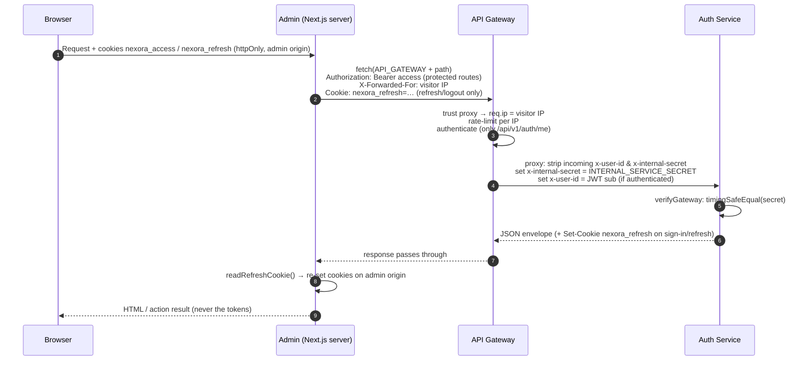

Header contract between hops:

| Header | Set by | Read by | Purpose |
|---|---|---|---|
| `X-Forwarded-For` | `apiServer` (last XFF entry or `x-real-ip` of the visitor) | gateway (`trust proxy`) | Per-visitor rate limiting. |
| `Authorization: Bearer` | `apiServer` when `accessToken` is passed | gateway `authenticate` | Access-token check. |
| `x-internal-secret` | gateway proxy (always, overwriting any client value) | auth-service `verifyGateway` | Proves the request came through the gateway. |
| `x-user-id` | gateway proxy, only after JWT verification (client value always stripped) | auth-service `me` controller | Authenticated user id. |
| `Cookie: nexora_refresh` | admin (`refreshCookieHeader`) | auth-service `refresh`, `logout` | Refresh token transport. |
| `Set-Cookie: nexora_refresh` | auth-service | admin (`readRefreshCookie`) | New refresh token after sign-in / rotation. |

---

## 6. Data model

Defined in [services/auth-service/src/prisma/contract.prisma](services/auth-service/src/prisma/contract.prisma) (Prisma ORM 8, ids are `cuid(2)`, timestamps are `Temporal.Instant`).

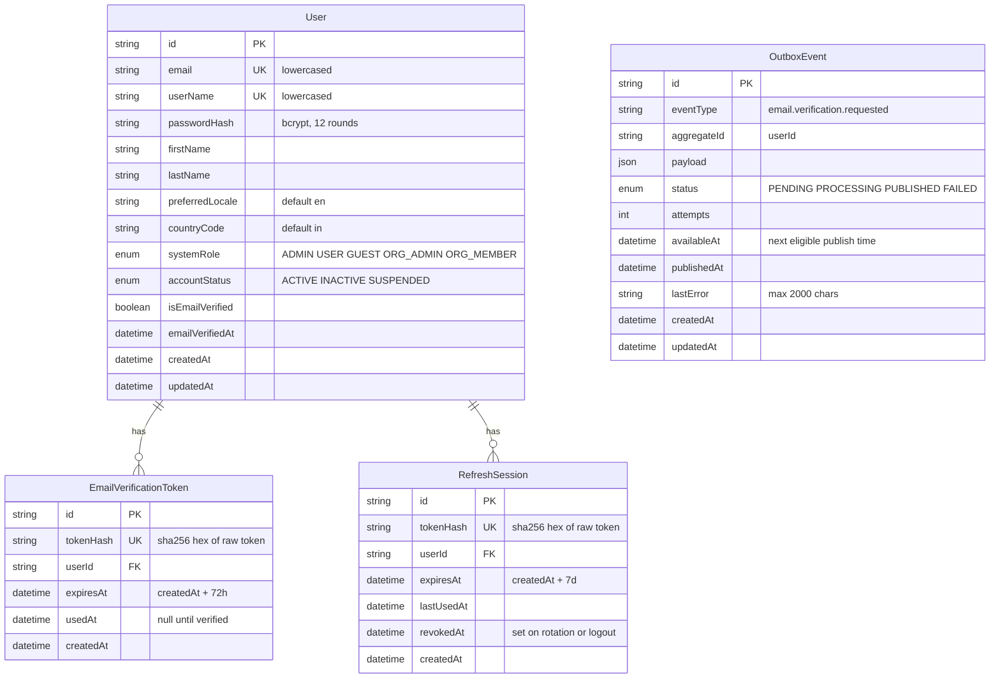

Indexes: `User(accountStatus)`, `User(systemRole)`, `EmailVerificationToken(userId)`, `EmailVerificationToken(expiresAt)`, `RefreshSession(userId, revokedAt)`, `RefreshSession(expiresAt)`, `OutboxEvent(status, availableAt)`, `OutboxEvent(aggregateId)`. Deleting a user cascades to its tokens and sessions.

**Only hashes are stored.** Raw verification and refresh tokens never touch the database. The raw verification token exists in only two places: AES-encrypted inside the outbox payload / Kafka message, and in the emailed link.

---

## 7. Flows

### 7.1 Sign-up

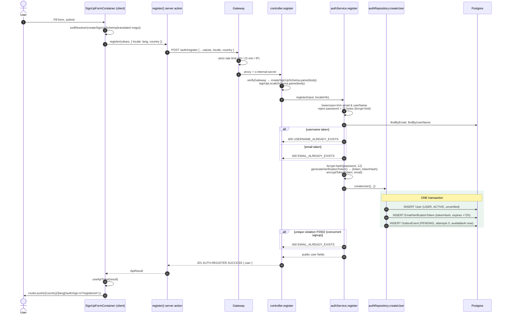

Key points:

- The request carries the **URL's** `country` and `lang`, which are stored as `countryCode` / `preferredLocale` and later decide the email's language and the link's path.
- The user row, the token hash and the outbox event commit **atomically**. Either the user exists *and* an email is guaranteed to be queued, or nothing happened. This is the point of the outbox pattern: no "user created but Kafka was down" gap, and no "email sent for a user that was rolled back".
- On failure, field errors from the server (`errors[]`) are mapped back onto form fields with `form.setError`.
- The sign-in page shows an info banner when `?registered=1`.

### 7.2 Transactional outbox → Kafka → email

This is the asynchronous half of sign-up and resend. Three independent processes cooperate through Postgres and Kafka.

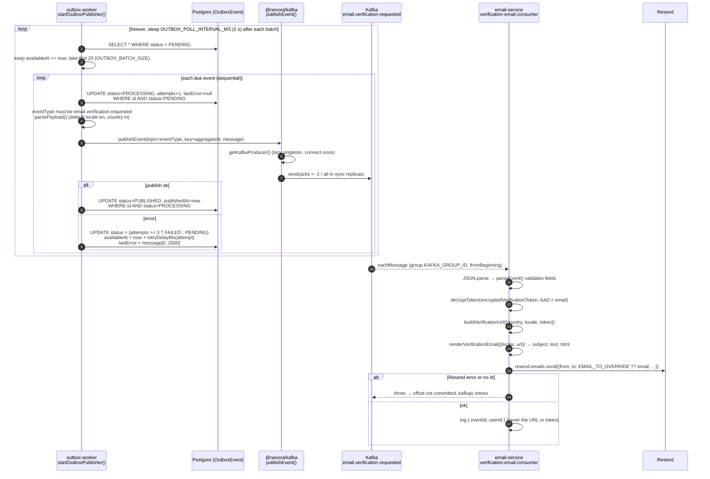

#### Outbox event state machine

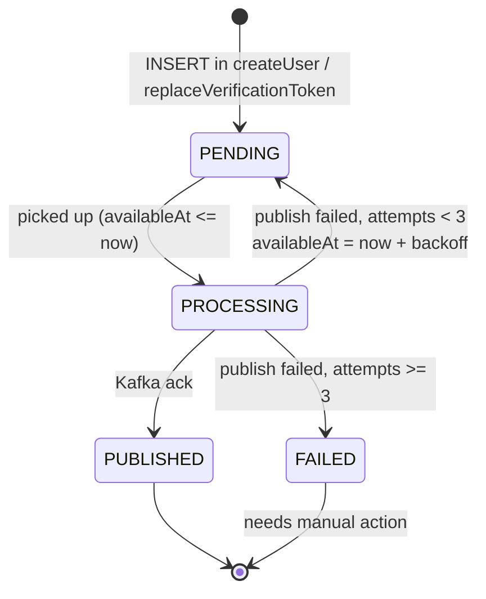

#### Retry schedule

`retryDelayMs(attempt) = min(OUTBOX_BASE_RETRY_DELAY_MS × 2^(attempt−1), OUTBOX_MAX_RETRY_DELAY_MS)` = `min(2 s × 2^(n−1), 5 min)`.

| Attempt | On failure | Next eligible after |
|---|---|---|
| 1 | → `PENDING` | 2 s |
| 2 | → `PENDING` | 4 s |
| 3 (`OUTBOX_MAX_ATTEMPTS`) | → `FAILED` | — (stops) |

Because the worker sleeps 2 s between polls, the real gap is the backoff plus up to one poll interval. With the current `OUTBOX_MAX_ATTEMPTS = 3`, the 5-minute cap is never reached; raise the attempt count to make use of it.

#### The Kafka message

Topic `email.verification.requested` (`KAFKA_TOPICS.EMAIL_VERIFICATION_REQUESTED`), key = `userId` (so all events for one user land on one partition, in order), value:

```json
{
  "eventId": "<OutboxEvent.id>",
  "eventType": "email.verification.requested",
  "occurredAt": "2026-10-27T10:00:00Z",
  "userId": "…",
  "email": "user@example.com",
  "locale": "ta",
  "country": "in",
  "encryptedVerificationToken": "v1.<iv>.<authTag>.<ciphertext>"
}
```

#### Token encryption on the wire

The raw token must reach email-service, but it would otherwise sit in plain text in the `OutboxEvent.payload` column and in Kafka. So auth-service encrypts it with **AES-256-GCM** using the shared `TOKEN_ENCRYPTION_KEY`:

```
v1 . base64url(12-byte random IV) . base64url(16-byte auth tag) . base64url(ciphertext)
```

The recipient **email address is bound as AAD** (additional authenticated data). Decryption fails if the ciphertext is moved into an event for a different address, so a tampered message can't redirect someone's verification link to another inbox. `decryptToken` rejects anything that is not exactly 4 parts, version `v1`, a 12-byte IV and a 16-byte tag.

#### The email

- **URL:** `FRONTEND_ADMIN_URL/{country}/{locale}/auth/verify-email?token=<raw token>`. An unsupported locale falls back to `en`.
- **Content:** subject, text and HTML from `src/locales/<locale>.json` (11 locales, each typed against `en.json` so a missing key fails typecheck). Arabic renders with `dir="rtl"`. All interpolated strings go through `escapeHtml`. The URL block is forced `dir="ltr"`.

#### Delivery guarantees

| Step | Guarantee |
|---|---|
| DB write → outbox row | Exactly-once (same transaction). |
| Outbox → Kafka | **At-least-once.** If the worker crashes after Kafka acks but before marking `PUBLISHED`, the event can be published again. |
| Kafka → email | **At-least-once.** A throw in the handler leaves the offset uncommitted, so kafkajs retries. A crash after Resend accepts the email but before the commit means a duplicate email. |

Duplicates are harmless here: every copy carries the same token for the same user.

### 7.3 Verify email

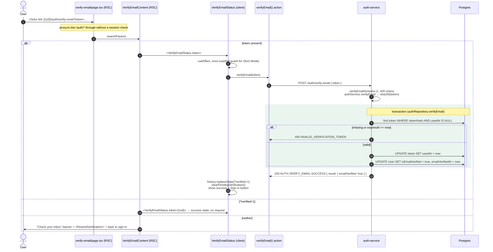

Why verification runs **in the browser, not during server render**: email security scanners pre-fetch links. If the server consumed the one-time token while rendering, the scanner would use it up before the user arrived. A scanner that doesn't run JavaScript never triggers the action.

Why `?verified=1` replaces the token in the URL: reloading or switching language would otherwise resend an already-used token and show an error.

### 7.4 Resend verification email

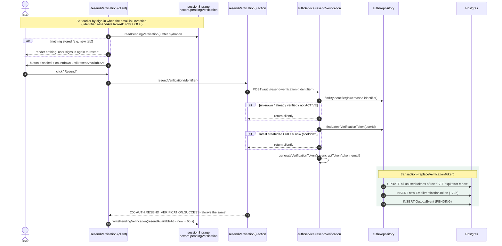

- Every outcome returns the **same 200 response**, so the endpoint can't be used to find out which accounts exist or are verified.
- Older links are invalidated by moving their `expiresAt` to now, so only the newest email works.
- The cooldown is enforced on the server (`VERIFICATION_RESEND_COOLDOWN_MS`); the client countdown only mirrors it. The gateway's 20/15 min/IP limit applies too.
- The identifier lives in `sessionStorage`, not the URL, so the email stays out of history and server logs, and it survives reloads and language switches.

From here, delivery follows [7.2](#72-transactional-outbox--kafka--email).

### 7.5 Sign-in

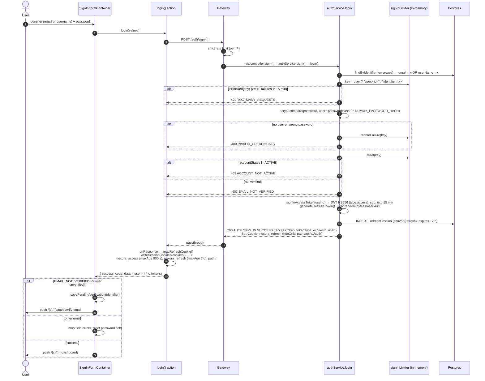

Protections in this flow:

- **Constant-ish timing:** unknown accounts are compared against `DUMMY_PASSWORD_HASH`, so a missing user costs the same bcrypt work as a wrong password.
- **Two layers of rate limiting:** the gateway limits per IP (20 / 15 min), and the auth-service limiter caps failures per **account** (10 / 15 min) however many IPs they come from. Keying by user id means switching between email and username doesn't reset the count. Unknown identifiers are limited the same way, so a 429 doesn't reveal whether an account exists.
- **Account state is revealed only after a correct password:** `ACCOUNT_NOT_ACTIVE` and `EMAIL_NOT_VERIFIED` come after the password check.

### 7.6 Session resolution and silent refresh (`proxy.ts`)

Server Components can't set cookies, so the session is refreshed in the Next.js proxy **before** rendering starts. The proxy runs on every non-asset request outside `/auth/*`.

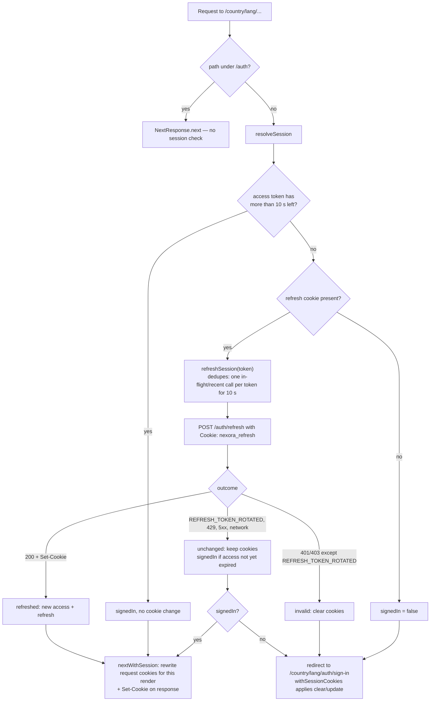

Details:

- `secondsUntilExpiry` only **decodes** the JWT payload to read `exp`; it never verifies it. Verification is the gateway's job.
- `REFRESH_BEFORE_EXPIRY_SECONDS = 10` refreshes slightly early, so the token is still valid when the request reaches the gateway.
- One page load fires several requests at once (document, RSC payload, prefetches), all with the same refresh token. `refreshSession` keeps a per-process `Map<token, Promise>` for `REFRESH_SHARED_RESULT_MS = 10 s`, so they share **one** rotation. Requests that slip past the cache (other instances, late arrivals) are covered by the server's 10 s reuse grace window (next section).
- `nextWithSession` rewrites the **incoming** request cookies so Server Components and Server Actions in the same request already see the new tokens, and it also sets them on the response for the browser.
- In a Server Component, `requireCurrentUser(country, lang)` (React-`cache`d per request) calls `/me`. A 401/403/404 redirects to sign-in. Anything else (429, gateway down) throws an `ApiRenderError` whose `digest` carries the backend code to `error.tsx`, which shows it translated.

### 7.7 Refresh-token rotation and reuse detection

`authService.refresh(rawToken)` on the auth-service:

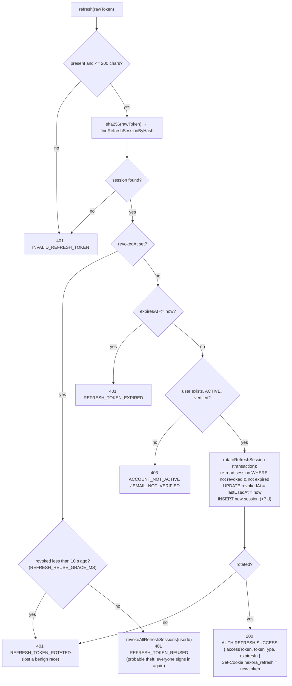

Each refresh token is **single-use**. A revoked token showing up again within 10 s means parallel requests raced (harmless). After 10 s it means the token was copied, so **every** session for that user is revoked, logging out both the attacker and the real user.

### 7.8 Current user (`/me`)

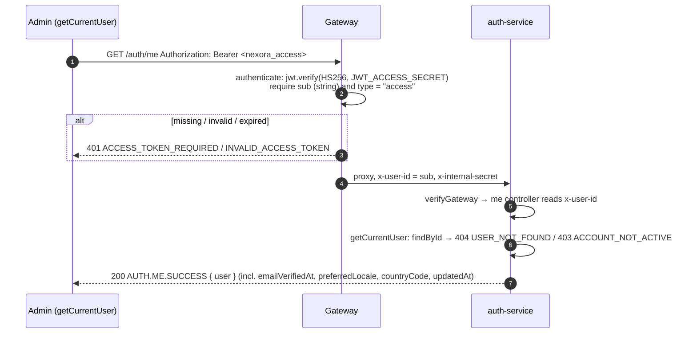

`/api/v1/auth/me` is currently the only route the gateway authenticates. All others are public and protected by rate limits and their own logic.

### 7.9 Sign-out

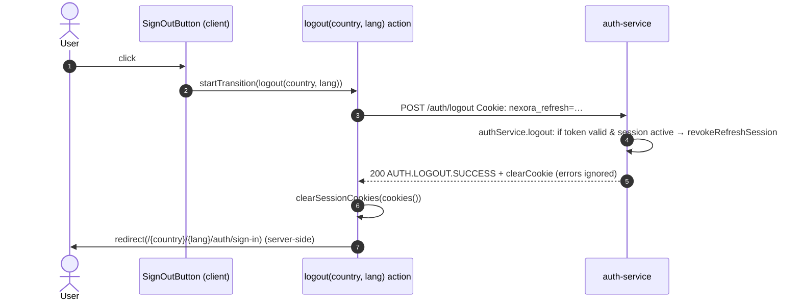

- Logout always succeeds from the user's side. If revocation fails, the session just expires on its own.
- The redirect happens **inside** the action. Redirecting from the client after the action returns would let Next re-render the current page without cookies, and that render's own redirect would lose the chosen language.
- `logout` validates `country` / `lang` before building the redirect, falling back to `in` and the country's default language.
- The access token stays valid at the gateway until it expires (≤ 15 min). It's deleted from the browser, so this only matters if it was copied.

### 7.10 Locale routing

Every page lives under `/{country}/{lang}/…`. Supported combinations ([apps/admin/lib/i18n/config.ts](apps/admin/lib/i18n/config.ts)):

| Country | Code | Default | Languages |
|---|---|---|---|
| India | `in` | `en` | `ta`, `en`, `ml`, `kn`, `hi` |
| France | `fr` | `fr` | `fr`, `en` |
| Germany | `de` | `de` | `de`, `en` |
| Saudi Arabia | `sa` | `ar` | `ar` (RTL), `en` |
| Japan | `jp` | `ja` | `ja`, `en` |
| China | `cn` | `zh` | `zh`, `en` |
| Spain | `es` | `es` | `es`, `en` |

`proxy.ts` rules, in order:

1. `/` → redirect to the visitor's country (Vercel `x-vercel-ip-country` header if supported, else `in`) and its default language.
2. Unknown country, or a `lang` that isn't any supported locale → **rewrite** to `/not-found` (a real server-rendered 404).
3. Missing `lang`, or one the country doesn't offer (e.g. `/jp/ta`) → redirect to the country's default language, **keeping the rest of the path and the query** (so a verification link still works).
4. `/…/auth/*` → pass through (no session check).
5. Everything else → session check ([7.6](#76-session-resolution-and-silent-refresh-proxyts)).

The root layout prerenders every valid pair via `generateStaticParams`, sets `<html lang dir>` and loads all four message namespaces (`auth`, `codes`, `common`, `dashboard`). `LanguageSwitcher` swaps the `lang` segment and keeps the path and query string. The locale chosen at sign-up flows through to the email language and link.

---

## 8. HTTP API reference

All routes go through the gateway at `/api/v1/auth/*` and are forwarded unchanged to auth-service. All bodies are JSON (max 10 kB at auth-service).

| Method & path | Auth | Gateway limit | Body | Success |
|---|---|---|---|---|
| `POST /register` | — | strict | `firstName`, `lastName` (2–50), `userName` (2–50), `email`, `password` (≥ 8, ≤ 72 bytes), `confirmPassword`, `locale?` (`[a-z]{2}`, default `en`), `country?` (default `in`) | `201 AUTH.REGISTER.SUCCESS` `{ user }` |
| `POST /verify-email` | — | strict | `token` (1–200) | `200 AUTH.VERIFY_EMAIL.SUCCESS` `{ result: { emailVerified: true } }` |
| `POST /resend-verification` | — | strict | `identifier` (1–254, email or username) | `200 AUTH.RESEND_VERIFICATION.SUCCESS` `null` (always) |
| `POST /sign-in` | — | strict | `identifier` (1–254), `password` | `200 AUTH.SIGN_IN.SUCCESS` `{ accessToken, tokenType: "Bearer", expiresIn: 900, user }` + `Set-Cookie nexora_refresh` |
| `POST /refresh` | refresh cookie | global | — | `200 AUTH.REFRESH.SUCCESS` `{ accessToken, tokenType, expiresIn }` + rotated cookie |
| `POST /logout` | refresh cookie (optional) | global | — | `200 AUTH.LOGOUT.SUCCESS` `null` + cleared cookie |
| `GET /me` | `Bearer` access token | global | — | `200 AUTH.ME.SUCCESS` `{ user }` |
| `GET /health` (both services) | — | global | — | `{ status: "ok", service, uptime }` |

Rate limits (per visitor IP, 15-minute windows, `RateLimit` draft-8 headers): **global 300**, **strict 20** on sign-in, register, resend-verification and verify-email.

---

## 9. Response envelope and error codes

Success (`sendSuccess`):

```json
{ "success": true, "message": "Signed in successfully", "code": "AUTH.SIGN_IN.SUCCESS", "data": { } }
```

Error (`errorHandler`):

```json
{ "success": false, "code": "VALIDATION_ERROR", "message": "…", "errors": [{ "field": "email", "message": "…" }] }
```

The admin UI **never shows `message`**. It translates `code` through `locales/<lang>/codes.json`; dotted codes such as `AUTH.SIGN_IN.SUCCESS` resolve as nested keys. Unknown error codes fall back to `UNKNOWN_ERROR`; unknown success codes show no toast.

| Code | HTTP | Raised by |
|---|---|---|
| `VALIDATION_ERROR` | 400 | Zod failure (with `errors[]`), or malformed/oversized JSON |
| `PASSWORD_TOO_LONG` | 400 | register (> 72 bytes) |
| `USERNAME_ALREADY_EXISTS` / `EMAIL_ALREADY_EXISTS` | 400 | register |
| `INVALID_VERIFICATION_TOKEN` | 400 | verify-email |
| `INVALID_CREDENTIALS` | 400 | sign-in |
| `TOO_MANY_REQUESTS` | 429 | gateway rate limit, or per-account sign-in limiter |
| `ACCOUNT_NOT_ACTIVE` | 403 | sign-in, refresh, me |
| `EMAIL_NOT_VERIFIED` | 403 | sign-in, refresh |
| `REFRESH_TOKEN_REQUIRED` | 401 | refresh without cookie |
| `INVALID_REFRESH_TOKEN` / `REFRESH_TOKEN_EXPIRED` | 401 | refresh |
| `REFRESH_TOKEN_ROTATED` | 401 | refresh lost a race (admin keeps cookies) |
| `REFRESH_TOKEN_REUSED` | 401 | replay detected, all sessions revoked |
| `ACCESS_TOKEN_REQUIRED` / `INVALID_ACCESS_TOKEN` | 401 | gateway `authenticate`, me controller |
| `USER_NOT_FOUND` | 404 | me |
| `FORBIDDEN` | 403 | `verifyGateway` (missing/wrong internal secret) |
| `ROUTE_NOT_FOUND` | 404 | either service |
| `INTERNAL_SERVER_ERROR` | 500 / 502 | unexpected error (details only in logs); 502 when the gateway can't reach a service |
| `JWT_ACCESS_SECRET_INVALID` | 500 | signing secret too short |
| `UNKNOWN_ERROR` | — | admin-side fallback (non-envelope or network failure) |

---

## 10. Function reference

### 10.1 auth-service

#### `src/modules/auth-routes.ts`
Mounts every route under `/api/v1/auth` with `verifyGateway` first: `POST /register`, `/verify-email`, `/resend-verification`, `/sign-in`, `/refresh`, `/logout`, `GET /me`.

#### `src/modules/auth-controller.ts`
Each handler is wrapped in `asyncHandler`, so a thrown error reaches `errorHandler`.

| Handler | What it does |
|---|---|
| `register` | Parses the body with `createSignUpSchema` (Zod's default messages) and `signUpLocaleSchema`, calls `authService.register`, responds `201`. |
| `verifyEmail` | Parses `{ token }`, calls `authService.verifyEmail`, responds `200 { result }`. |
| `resendVerification` | Parses `{ identifier }`, calls the service, always responds with the same `200`. |
| `signIn` | Parses credentials, calls `authService.signIn`, sets the `nexora_refresh` cookie, removes `refreshToken` from the JSON body. |
| `refresh` | Reads `req.cookies.nexora_refresh` (else `401 REFRESH_TOKEN_REQUIRED`), calls `authService.refresh`, sets the rotated cookie, returns the new access token. |
| `me` | Reads `x-user-id` (set by the gateway), calls `getCurrentUser`. |
| `logout` | Calls `authService.logout` with the cookie (if any), clears the cookie, returns `200`. |

#### `src/modules/auth-service.ts` — business rules

| Function | Description |
|---|---|
| `register(input, localeInfo)` | Normalises email/username to lowercase, enforces the 72-byte bcrypt limit, checks username then email uniqueness, hashes the password (12 rounds), creates a verification token, encrypts it with the email as AAD, and calls `createUser` (user + token + outbox in one transaction). Maps a concurrent Postgres unique violation (`P2002`) to `EMAIL_ALREADY_EXISTS`. Returns the public user fields. |
| `verifyEmail(token)` | Rejects empty or > 200-char tokens, hashes, delegates to `authRepository.verifyEmail`; `false` → `INVALID_VERIFICATION_TOKEN`. |
| `resendVerification(identifier)` | Silent no-op for unknown, verified or inactive accounts, and within the 60 s cooldown; otherwise issues a new token through `replaceVerificationToken`. |
| `login({ identifier, password })` | Looks up by email or username, checks the per-account limiter, compares against the real or dummy hash, records/resets failures, checks status and verification, signs the access JWT, creates a hashed refresh session. Returns tokens and the user. |
| `signIn(input)` | Alias for `login`. |
| `getCurrentUser(userId)` | `404` if missing, `403` if not active, else the full profile. |
| `refresh(rawToken)` | Rotation with reuse detection; see [7.7](#77-refresh-token-rotation-and-reuse-detection). |
| `logout(rawToken?)` | Revokes the matching active session; silently ignores missing, invalid or already-revoked tokens. |
| *module scope* `DUMMY_PASSWORD_HASH` | A bcrypt hash computed once at startup, used to equalise timing for unknown users. |
| *module scope* `signInLimiter` | `createAttemptLimiter({ limit: 10, windowMs: 15 min })`. |

#### `src/modules/auth-repository.ts` — data access

| Function | Description |
|---|---|
| `findById(id)` / `findByEmail(email)` / `findByUserName(userName)` | Single `User` lookup. |
| `findByIdentifier(identifier)` | `User` where `email = x OR userName = x`. |
| `createUser(input)` | **Transaction:** insert `User` (`USER`, `ACTIVE`, unverified) → `EmailVerificationToken` → `OutboxEvent` (`email.verification.requested`, `PENDING`, payload `{ userId, email, encryptedVerificationToken, locale, country }`). |
| `findValidVerificationToken(tokenHash)` | Unused token by hash. *(Currently not called.)* |
| `findLatestVerificationToken(userId)` | Loads the user's tokens and returns the newest by `createdAt` (used for the resend cooldown). |
| `replaceVerificationToken(input)` | **Transaction:** set `expiresAt = now` on **all** of the user's unused tokens (`updateAndCount`), insert the new token, insert a new `OutboxEvent`. |
| `verifyEmail(tokenHash, now)` | **Transaction:** find the unused token, reject if expired, set `usedAt`, mark the user verified. Returns `boolean`. |
| `createRefreshSession({ userId, tokenHash, expiresAt })` | Insert a `RefreshSession`. |
| `findRefreshSessionByHash(tokenHash)` | Lookup, including revoked sessions (needed for reuse detection). |
| `rotateRefreshSession(input)` | **Transaction:** re-read the session as active and unexpired, revoke it (guarded by `revokedAt: null`), insert the replacement. Returns `false` if another request won the race. |
| `revokeRefreshSession(sessionId, now)` | Revoke one active session. |
| `revokeAllRefreshSessions(userId, now)` | Revoke **every** active session of the user (`updateAndCount`). |

#### `src/outbox/auth-outbox-publisher.ts`

| Function | Description |
|---|---|
| `parsePayload(value)` | Validates `userId`, `email` and `encryptedVerificationToken` are strings; defaults `locale → "en"` and `country → "in"` for events created before locale support. |
| `retryDelayMs(attempt)` | `min(2000 × 2^(attempt−1), 300000)` ms. |
| `processEvent(event)` | Claims the row (`PENDING → PROCESSING`, `attempts + 1`), checks the event type, publishes to Kafka, then marks `PUBLISHED`. On error: back to `PENDING` with a backoff `availableAt`, or `FAILED` once `attempts >= 3`; stores `lastError` (truncated to 2000 chars) and logs. |
| `publishPendingOutboxEvents()` | One poll: fetch `PENDING` rows, keep the due ones (`availableAt <= now`), take 20, process them one at a time. |
| `startOutboxPublisher()` | Infinite loop: poll → catch/log any error → sleep 2 s. |

#### `src/workers/auth-outbox-worker.ts`
Entry point for the worker process. Loads `dotenv` and the Temporal polyfill, runs `startOutboxPublisher()`, and sets `process.exitCode = 1` if it ever rejects.

#### `src/lib/*`

| Function / export | Description |
|---|---|
| `helpers/verification-token.ts` `generateVerificationToken()` | 32 random bytes as base64url → `{ token, tokenHash: sha256 hex }`. |
| `helpers/verification-token.ts` `hashVerificationToken(token)` | sha256 hex. |
| `helpers/refresh-token.ts` `generateRefreshToken()` | 32 random bytes as base64url. |
| `helpers/refresh-token.ts` `hashRefreshToken(token)` | sha256 hex. |
| `helpers/refresh-token.ts` `refreshCookieOptions` | `httpOnly`, `secure` in production, `sameSite: lax`, `path: /api/v1/auth`, `maxAge: 7 d`. |
| `helpers/access-token.ts` `signInAccessToken(userId)` | Checks the secret is ≥ 32 bytes, signs `{ type: "access" }` with HS256, `sub = userId`, `expiresIn = 900`. |
| `helpers/token-encryption.ts` `encryptToken(token, context)` | AES-256-GCM with a random 12-byte IV, `context` (email) as AAD → `v1.iv.tag.ciphertext` in base64url. |
| `attempt-limiter.ts` `createAttemptLimiter({ limit, windowMs })` | Fixed-window failure counter in a `Map`: `isBlocked`, `recordFailure`, `reset`. An `unref`'d interval purges expired windows so the map can't grow without bound. |
| `async-handler.ts` `asyncHandler(fn)` | Forwards promise rejections to `next()`. |
| `api-response.ts` `sendSuccess(res, status, message, code, data)` | Writes the success envelope. |
| `auth-error-handler.ts` `AppError(message, statusCode, code)` | Typed error that becomes the error envelope. |

#### `src/middleware/*`

| Function | Description |
|---|---|
| `verifyGateway` | Requires `x-internal-secret` to equal `INTERNAL_SERVICE_SECRET` (length check + `timingSafeEqual`); otherwise `403 FORBIDDEN`. |
| `errorHandler` | `ZodError` → 400 with `errors[]`; `AppError` → its status and code; exposed 4xx body-parser errors → 400 `VALIDATION_ERROR`; anything else → logged, then a generic 500. |
| `notFoundHandler` | 404 `ROUTE_NOT_FOUND`. |

#### `src/auth-app.ts`, `src/auth-server.ts`, `src/config/auth-env.ts`, `src/prisma/auth-db.ts`
`app.ts` sets up Express: `x-powered-by` off, helmet, CORS (`CLIENT_ORIGINS`, credentials), JSON ≤ 10 kB, urlencoded, cookie-parser, `/health`, routes, 404 and error handlers. `server.ts` listens on `PORT` and closes gracefully on SIGINT/SIGTERM. `env.ts` is the Zod-validated config. `db.ts` builds the Prisma 8 Postgres client from the generated `contract.json`.

### 10.2 api-gateway

| File / function | Description |
|---|---|
| `app.ts` | `trust proxy = TRUST_PROXY`, helmet, CORS callback (allowed origins get headers; others get none), global limiter 300/15 min, strict limiter 20/15 min on four auth paths, `/health`, proxy routes, 404/500 handlers. |
| `routes/proxy-routes.ts` | `/api/v1/auth/me` → `authenticate` → proxy; then `/api/v1/auth/*` → proxy without authentication. |
| `routes/create-service-proxy.ts` `createServiceProxy(prefix, target)` | `http-proxy-middleware` with a `pathFilter` on the prefix and `changeOrigin`. `proxyReq` **removes any client-supplied** `x-user-id` and `x-internal-secret`, sets the real secret, and adds `x-user-id` when `req.userId` exists. `error` returns a JSON 502 instead of the default page that echoes host and path. |
| `middleware/authenticate.ts` `authenticate` | Requires `Authorization: Bearer`, verifies HS256 with `JWT_ACCESS_SECRET`, requires `sub` and `type === "access"`, sets `req.userId`. Verification error details are never returned. |
| `middleware/gateway-error-handler.ts` | `notFoundHandler` (404) and `errorHandler` (logs, generic 500 unless headers were already sent). |
| `server.ts`, `config/env.ts` | Listen and graceful shutdown; Zod config. |

### 10.3 email-service

| File / function | Description |
|---|---|
| `server.ts` `main()` | Starts the consumer; logs and sets exit code 1 on startup failure. |
| `consumers/verification-email.consumer.ts` `parseEvent(value)` | Validates `eventId`, `eventType === "email.verification.requested"`, `userId`, `email`, `encryptedVerificationToken`; defaults locale/country. |
| `consumers/verification-email.consumer.ts` `startVerificationEmailConsumer()` | `startConsumer` on the verification topic: parse → decrypt (AAD = email) → build URL → send → log ids. |
| `crypto/token-decryption.ts` `decryptToken(encrypted, context)` | Checks format, version, IV and tag lengths; AES-256-GCM decrypt with AAD and auth tag. Throws on any tampering. |
| `templates/verification-email.ts` `buildVerificationUrl({ country, locale, token })` | `FRONTEND_ADMIN_URL/{country}/{locale}/auth/verify-email?token=…` (locale falls back to `en`). |
| `templates/verification-email.ts` `renderVerificationEmail({ locale, verificationUrl })` | Returns `{ subject, text, html }`: localised copy, RTL for `ar`, `{year}` copyright, every string HTML-escaped. |
| `templates/verification-email.ts` `resolveLocale`, `escapeHtml` | Internal helpers. |
| `providers/email-provider.ts` `sendVerificationEmail({ email, locale, verificationUrl })` | Renders and sends via Resend to `EMAIL_TO_OVERRIDE ?? email`; throws if Resend returns an error or no id (the error never includes the URL). |
| `config/env.ts` | Zod config; refuses `EMAIL_TO_OVERRIDE` in production. |

### 10.4 packages

| Package / function | Description |
|---|---|
| `@nexora/kafka` `kafka` | `new Kafka({ clientId, brokers })` from env. |
| `@nexora/kafka` `getKafkaProducer()` | Lazily connects one producer per process; concurrent callers share the same connect promise. |
| `@nexora/kafka` `publishEvent(topic, key, event)` | `producer.send` with `acks: -1`, value `JSON.stringify(event)`. |
| `@nexora/kafka` `disconnectKafkaProducer()` | Disconnects and resets the singleton. *(Exported, not yet called on shutdown.)* |
| `@nexora/kafka` `startConsumer({ groupId, topic, handleEvent })` | Connect → subscribe (`fromBeginning: true`) → `run({ eachMessage })`. Rejects empty messages, `JSON.parse`s, calls the handler. Disconnects if subscribe/run fails. |
| `@nexora/kafka` `KAFKA_TOPICS` | `{ EMAIL_VERIFICATION_REQUESTED: "email.verification.requested" }`. |
| `@nexora/schemas/auth/sign-up` | `createSignUpSchema(messages)`, `signUpLocaleSchema`, `verifyEmailSchema`, `resendVerificationSchema` and their types. Schema factories take translated messages, so the same rules run in the browser form (localised) and on the server. |
| `@nexora/schemas/auth/sign-in` | `createSignInSchema(messages)`, `SignInFormValues`. |
| `@nexora/shared/constants/*` | See [section 11](#11-shared-constants). |
| `@nexora/ui` | shadcn/ui components: alert-dialog, banner, button, field, input, label, select, separator, toast; `cn()` helper; global Tailwind styles. |

### 10.5 apps/admin

#### Gateway client — `lib/api/*`

| Function | Description |
|---|---|
| `server.ts` `apiServer(endpoint, options)` | Server-only `fetch` to `API_GATEWAY`: builds the URL and query, JSON-encodes the body, adds `Authorization` (when `accessToken` is given) and the visitor's `X-Forwarded-For`, calls `onResponse(raw)` (used to read `Set-Cookie`), parses JSON or text, and throws `ApiError` on non-2xx. |
| `server.ts` `api.get/post/put/patch/delete` | Thin wrappers around `apiServer`. |
| `server.ts` `ApiError` | Carries `status`, backend `code` and `errors[]`. |
| `result.ts` `toApiResult(promise)` | Turns a call into a serialisable `ApiResult` (`{ success, code, data }` or `{ success: false, code, status, errors }`) so server actions return instead of throwing. |
| `client-ip.ts` `getClientIp(headers)` | Last `X-Forwarded-For` entry (added by the nearest trusted proxy), else `x-real-ip`. |
| `render-error.ts` `ApiRenderError(code, status)` | Error with `digest = "API_ERROR;" + code`; Next keeps the digest in production, so the code reaches `error.tsx`. |
| `render-error.ts` `getApiErrorCode(error)` | Reads the code back from the digest. |

#### Auth server actions — `lib/api/auth/*`

| Function | Description |
|---|---|
| `register(values, localeInfo)` | `POST /auth/register` with `{ ...values, locale, country }`. |
| `verifyEmail(token)` | `POST /auth/verify-email`. |
| `resendVerification(identifier)` | `POST /auth/resend-verification`. |
| `login(values)` | `POST /auth/sign-in`; captures the refresh cookie from the response, writes both cookies on the admin origin, returns only `{ user }`. A success without a refresh cookie → `UNKNOWN_ERROR`. |
| `logout(country, lang)` | Revokes via `POST /auth/logout` (errors ignored), clears cookies, redirects to the localised sign-in page. |
| `getCurrentUser()` (`me.ts`) | Reads `nexora_access`, calls `GET /auth/me`. For Server Components. |

#### Session helpers — `lib/api/auth/helpers/*`

| Function | Description |
|---|---|
| `session-cookies.ts` `writeSessionCookies(store, tokens)` | Sets `nexora_access` (`maxAge = expiresIn`) and `nexora_refresh` (`maxAge = refreshMaxAge`), both httpOnly, `sameSite=lax`, `path=/`, `secure` in production. Works with `cookies()` and `NextResponse.cookies`. |
| `session-cookies.ts` `clearSessionCookies(store)` | Deletes both cookies. |
| `session-cookies.ts` `refreshCookieHeader(token)` | `nexora_refresh=<encoded>` for the outgoing `Cookie` header. |
| `session-cookies.ts` `readRefreshCookie(response)` | Parses `Set-Cookie` for `nexora_refresh` and its `Max-Age` (falls back to 7 d). |
| `session-cookies.ts` `secondsUntilExpiry(jwt)` | Decodes (does not verify) `exp`; returns 0 if unreadable. |
| `refresh-session.ts` `refreshSession(token, headers)` | Deduplicates refreshes per token for 10 s via a module-level `Map`. |
| `refresh-session.ts` `requestRefresh(token, headers)` | Calls `/auth/refresh` and classifies the result as `refreshed`, `invalid` or `unchanged` (see [7.6](#76-session-resolution-and-silent-refresh-proxyts)). |
| `proxy-session.ts` `resolveSession(request)` | Decides whether to refresh and returns `{ signedIn, update? }` (`update: null` means sign out). |
| `proxy-session.ts` `nextWithSession(request, session)` | Rewrites request cookies for this render and sets the response cookies. |
| `proxy-session.ts` `withSessionCookies(response, session)` | Applies an update or clear to any response (e.g. a redirect). |
| `current-user.ts` `requireCurrentUser(country, lang)` | React-`cache`d per request. Returns the user, redirects to sign-in on 401/403/404, or throws `ApiRenderError`. *(Ready for dashboard pages; not used yet.)* |

#### `proxy.ts` — `proxy(request)`
Locale routing and session gate; see [7.6](#76-session-resolution-and-silent-refresh-proxyts) and [7.10](#710-locale-routing). The matcher skips `_next/` and any path with a file extension.

#### i18n — `lib/i18n/*`

| Function | Description |
|---|---|
| `config.ts` `supportedCountries`, `isLocale`, `isCountry`, `isCountryLanguage`, `getCountryLanguages`, `getCountryDefaultLanguage`, `getDirection`, `localizedPath`, `href` | Country/language tables and path builders. |
| `get-user-country.ts` `getDetectedCountry`, `getUserCountry` | Country from `x-vercel-ip-country`, falling back to `in`. |
| `locale-params.ts` `resolveLocaleParams(params)` | Narrows route params to supported values or calls `notFound()` (pages render in parallel with layouts, so each page re-checks). |
| `messages.ts` `loadMessages(locale)` | Dynamically imports the four namespaces for a locale. |
| `request.ts` | next-intl request config; throws if a server function is called without an explicit supported `locale`. |

#### Features and components

| Module | Description |
|---|---|
| `features/auth/sign-up/sign-up-form-container.tsx` | Translated Zod schema + react-hook-form; calls `register`, toasts, maps field errors, redirects to sign-in with `?registered=1`. |
| `features/auth/sign-in/sign-in-form-container.tsx` | Calls `login`; on `EMAIL_NOT_VERIFIED` (or an unverified user) saves the pending identifier and goes to verify-email; otherwise maps errors and clears the password, or goes to the dashboard. |
| `features/auth/*/…-form.tsx`, `…-form-fields.tsx` | Presentational forms with accessible labels and error wiring. |
| `features/auth/verify-email/pending-verification.ts` | `savePendingVerification`, `writePendingVerification`, `readPendingVerification`, `clearPendingVerification` on `sessionStorage` key `nexora.pendingVerification` (fails quietly if storage is blocked). |
| `features/auth/verify-email/verify-email-content.tsx` | Server component choosing between token verification, the verified state, and the "check your inbox + resend" state. |
| `features/auth/verify-email/verify-email-status.tsx` | Client-side, once-only token verification; success, verifying and error UIs. |
| `features/auth/verify-email/resend-verification.tsx` | Resend button with the cooldown countdown. |
| `features/dashboard/sign-out-button.tsx` | Calls the `logout` action inside a transition. |
| `hooks/use-api-toast.ts` `useApiToast()` | Turns an `ApiResult.code` into a translated toast. |
| `app/[country]/[lang]/error.tsx` | Error boundary: shows the translated backend code from the digest with a Retry button. |
| `components/auth/*`, `components/branding/*`, `components/common/language-switcher.tsx` | Auth page layouts, brand panel, logo, feature list, language switcher. |
| `next.config.ts` | next-intl plugin (generates typed message declarations), security headers (CSP, `X-Frame-Options: DENY`, `nosniff`, `Referrer-Policy: strict-origin-when-cross-origin` so the verify token doesn't leak, Permissions-Policy, HSTS in production), `cacheComponents`, `partialPrefetching`, AVIF/WebP images. |

---

## 11. Shared constants

`packages/shared/src/constants/*`, imported by both sides of every contract so the values can't drift apart.

| Constant | Value | Used for |
|---|---|---|
| `ACCESS_TOKEN_TTL_SECONDS` | 900 (15 min) | JWT `exp`, `expiresIn`, access cookie `maxAge` |
| `REFRESH_TOKEN_TTL_MS` | 7 days | Refresh session expiry and cookie |
| `REFRESH_REUSE_GRACE_MS` | 10 s | Race window before reuse counts as theft |
| `REFRESH_SHARED_RESULT_MS` | 10 s | Admin-side refresh dedup cache |
| `REFRESH_BEFORE_EXPIRY_SECONDS` | 10 | Refresh slightly early |
| `REFRESH_COOKIE_NAME` / `ACCESS_COOKIE_NAME` | `nexora_refresh` / `nexora_access` | Cookie names |
| `SIGNED_OUT_STATUSES` | 401, 403, 404 | Statuses that mean "session is gone" |
| `PASSWORD_HASH_ROUNDS` | 12 | bcrypt cost |
| `SIGN_IN_ATTEMPT_LIMIT` / `SIGN_IN_ATTEMPT_WINDOW_MS` | 10 / 15 min | Per-account limiter |
| `VERIFICATION_TOKEN_TTL_HOURS` | 72 | Link lifetime |
| `VERIFICATION_RESEND_COOLDOWN_MS` | 60 s | Server cooldown and client countdown |
| `PENDING_VERIFICATION_STORAGE_KEY` | `nexora.pendingVerification` | sessionStorage key |
| `TOKEN_ENCRYPTION_ALGORITHM` / `_VERSION` / `_IV_BYTES` / `_AUTH_TAG_BYTES` | `aes-256-gcm` / `v1` / 12 / 16 | Outbox token encryption format |
| `OUTBOX_BATCH_SIZE` | 20 | Events per poll |
| `OUTBOX_MAX_ATTEMPTS` | 3 | Before `FAILED` |
| `OUTBOX_POLL_INTERVAL_MS` | 2 s | Sleep between polls |
| `OUTBOX_BASE_RETRY_DELAY_MS` / `OUTBOX_MAX_RETRY_DELAY_MS` | 2 s / 5 min | Backoff |
| `DEFAULT_LOCALE` / `RTL_LOCALES` / `COUNTRY_HEADER` | `en` / `{ar}` / `x-vercel-ip-country` | i18n |
| `API_ERROR_DIGEST_PREFIX` | `API_ERROR;` | Carries backend codes to `error.tsx` |

---

## 12. Known limitations

These are things the current code does not handle yet and that are worth knowing before going to production:

1. **Outbox rows can get stuck in `PROCESSING`.** If the worker dies between claiming a row and updating it afterwards, nothing moves it back to `PENDING`. A reaper that resets old `PROCESSING` rows (by `updatedAt`) would fix this.
2. **Only one outbox worker can run safely.** The claim (`UPDATE … WHERE status = PENDING`) doesn't check how many rows it changed, so two workers can both publish the same event. Check the update count, or use `SELECT … FOR UPDATE SKIP LOCKED`, before scaling out.
3. **`FAILED` events are terminal.** There is no automatic replay or alert; they need manual action.
4. **The outbox poll loads every `PENDING` row** and filters/limits in memory. Fine at today's volume; push `availableAt <= now`, ordering and `LIMIT` into the query (the `(status, availableAt)` index already exists) as it grows.
5. **No dead-letter topic in email-service.** A message that always fails (e.g. it can't be decrypted because the keys don't match) is retried by kafkajs and blocks its partition. Consider catching non-retryable errors and sending them to a DLQ.
6. **No idempotency by `eventId`** in email-service, so a redelivery sends a second (identical) email.
7. **The sign-in limiter and the refresh dedup cache live in process memory.** With several auth-service or admin instances, each keeps its own counts. Move them to a shared store (e.g. Redis) when scaling out.
8. **Graceful shutdown doesn't disconnect Kafka** (`disconnectKafkaProducer` is never called), and the outbox loop has no stop signal.
9. **A concurrent username collision is reported as `EMAIL_ALREADY_EXISTS`**, because every `P2002` maps to the email message.
10. **Every validation error says `"Invalid Registration data"`** in `message`, whatever the endpoint. The UI shows translated `code`s, so users don't see it, but logs and API clients do.
11. **`rotateRefreshSession` relies on `update()` returning a falsy value when no row matched**; the code comment asks for this to be checked against the generated Prisma 8 contract.
12. **Local Kafka is plaintext with no auth.** Production needs SASL/TLS listeners and topic ACLs (see the comment in `docker-compose.yml`).

---

## 13. Security design

| Concern | How it's handled |
|---|---|
| Token theft via XSS | Access and refresh tokens are httpOnly cookies on the admin origin; browser JavaScript never sees them, and server actions return only the user. |
| Stolen refresh token | Single-use rotation; replay after 10 s revokes every session for the user. |
| Tokens at rest | Only sha256 hashes stored. The raw verification token in the outbox/Kafka is AES-256-GCM encrypted and bound to the recipient email. |
| Bypassing the gateway | auth-service requires a ≥ 32-char `x-internal-secret`, compared in constant time. The gateway strips client-sent `x-internal-secret` and `x-user-id`. |
| Brute force / enumeration | Per-IP gateway limits; per-account sign-in limiter; dummy bcrypt compare for unknown users; identical responses for resend; account state shown only after a correct password. |
| IP spoofing past rate limits | `trust proxy` only for `TRUST_PROXY` (default loopback); admin forwards the **last** XFF entry. |
| Email link scanners | The token is used from client-side JS, not during server render. |
| Verify token leaking via Referer | `Referrer-Policy: strict-origin-when-cross-origin`; the URL is swapped to `?verified=1` after use. |
| Error detail leaks | Generic 500s; DB/driver/JWT/proxy details only in logs; the proxy error page that echoes host and path is replaced. |
| Clickjacking, injection | CSP, `frame-ancestors 'none'`, `X-Frame-Options: DENY`, `nosniff`, helmet on both Express services, HTML-escaped email templates. |
| Dev-only email redirect | `EMAIL_TO_OVERRIDE` refused in production at startup. |
| bcrypt truncation | Passwords > 72 bytes rejected rather than silently truncated. |

---

## 14. UI components (shadcn/ui)

Shared components live in `packages/ui/src/components`. To add one, run this at the repo root against the admin app:

```bash
pnpm dlx shadcn@latest add button -c apps/admin
```

The component is placed in `packages/ui/src/components`. Import it from the `ui` package:

```tsx
import { Button } from "@nexora/ui/components/button"
```
