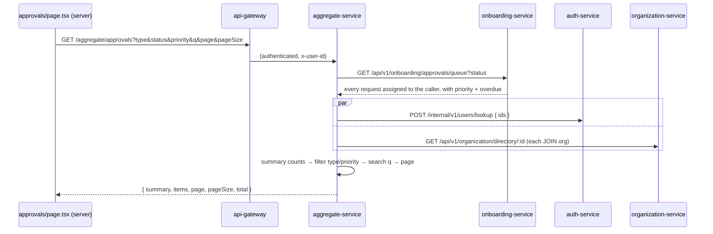

# Approvals page

The admin app's **Approvals** page (`/[country]/[lang]/approvals`): one
place where a reviewer sees the requests assigned to them, filters them and
opens one to act on it.

Design reference: [`figma/approval overall.png`](../../figma/approval%20overall.png).

This doc holds the full code for every file the page needs, backend and
frontend, in build order. Nothing here is in the codebase yet.

## Contents

1. [Decisions](#1-decisions)
2. [Architecture](#2-architecture)
3. [Shared contracts](#3-shared-contracts)
4. [auth-service: user lookup](#4-auth-service-user-lookup)
5. [onboarding-service: approval queue](#5-onboarding-service-approval-queue)
6. [aggregate-service: approvals API](#6-aggregate-service-approvals-api)
7. [Admin app: API client](#7-admin-app-api-client)
8. [Admin app: generic building blocks](#8-admin-app-generic-building-blocks)
9. [Admin app: dashboard shell and sidebar](#9-admin-app-dashboard-shell-and-sidebar)
10. [Admin app: approvals feature](#10-admin-app-approvals-feature)
11. [Admin app: route](#11-admin-app-route)
12. [i18n](#12-i18n)
13. [Checklist](#13-checklist)

## 1. Decisions

| Question | Decision |
| --- | --- |
| Priority | Worked out from age: High if open over 72 h, Medium over 24 h, else Low. No migration |
| Overdue | Open and older than 72 h (`APPROVAL_SLA_HOURS`) |
| Names, emails | aggregate-service enriches: auth-service for people, organization-service for org names |
| Assigned to | Only the caller's own queue. The "Assigned to" filter is dropped; the column stays |
| Sidebar | Approvals gets nested per-type links with pending counts |
| Product and category approvals | Not built (no backend). Adding a type is one registry entry (§10.1) |
| Approval Settings button | Not built (no backend) |
| Avatars | No avatar field exists anywhere yet: initials only |

## 2. Architecture



Why it's shaped this way:

- **onboarding-service owns assignment, status and age.** It returns the
  caller's whole queue (only theirs, so it stays small), already filtered by
  status.
- **aggregate-service owns joining.** Search has to match the submitter's
  name, which only auth-service knows, so filtering, searching and paging
  happen after enrichment, in aggregate-service.
- **The gateway needs no change.** `/api/v1/aggregate` is already
  authenticated and proxied (`services/api-gateway/src/routes/proxy-routes.ts`).
  auth-service's new route is mounted under `/internal/v1`, which the gateway
  never proxies.

Frontend layers, each depending only on the ones below:

```
app/[country]/[lang]/(dashboard)/approvals/page.tsx     params, permission, fetch
features/approvals/*                                    registry, columns, wiring
components/common/{layout,page,stats,filters,
                   data-table,badges,cells}/*           generic, no approvals code
hooks/*, lib/url/*, lib/pagination.ts                   generic helpers
@nexora/ui                                              shadcn primitives
```

## 3. Shared contracts

### 3.1 `packages/schemas/src/onboarding/approvals.ts`

The single source for request types, statuses, priorities, the reviewer
module per type, and query parsing. `REVIEWER_MODULE` moves here from
`request-assignment.ts` so the backend and the admin app can't disagree.

```ts
import { z } from "zod"

import type { PermissionAction, PermissionModuleCode } from "./become-admin"

export const APPROVAL_REQUEST_TYPES = [
  "ADMIN_ACCESS",
  "CREATE_ORG",
  "JOIN_ORG",
] as const
export type ApprovalRequestType = (typeof APPROVAL_REQUEST_TYPES)[number]

export const APPROVAL_STATUSES = [
  "PENDING",
  "UNDER_REVIEW",
  "APPROVED",
  "REJECTED",
  "WITHDRAWN",
] as const
export type ApprovalStatus = (typeof APPROVAL_STATUSES)[number]

/** Statuses still waiting on a reviewer; only these age into priority. */
export const OPEN_APPROVAL_STATUSES = [
  "PENDING",
  "UNDER_REVIEW",
] as const satisfies ApprovalStatus[]

export const isOpenApprovalStatus = (status: ApprovalStatus) =>
  (OPEN_APPROVAL_STATUSES as readonly ApprovalStatus[]).includes(status)

export const APPROVAL_PRIORITIES = ["HIGH", "MEDIUM", "LOW"] as const
export type ApprovalPriority = (typeof APPROVAL_PRIORITIES)[number]

export const APPROVAL_PAGE_SIZES = [10, 20, 50] as const
export type ApprovalPageSize = (typeof APPROVAL_PAGE_SIZES)[number]

/** An open request older than this is overdue. */
export const APPROVAL_SLA_HOURS = 72

/** Age, in hours, from which an open request has each priority. */
export const APPROVAL_PRIORITY_FROM_HOURS = {
  HIGH: 72,
  MEDIUM: 24,
} as const

/** The admin module whose holders review each kind of request. */
export const REVIEWER_MODULE = {
  ADMIN_ACCESS: "USER_MANAGEMENT",
  CREATE_ORG: "ORGANIZATION_MANAGEMENT",
  JOIN_ORG: "ORGANIZATION_MANAGEMENT",
} as const satisfies Record<ApprovalRequestType, PermissionModuleCode>

/** Approving or rejecting changes a request: VIEW isn't enough. */
export const REVIEWER_ACCESS_LEVEL = "EDIT" as const satisfies PermissionAction

export const APPROVAL_FILTER_DEFAULTS = {
  status: "PENDING",
  page: 1,
  pageSize: 10,
} as const satisfies {
  status: ApprovalStatus
  page: number
  pageSize: ApprovalPageSize
}

export const APPROVAL_SEARCH_MAX_LENGTH = 100

const pageSizeSchema = z.coerce
  .number()
  .int()
  .refine((n) => (APPROVAL_PAGE_SIZES as readonly number[]).includes(n))
  .transform((n) => n as ApprovalPageSize)

/**
 * GET /aggregate/approvals. Every field falls back to its default instead
 * of failing, so a hand-edited or stale URL still shows a page.
 */
export const listApprovalsQuerySchema = z.object({
  type: z.enum(APPROVAL_REQUEST_TYPES).optional().catch(undefined),
  status: z
    .enum(APPROVAL_STATUSES)
    .default(APPROVAL_FILTER_DEFAULTS.status)
    .catch(APPROVAL_FILTER_DEFAULTS.status),
  priority: z.enum(APPROVAL_PRIORITIES).optional().catch(undefined),
  q: z
    .string()
    .trim()
    .max(APPROVAL_SEARCH_MAX_LENGTH)
    .optional()
    .transform((q) => q || undefined)
    .catch(undefined),
  page: z.coerce
    .number()
    .int()
    .min(1)
    .default(APPROVAL_FILTER_DEFAULTS.page)
    .catch(APPROVAL_FILTER_DEFAULTS.page),
  pageSize: pageSizeSchema
    .default(APPROVAL_FILTER_DEFAULTS.pageSize)
    .catch(APPROVAL_FILTER_DEFAULTS.pageSize),
})
export type ListApprovalsQuery = z.infer<typeof listApprovalsQuerySchema>

/** GET /onboarding/approvals/queue and GET /aggregate/approvals/summary. */
export const approvalQueueQuerySchema = listApprovalsQuerySchema.pick({
  status: true,
})
export type ApprovalQueueQuery = z.infer<typeof approvalQueueQuerySchema>
```

### 3.2 `packages/schemas/src/auth/user-lookup.ts`

```ts
import { z } from "zod"

/** Ids per call; callers chunk longer lists. */
export const USER_LOOKUP_MAX_IDS = 100

export const userLookupInputSchema = z.object({
  ids: z
    .array(z.string().min(1).max(64))
    .min(1)
    .max(USER_LOOKUP_MAX_IDS)
    .transform((ids) => [...new Set(ids)]),
})
export type UserLookupInput = z.infer<typeof userLookupInputSchema>
```

### 3.3 `packages/shared/src/types/approvals.ts`

`@nexora/shared` gets `"@nexora/schemas": "workspace:*"` in its
`package.json` dependencies. The import is type-only, and schemas doesn't
depend on shared, so there's no cycle.

```ts
// `data` of approvals responses, as they arrive over JSON: timestamps are
// ISO 8601 strings.
import type {
  ApprovalPriority,
  ApprovalRequestType,
  ApprovalStatus,
} from "@nexora/schemas/onboarding/approvals"

/** One request in a reviewer's queue, as onboarding-service knows it. */
export interface ApprovalQueueItem {
  id: string
  type: ApprovalRequestType
  status: ApprovalStatus
  priority: ApprovalPriority
  overdue: boolean
  /** ADMIN_ACCESS: current organization. CREATE_ORG: proposed name. JOIN_ORG: null. */
  subject: string | null
  /** JOIN_ORG only: the organization being joined. */
  organizationId: string | null
  submittedByUserId: string
  assignedToUserId: string
  submittedAt: string
}

/** GET /onboarding/approvals/queue */
export interface ApprovalQueueResponseData {
  items: ApprovalQueueItem[]
}

/** Someone shown on a row; name and email are null when the lookup failed. */
export interface ApprovalPerson {
  userId: string
  name: string | null
  email: string | null
  avatarUrl: string | null
}

export interface ApprovalListItem {
  id: string
  type: ApprovalRequestType
  status: ApprovalStatus
  priority: ApprovalPriority
  overdue: boolean
  /** What the request is about, e.g. the organization's name. */
  subject: string | null
  submittedBy: ApprovalPerson
  assignedTo: ApprovalPerson
  submittedAt: string
}

/** For the status asked for; ignores type, priority and search. */
export interface ApprovalSummary {
  total: number
  overdue: number
  byType: Record<ApprovalRequestType, number>
}

/** GET /aggregate/approvals/summary */
export interface ApprovalSummaryResponseData {
  summary: ApprovalSummary
}

/** GET /aggregate/approvals */
export interface ListApprovalsResponseData {
  summary: ApprovalSummary
  items: ApprovalListItem[]
  /** May be lower than asked for, when the asked page is past the end. */
  page: number
  pageSize: number
  /** Items after type, priority and search, before paging. */
  total: number
}
```

### 3.4 `packages/shared/src/types/auth.ts` (append)

```ts
/** What other services may know about a user. */
export interface UserSummary {
  id: string
  firstName: string
  lastName: string
  email: string
}

/** POST /internal/v1/users/lookup. Unknown ids are left out. */
export interface UserLookupResponseData {
  users: UserSummary[]
}
```

## 4. auth-service: user lookup

### 4.1 `services/auth-service/src/modules/auth-repository.ts` (add to `authRepository`)

```ts
  async findSummariesByIds(ids: string[]) {
    const rows = await users.where((user) => user.id.in(ids)).all()

    return rows.map(({ id, firstName, lastName, email }) => ({
      id,
      firstName,
      lastName,
      email,
    }))
  },
```

### 4.2 `services/auth-service/src/modules/auth-internal-controller.ts`

```ts
import type { Request, RequestHandler, Response } from "express"

import { userLookupInputSchema } from "@nexora/schemas/auth/user-lookup"
import { sendSuccess } from "@nexora/shared/express/api-response"
import { asyncHandler } from "@nexora/shared/express/async-handler"
import type { UserLookupResponseData } from "@nexora/shared/types/auth"

import { authRepository } from "./auth-repository"

/** Service-to-service: names and emails for a list of user ids. */
export const lookupUsers: RequestHandler = asyncHandler(
  async (req: Request, res: Response) => {
    const { ids } = userLookupInputSchema.parse(req.body)

    const data: UserLookupResponseData = {
      users: await authRepository.findSummariesByIds(ids),
    }

    return sendSuccess(res, 200, "Users fetched", "AUTH.USERS_LOOKUP.SUCCESS", data)
  }
)
```

### 4.3 `services/auth-service/src/modules/auth-internal-routes.ts`

```ts
import { Router } from "express"

import { createVerifyGateway } from "@nexora/shared/express/verify-gateway"

import { env } from "../config/auth-env"
import { lookupUsers } from "./auth-internal-controller"

const verifyGateway = createVerifyGateway(env.INTERNAL_SERVICE_SECRET)

// Service-to-service only: the gateway doesn't proxy /internal. Callers
// decide who may see what before calling.
const router: Router = Router()

router.use(verifyGateway)

router.post("/users/lookup", lookupUsers)

export default router
```

### 4.4 `services/auth-service/src/auth-app.ts` (mount)

```ts
import internalRoutes from "./modules/auth-internal-routes"

// next to app.use("/api/v1/auth", authRoutes)
app.use("/internal/v1", internalRoutes)
```

## 5. onboarding-service: approval queue

### 5.1 `services/onboarding-service/src/modules/request-assignment.ts` (change)

Use the shared constants instead of the local ones, so listing and
assignment agree:

```ts
import {
  REVIEWER_ACCESS_LEVEL,
  REVIEWER_MODULE,
  type ApprovalRequestType,
} from "@nexora/schemas/onboarding/approvals"

/** RequestAssignment.requestType values. */
export type AssignableRequestType = ApprovalRequestType

// Delete the local REVIEWER_MODULE and REVIEWER_ACCESS_LEVEL constants;
// eligibleReviewers() keeps using them under the same names.
```

### 5.2 `services/onboarding-service/src/modules/approvals/approval-sla.ts`

```ts
import { Temporal } from "temporal-polyfill"

import {
  APPROVAL_PRIORITY_FROM_HOURS,
  APPROVAL_SLA_HOURS,
  isOpenApprovalStatus,
  type ApprovalPriority,
  type ApprovalStatus,
} from "@nexora/schemas/onboarding/approvals"

const HOUR_MS = 60 * 60 * 1000

const ageInHours = (submittedAt: Temporal.Instant, now: Temporal.Instant) =>
  (now.epochMilliseconds - submittedAt.epochMilliseconds) / HOUR_MS

/**
 * Priority until requests store one: the longer an open request has waited,
 * the higher. Closed requests are LOW; nothing is waiting on them.
 */
export const derivePriority = (
  status: ApprovalStatus,
  submittedAt: Temporal.Instant,
  now: Temporal.Instant
): ApprovalPriority => {
  if (!isOpenApprovalStatus(status)) return "LOW"

  const hours = ageInHours(submittedAt, now)
  if (hours > APPROVAL_PRIORITY_FROM_HOURS.HIGH) return "HIGH"
  if (hours > APPROVAL_PRIORITY_FROM_HOURS.MEDIUM) return "MEDIUM"
  return "LOW"
}

export const isOverdue = (
  status: ApprovalStatus,
  submittedAt: Temporal.Instant,
  now: Temporal.Instant
) => isOpenApprovalStatus(status) && ageInHours(submittedAt, now) > APPROVAL_SLA_HOURS
```

### 5.3 `services/onboarding-service/src/modules/approvals/approvals-repository.ts`

```ts
import { Temporal } from "temporal-polyfill"

import type {
  ApprovalRequestType,
  ApprovalStatus,
} from "@nexora/schemas/onboarding/approvals"

import { db } from "../../prisma/onboarding-db"

const assignmentKey = (requestType: string, requestId: string) =>
  `${requestType}:${requestId}`

/**
 * The requests whose CURRENT assignment is `reviewerUserId`. A request
 * reassigned to someone else since is left out, though the old assignment
 * row is still theirs.
 */
export const findCurrentAssignmentsRepository = async (
  reviewerUserId: string
) => {
  const mine = await db.orm.public.RequestAssignment.where({
    assignedToUserId: reviewerUserId,
  }).all()

  if (mine.length === 0) return []

  const requestIds = [...new Set(mine.map(({ requestId }) => requestId))]
  const all = await db.orm.public.RequestAssignment.where((a) =>
    a.requestId.in(requestIds)
  ).all()

  const latest = new Map<string, (typeof all)[number]>()
  for (const assignment of all) {
    const key = assignmentKey(assignment.requestType, assignment.requestId)
    const current = latest.get(key)
    if (
      !current ||
      Temporal.Instant.compare(assignment.assignedAt, current.assignedAt) > 0
    ) {
      latest.set(key, assignment)
    }
  }

  return [...latest.values()].filter(
    ({ assignedToUserId }) => assignedToUserId === reviewerUserId
  )
}

/** Admin access requests with these ids, in `status`. */
export const findAdminAccessRequestsRepository = async (
  ids: string[],
  status: ApprovalStatus
) =>
  ids.length === 0
    ? []
    : db.orm.public.AdminAccessRequest.where({ status })
        .where((r) => r.id.in(ids))
        .all()

/** Organization requests (CREATE and JOIN) with these ids, in `status`. */
export const findOrganizationRequestsRepository = async (
  ids: string[],
  status: ApprovalStatus
) =>
  ids.length === 0
    ? []
    : db.orm.public.OrganizationRequest.where({ status })
        .where((r) => r.id.in(ids))
        .all()

export const idsOfType = (
  assignments: { requestType: string; requestId: string }[],
  ...types: ApprovalRequestType[]
) =>
  assignments
    .filter(({ requestType }) =>
      (types as string[]).includes(requestType)
    )
    .map(({ requestId }) => requestId)
```

### 5.4 `services/onboarding-service/src/modules/approvals/approvals-service.ts`

```ts
import { Temporal } from "temporal-polyfill"

import type { ApprovalQueueQuery } from "@nexora/schemas/onboarding/approvals"
import type {
  ApprovalQueueItem,
  ApprovalQueueResponseData,
} from "@nexora/shared/types/approvals"

import { derivePriority, isOverdue } from "./approval-sla"
import {
  findAdminAccessRequestsRepository,
  findCurrentAssignmentsRepository,
  findOrganizationRequestsRepository,
  idsOfType,
} from "./approvals-repository"

/** A queue longer than this is cut, newest first, and logged. */
const MAX_QUEUE_ITEMS = 1000

/** Every request in `status` currently assigned to `reviewerUserId`, newest first. */
export const getApprovalQueueService = async (
  reviewerUserId: string,
  { status }: ApprovalQueueQuery
): Promise<ApprovalQueueResponseData> => {
  const assignments = await findCurrentAssignmentsRepository(reviewerUserId)

  const [adminRequests, organizationRequests] = await Promise.all([
    findAdminAccessRequestsRepository(
      idsOfType(assignments, "ADMIN_ACCESS"),
      status
    ),
    findOrganizationRequestsRepository(
      idsOfType(assignments, "CREATE_ORG", "JOIN_ORG"),
      status
    ),
  ])

  const now = Temporal.Now.instant()
  const timing = (submittedAt: Temporal.Instant) => ({
    priority: derivePriority(status, submittedAt, now),
    overdue: isOverdue(status, submittedAt, now),
    submittedAt: submittedAt.toString(),
  })

  const items: ApprovalQueueItem[] = [
    ...adminRequests.map((r) => ({
      id: r.id,
      type: "ADMIN_ACCESS" as const,
      status: r.status,
      subject: r.currentOrganizationName,
      organizationId: null,
      submittedByUserId: r.userId,
      assignedToUserId: reviewerUserId,
      ...timing(r.submittedAt),
    })),
    ...organizationRequests.map((r) => ({
      id: r.id,
      type: r.type === "CREATE" ? ("CREATE_ORG" as const) : ("JOIN_ORG" as const),
      status: r.status,
      subject: r.type === "CREATE" ? r.proposedName : null,
      organizationId: r.type === "JOIN" ? r.organizationId : null,
      submittedByUserId: r.userId,
      assignedToUserId: reviewerUserId,
      ...timing(r.submittedAt),
    })),
  ].sort((a, b) => b.submittedAt.localeCompare(a.submittedAt))

  if (items.length > MAX_QUEUE_ITEMS) {
    console.warn(
      `Approval queue of ${reviewerUserId} has ${items.length} items; returning the newest ${MAX_QUEUE_ITEMS}`
    )
  }

  return { items: items.slice(0, MAX_QUEUE_ITEMS) }
}
```

ISO strings of `Temporal.Instant` in UTC sort the same as the instants, so
`localeCompare` is a correct newest-first sort.

### 5.5 `services/onboarding-service/src/modules/approvals/approvals-controller.ts`

```ts
import type { Request, RequestHandler, Response } from "express"

import { approvalQueueQuerySchema } from "@nexora/schemas/onboarding/approvals"
import { sendSuccess } from "@nexora/shared/express/api-response"
import { asyncHandler } from "@nexora/shared/express/async-handler"
import { requireUserId } from "@nexora/shared/express/require-user-id"

import { getApprovalQueueService } from "./approvals-service"

export const getApprovalQueue: RequestHandler = asyncHandler(
  async (req: Request, res: Response) => {
    const userId = requireUserId(req)

    const query = approvalQueueQuerySchema.parse(req.query)
    const data = await getApprovalQueueService(userId, query)

    return sendSuccess(
      res,
      200,
      "Approval queue fetched",
      "ONBOARDING.APPROVAL_QUEUE_FETCHED",
      data
    )
  }
)
```

### 5.6 `services/onboarding-service/src/modules/approvals/approvals-routes.ts`

```ts
import { Router } from "express"

import { getApprovalQueue } from "./approvals-controller"

// Mounted on the onboarding router, which already runs verifyGateway.
const router: Router = Router()

// Only ever the caller's own queue, so it's safe through the gateway too.
router.get("/approvals/queue", getApprovalQueue)

export default router
```

### 5.7 `services/onboarding-service/src/modules/onboarding-routes.ts` (mount)

```ts
import approvalsRoutes from "./approvals/approvals-routes"

// after router.use(verifyGateway)
router.use(approvalsRoutes)
```

## 6. aggregate-service: approvals API

`services/aggregate-service/package.json` gets
`"@nexora/schemas": "workspace:*"`.

### 6.1 `services/aggregate-service/src/config/aggregate-env.ts` (add)

```ts
  ORGANIZATION_SERVICE_URL: z.url(),
```

and `ORGANIZATION_SERVICE_URL=http://localhost:<organization port>` in the
service's `.env`.

### 6.2 `services/aggregate-service/src/clients/service-client.ts` (replace)

Adds the organization service, query strings and JSON bodies. Existing
calls (`fetchFromService(service, path, userId)`) keep working.

```ts
import { AppError } from "@nexora/shared/express/app-error"
import type { ApiErrorResponse } from "@nexora/shared/types/api"

import { env } from "../config/aggregate-env"

type ServiceName = "auth" | "onboarding" | "user" | "organization"

const baseUrls: Record<ServiceName, string> = {
  auth: env.AUTH_SERVICE_URL,
  onboarding: env.ONBOARDING_SERVICE_URL,
  user: env.USER_SERVICE_URL,
  organization: env.ORGANIZATION_SERVICE_URL,
}

type QueryValue = string | number | boolean | null | undefined

interface ServiceRequestOptions {
  method?: "GET" | "POST"
  query?: Record<string, QueryValue>
  body?: unknown
}

// Read defensively: a proxy or crashed service may not send the envelope.
type ServiceErrorBody = Partial<Record<keyof ApiErrorResponse, unknown>>

const buildUrl = (
  service: ServiceName,
  path: string,
  query?: Record<string, QueryValue>
) => {
  const url = new URL(path, baseUrls[service])
  for (const [key, value] of Object.entries(query ?? {})) {
    if (value !== undefined && value !== null) {
      url.searchParams.set(key, String(value))
    }
  }
  return url
}

// Calls services directly, not through the gateway, with the same headers the
// gateway would set after authenticating the request.
export const fetchFromService = async <T>(
  service: ServiceName,
  path: string,
  userId: string,
  { method = "GET", query, body }: ServiceRequestOptions = {}
): Promise<T> => {
  let response: Response

  try {
    response = await fetch(buildUrl(service, path, query), {
      method,
      headers: {
        accept: "application/json",
        ...(body === undefined ? {} : { "content-type": "application/json" }),
        "x-internal-secret": env.INTERNAL_SERVICE_SECRET,
        "x-user-id": userId,
      },
      body: body === undefined ? undefined : JSON.stringify(body),
      signal: AbortSignal.timeout(env.SERVICE_TIMEOUT_MS),
    })
  } catch (error) {
    console.error(`Aggregate service: ${service} service unreachable`, error)
    throw new AppError("Service unavailable", 502, "SERVICE_UNAVAILABLE")
  }

  const responseBody: unknown = await response.json().catch(() => null)

  if (!response.ok) {
    // Pass the downstream status and code through, e.g. 403
    // ACCOUNT_NOT_ACTIVE from auth, so clients see the real reason.
    const errorBody = (responseBody ?? {}) as ServiceErrorBody

    throw new AppError(
      typeof errorBody.message === "string"
        ? errorBody.message
        : "Service request failed",
      response.status,
      typeof errorBody.code === "string"
        ? errorBody.code
        : "SERVICE_REQUEST_FAILED"
    )
  }

  if (
    typeof responseBody !== "object" ||
    responseBody === null ||
    !("data" in responseBody)
  ) {
    throw new AppError("Service unavailable", 502, "SERVICE_UNAVAILABLE")
  }

  return responseBody.data as T
}
```

### 6.3 `services/aggregate-service/src/modules/approvals/approval-enrichment.ts`

```ts
import { USER_LOOKUP_MAX_IDS } from "@nexora/schemas/auth/user-lookup"
import type {
  ApprovalListItem,
  ApprovalPerson,
  ApprovalQueueItem,
} from "@nexora/shared/types/approvals"
import type { UserLookupResponseData, UserSummary } from "@nexora/shared/types/auth"
import type { OrganizationDirectoryEntryResponseData } from "@nexora/shared/types/organization"

import { fetchFromService } from "../../clients/service-client"

const chunk = <T>(items: T[], size: number) =>
  Array.from({ length: Math.ceil(items.length / size) }, (_, i) =>
    items.slice(i * size, i * size + size)
  )

/** Names by user id; a failed lookup leaves those ids out. */
const lookupUsers = async (callerId: string, ids: string[]) => {
  const results = await Promise.allSettled(
    chunk(ids, USER_LOOKUP_MAX_IDS).map((batch) =>
      fetchFromService<UserLookupResponseData>(
        "auth",
        "/internal/v1/users/lookup",
        callerId,
        { method: "POST", body: { ids: batch } }
      )
    )
  )

  const users = new Map<string, UserSummary>()
  for (const result of results) {
    if (result.status === "rejected") {
      console.error("Aggregate service: user lookup failed", result.reason)
      continue
    }
    for (const user of result.value.users) users.set(user.id, user)
  }
  return users
}

/** Organization names by id; one that fails or is gone is left out. */
const lookupOrganizationNames = async (callerId: string, ids: string[]) => {
  const results = await Promise.allSettled(
    ids.map((id) =>
      fetchFromService<OrganizationDirectoryEntryResponseData>(
        "organization",
        `/api/v1/organization/directory/${encodeURIComponent(id)}`,
        callerId
      )
    )
  )

  const names = new Map<string, string>()
  results.forEach((result, index) => {
    if (result.status === "fulfilled") {
      names.set(ids[index]!, result.value.organization.name)
    }
  })
  return names
}

const toPerson = (
  userId: string,
  users: Map<string, UserSummary>
): ApprovalPerson => {
  const user = users.get(userId)
  return {
    userId,
    name: user ? `${user.firstName} ${user.lastName}`.trim() : null,
    email: user?.email ?? null,
    // No avatar is stored anywhere yet; the UI shows initials.
    avatarUrl: null,
  }
}

/**
 * Queue items with names, emails and JOIN organization names filled in.
 * Lookups that fail leave nulls rather than failing the page.
 */
export const enrichApprovals = async (
  callerId: string,
  items: ApprovalQueueItem[]
): Promise<ApprovalListItem[]> => {
  if (items.length === 0) return []

  const userIds = [
    ...new Set(items.flatMap((i) => [i.submittedByUserId, i.assignedToUserId])),
  ]
  const organizationIds = [
    ...new Set(items.flatMap((i) => (i.organizationId ? [i.organizationId] : []))),
  ]

  const [users, organizationNames] = await Promise.all([
    lookupUsers(callerId, userIds),
    lookupOrganizationNames(callerId, organizationIds),
  ])

  return items.map((item) => ({
    id: item.id,
    type: item.type,
    status: item.status,
    priority: item.priority,
    overdue: item.overdue,
    subject:
      item.subject ??
      (item.organizationId ? organizationNames.get(item.organizationId) ?? null : null),
    submittedBy: toPerson(item.submittedByUserId, users),
    assignedTo: toPerson(item.assignedToUserId, users),
    submittedAt: item.submittedAt,
  }))
}
```

### 6.4 `services/aggregate-service/src/modules/approvals/approvals-service.ts`

```ts
import {
  APPROVAL_REQUEST_TYPES,
  type ApprovalQueueQuery,
  type ListApprovalsQuery,
} from "@nexora/schemas/onboarding/approvals"
import type {
  ApprovalListItem,
  ApprovalQueueItem,
  ApprovalQueueResponseData,
  ApprovalSummary,
  ListApprovalsResponseData,
} from "@nexora/shared/types/approvals"

import { fetchFromService } from "../../clients/service-client"
import { enrichApprovals } from "./approval-enrichment"

const fetchQueue = async (userId: string, { status }: ApprovalQueueQuery) => {
  const { items } = await fetchFromService<ApprovalQueueResponseData>(
    "onboarding",
    "/api/v1/onboarding/approvals/queue",
    userId,
    { query: { status } }
  )
  return items
}

export const summarize = (items: ApprovalQueueItem[]): ApprovalSummary => ({
  total: items.length,
  overdue: items.filter(({ overdue }) => overdue).length,
  byType: Object.fromEntries(
    APPROVAL_REQUEST_TYPES.map((type) => [
      type,
      items.filter((item) => item.type === type).length,
    ])
  ) as ApprovalSummary["byType"],
})

const matchesSearch = (item: ApprovalListItem, q: string) => {
  const needle = q.toLocaleLowerCase()
  return [item.subject, item.submittedBy.name, item.submittedBy.email].some(
    (value) => value?.toLocaleLowerCase().includes(needle)
  )
}

export const getApprovalSummary = async (
  userId: string,
  query: ApprovalQueueQuery
) => ({ summary: summarize(await fetchQueue(userId, query)) })

/**
 * The caller's queue: counts over the whole status, then type and priority
 * (cheap, before any lookup), then names and the search (which needs them),
 * then one page.
 */
export const listApprovals = async (
  userId: string,
  { type, status, priority, q, page, pageSize }: ListApprovalsQuery
): Promise<ListApprovalsResponseData> => {
  const queue = await fetchQueue(userId, { status })
  const summary = summarize(queue)

  const narrowed = queue.filter(
    (item) =>
      (!type || item.type === type) && (!priority || item.priority === priority)
  )

  // Without a search only the page needs names, so look up only that.
  if (!q) {
    const lastPage = Math.max(1, Math.ceil(narrowed.length / pageSize))
    const current = Math.min(page, lastPage)
    const slice = narrowed.slice((current - 1) * pageSize, current * pageSize)

    return {
      summary,
      items: await enrichApprovals(userId, slice),
      page: current,
      pageSize,
      total: narrowed.length,
    }
  }

  const matched = (await enrichApprovals(userId, narrowed)).filter((item) =>
    matchesSearch(item, q)
  )
  const lastPage = Math.max(1, Math.ceil(matched.length / pageSize))
  const current = Math.min(page, lastPage)

  return {
    summary,
    items: matched.slice((current - 1) * pageSize, current * pageSize),
    page: current,
    pageSize,
    total: matched.length,
  }
}
```

### 6.5 `services/aggregate-service/src/modules/approvals/approvals-controller.ts`

```ts
import type { Request, RequestHandler, Response } from "express"

import {
  approvalQueueQuerySchema,
  listApprovalsQuerySchema,
} from "@nexora/schemas/onboarding/approvals"
import { sendSuccess } from "@nexora/shared/express/api-response"
import { asyncHandler } from "@nexora/shared/express/async-handler"
import {
  ACCESS_TOKEN_REQUIRED,
  requireUserId,
} from "@nexora/shared/express/require-user-id"

import { getApprovalSummary, listApprovals } from "./approvals-service"

export const getApprovals: RequestHandler = asyncHandler(
  async (req: Request, res: Response) => {
    const userId = requireUserId(req, ACCESS_TOKEN_REQUIRED)

    const query = listApprovalsQuerySchema.parse(req.query)
    const data = await listApprovals(userId, query)

    return sendSuccess(res, 200, "Approvals fetched", "AGGREGATE.APPROVALS.SUCCESS", data)
  }
)

export const getApprovalsSummary: RequestHandler = asyncHandler(
  async (req: Request, res: Response) => {
    const userId = requireUserId(req, ACCESS_TOKEN_REQUIRED)

    const query = approvalQueueQuerySchema.parse(req.query)
    const data = await getApprovalSummary(userId, query)

    return sendSuccess(
      res,
      200,
      "Approvals summary fetched",
      "AGGREGATE.APPROVALS_SUMMARY.SUCCESS",
      data
    )
  }
)
```

### 6.6 `services/aggregate-service/src/modules/aggregate-routes.ts` (add)

```ts
import {
  getApprovals,
  getApprovalsSummary,
} from "./approvals/approvals-controller"

router.get("/approvals", getApprovals)
router.get("/approvals/summary", getApprovalsSummary)
```

## 7. Admin app: API client

### 7.1 `apps/admin/lib/api/approvals/list-approvals.ts`

```ts
import type { ListApprovalsQuery } from "@nexora/schemas/onboarding/approvals"
import type { ListApprovalsResponseData } from "@nexora/shared/types/approvals"

import { apiResult, type ApiResult } from "../result"

export async function listApprovals(
  query: ListApprovalsQuery
): Promise<ApiResult<ListApprovalsResponseData>> {
  return apiResult.get<ListApprovalsResponseData>("/aggregate/approvals", {
    query,
  })
}
```

### 7.2 `apps/admin/lib/api/approvals/get-approval-summary.ts`

```ts
import { cache } from "react"

import { APPROVAL_FILTER_DEFAULTS } from "@nexora/schemas/onboarding/approvals"
import type { ApprovalSummaryResponseData } from "@nexora/shared/types/approvals"

import { apiResult } from "../result"

/** Pending counts for the sidebar. Once per request. */
export const getPendingApprovalSummary = cache(async () =>
  apiResult.get<ApprovalSummaryResponseData>("/aggregate/approvals/summary", {
    query: { status: APPROVAL_FILTER_DEFAULTS.status },
  })
)
```

### 7.3 `apps/admin/lib/api/onboarding/granted-permissions.ts` (change)

The shell and the approvals page both need the permissions; `cache` makes
it one fetch per request.

```ts
import { cache } from "react"

import {
  toCountryPermissions,
  type CountryPermissions,
} from "@/lib/auth/permissions"

import { getBecomeAdminFormDetails } from "./become-admin-get"

/**
 * What the signed-in user was granted: the permissions on their admin access
 * request once it's APPROVED. Anything else, including users who never took
 * the become-admin path, grants nothing. Once per request.
 */
export const getGrantedPermissions = cache(
  async (): Promise<CountryPermissions> => {
    const result = await getBecomeAdminFormDetails()
    const request = result.success ? result.data.adminAccessRequest : null

    if (request?.status !== "APPROVED") return {}
    return toCountryPermissions(request.requestedPermissions)
  }
)
```

## 8. Admin app: generic building blocks

None of these files import from `features/` or `lib/api/`. Each takes
already-translated text and plain data. They're the parts the users,
organizations, products and orders pages will reuse.

### 8.1 Helpers

#### `apps/admin/lib/pagination.ts`

```ts
export type PageItem = number | "ellipsis-start" | "ellipsis-end"

export const pageCount = (total: number, pageSize: number) =>
  Math.max(1, Math.ceil(total / pageSize))

/** 1-based, inclusive; { from: 0, to: 0 } when there's nothing. */
export const pageRange = (page: number, pageSize: number, total: number) =>
  total === 0
    ? { from: 0, to: 0 }
    : {
        from: (page - 1) * pageSize + 1,
        to: Math.min(page * pageSize, total),
      }

/**
 * The buttons to show, e.g. page 2 of 7 → [1, 2, 3, 4, 5, "ellipsis-end", 7].
 * Always the first and last page, `siblings` either side of the current one,
 * and an ellipsis for each gap.
 */
export const getPageItems = (
  page: number,
  count: number,
  siblings = 1
): PageItem[] => {
  // first + last + current + siblings + two ellipses
  const slots = siblings * 2 + 5
  if (count <= slots) return Array.from({ length: count }, (_, i) => i + 1)

  const start = Math.max(2, Math.min(page - siblings, count - slots + 3))
  const end = Math.min(count - 1, Math.max(page + siblings, slots - 2))

  return [
    1,
    ...(start > 2 ? (["ellipsis-start"] as const) : []),
    ...Array.from({ length: end - start + 1 }, (_, i) => start + i),
    ...(end < count - 1 ? (["ellipsis-end"] as const) : []),
    count,
  ]
}
```

#### `apps/admin/lib/url/search-params.ts`

```ts
export type SearchParamsRecord = Record<string, string | string[] | undefined>

export type SearchParamPatch = Record<
  string,
  string | number | null | undefined
>

/** The first value of a param from Next's `searchParams`. */
export const firstParam = (params: SearchParamsRecord, key: string) => {
  const value = params[key]
  return Array.isArray(value) ? value[0] : value
}

/**
 * `path` with `params` applied: null, undefined and "" remove a key, and a
 * value equal to its `defaults` entry is left out, so default views have
 * clean URLs.
 */
export const withSearchParams = (
  path: string,
  params: SearchParamPatch,
  defaults: SearchParamPatch = {}
) => {
  const search = new URLSearchParams()
  for (const [key, value] of Object.entries(params)) {
    if (value === null || value === undefined || value === "") continue
    if (defaults[key] !== undefined && String(defaults[key]) === String(value)) {
      continue
    }
    search.set(key, String(value))
  }
  const query = search.toString()
  return query ? `${path}?${query}` : path
}
```

#### `apps/admin/hooks/use-debounced-value.ts`

```ts
"use client"

import { useEffect, useState } from "react"

/** `value`, once it has stopped changing for `delayMs`. */
export const useDebouncedValue = <T,>(value: T, delayMs: number) => {
  const [debounced, setDebounced] = useState(value)

  useEffect(() => {
    const timer = setTimeout(() => setDebounced(value), delayMs)
    return () => clearTimeout(timer)
  }, [value, delayMs])

  return debounced
}
```

#### `apps/admin/hooks/use-search-param-state.ts`

```ts
"use client"

import { usePathname, useRouter, useSearchParams } from "next/navigation"
import { useCallback, useTransition } from "react"

import type { SearchParamPatch } from "@/lib/url/search-params"

interface SetOptions {
  /** Drops `page`, since a new filter changes what page 1 is. Default true. */
  resetPage?: boolean
  /** "replace" for typing, so each keystroke isn't a history entry. */
  history?: "push" | "replace"
}

/**
 * Filters kept in the URL. `set` merges a patch into the current query
 * (null or "" removes a key) and navigates in a transition, so the server
 * re-renders with new data while `isPending` lets the UI dim.
 */
export const useSearchParamState = () => {
  const router = useRouter()
  const pathname = usePathname()
  const searchParams = useSearchParams()
  const [isPending, startTransition] = useTransition()

  const set = useCallback(
    (
      patch: SearchParamPatch,
      { resetPage = true, history = "push" }: SetOptions = {}
    ) => {
      const next = new URLSearchParams(searchParams)
      for (const [key, value] of Object.entries(patch)) {
        if (value === null || value === undefined || value === "") {
          next.delete(key)
        } else {
          next.set(key, String(value))
        }
      }
      if (resetPage) next.delete("page")

      const query = next.toString()
      const url = query ? `${pathname}?${query}` : pathname
      startTransition(() => router[history](url, { scroll: false }))
    },
    [pathname, router, searchParams]
  )

  return { searchParams, set, isPending }
}
```

#### `apps/admin/components/common/tones.ts`

Every coloured surface picks one of these. They map to theme tokens from
`packages/ui/src/styles/globals.css`, so dark mode follows.

```ts
export const TONES = [
  "neutral",
  "brand",
  "info",
  "success",
  "warning",
  "danger",
] as const

export type Tone = (typeof TONES)[number]

export const toneClasses: Record<Tone, { tile: string; badge: string }> = {
  neutral: {
    tile: "bg-muted text-muted-foreground",
    badge: "bg-muted text-muted-foreground",
  },
  brand: {
    tile: "bg-primary/10 text-primary",
    badge: "bg-primary/10 text-primary",
  },
  info: {
    tile: "bg-info/10 text-info",
    badge: "bg-info/10 text-info",
  },
  success: {
    tile: "bg-success/10 text-success",
    badge: "bg-success/10 text-success",
  },
  warning: {
    tile: "bg-warning/10 text-warning",
    badge: "bg-warning/10 text-warning",
  },
  danger: {
    tile: "bg-destructive/10 text-destructive",
    badge: "bg-destructive/10 text-destructive",
  },
}
```

### 8.2 Page

#### `apps/admin/components/common/page/page-header.tsx`

```tsx
import type { ReactNode } from "react"

interface PageHeaderProps {
  title: string
  description?: string
  /** Buttons on the right, e.g. a settings button. */
  actions?: ReactNode
}

export const PageHeader = ({ title, description, actions }: PageHeaderProps) => (
  <div className="flex flex-col gap-4 sm:flex-row sm:items-start sm:justify-between">
    <div className="min-w-0 space-y-1">
      <h1 className="text-2xl font-semibold tracking-tight">{title}</h1>
      {description && (
        <p className="text-sm text-muted-foreground">{description}</p>
      )}
    </div>
    {actions && <div className="flex shrink-0 flex-wrap gap-2">{actions}</div>}
  </div>
)
```

#### `apps/admin/components/common/page/page-section.tsx`

```tsx
import type { ReactNode } from "react"

import { cn } from "@nexora/ui/lib/utils"

interface PageSectionProps {
  children: ReactNode
  className?: string
  "aria-label"?: string
}

/** The bordered card holding a list: tabs, filters, table, pagination. */
export const PageSection = ({ children, className, ...props }: PageSectionProps) => (
  <section
    className={cn("flex flex-col gap-4 rounded-xl border bg-card p-4 sm:p-5", className)}
    {...props}
  >
    {children}
  </section>
)
```

#### `apps/admin/components/common/page/empty-state.tsx`

```tsx
import type { LucideIcon } from "lucide-react"
import type { ReactNode } from "react"

import { IconTile } from "../stats/icon-tile"

interface EmptyStateProps {
  icon: LucideIcon
  title: string
  description?: string
  action?: ReactNode
}

export const EmptyState = ({ icon, title, description, action }: EmptyStateProps) => (
  <div className="flex flex-col items-center gap-3 px-4 py-12 text-center">
    <IconTile icon={icon} tone="neutral" />
    <div className="space-y-1">
      <p className="font-medium">{title}</p>
      {description && (
        <p className="text-sm text-muted-foreground">{description}</p>
      )}
    </div>
    {action}
  </div>
)
```

### 8.3 Stats

#### `apps/admin/components/common/stats/icon-tile.tsx`

```tsx
import type { LucideIcon } from "lucide-react"

import { cn } from "@nexora/ui/lib/utils"

import { toneClasses, type Tone } from "../tones"

const sizes = {
  sm: "size-9 rounded-lg [&>svg]:size-4",
  md: "size-12 rounded-xl [&>svg]:size-6",
} as const

interface IconTileProps {
  icon: LucideIcon
  tone?: Tone
  size?: keyof typeof sizes
  className?: string
}

/** A tinted square with an icon; decorative, so hidden from screen readers. */
export const IconTile = ({
  icon: Icon,
  tone = "neutral",
  size = "md",
  className,
}: IconTileProps) => (
  <span
    aria-hidden="true"
    className={cn(
      "inline-flex shrink-0 items-center justify-center",
      sizes[size],
      toneClasses[tone].tile,
      className
    )}
  >
    <Icon />
  </span>
)
```

#### `apps/admin/components/common/stats/stat-card.tsx`

```tsx
import type { LucideIcon } from "lucide-react"
import { useFormatter } from "next-intl"
import Link from "next/link"

import { cn } from "@nexora/ui/lib/utils"

import type { Tone } from "../tones"
import { IconTile } from "./icon-tile"

interface StatCardProps {
  icon: LucideIcon
  tone: Tone
  label: string
  value: number
  caption?: string
  /** Makes the whole card a link, e.g. to the filtered list. */
  href?: string
}

const cardClass = "flex items-center gap-4 rounded-xl border bg-card p-4"

export const StatCard = ({ icon, tone, label, value, caption, href }: StatCardProps) => {
  const format = useFormatter()

  const body = (
    <>
      <IconTile icon={icon} tone={tone} />
      <div className="min-w-0">
        <p className="truncate text-sm text-muted-foreground">{label}</p>
        <p className="text-2xl font-semibold tabular-nums">{format.number(value)}</p>
        {caption && <p className="truncate text-xs text-muted-foreground">{caption}</p>}
      </div>
    </>
  )

  return href ? (
    <Link
      href={href}
      className={cn(
        cardClass,
        "transition-colors outline-none hover:bg-accent focus-visible:ring-3 focus-visible:ring-ring/50"
      )}
    >
      {body}
    </Link>
  ) : (
    <div className={cardClass}>{body}</div>
  )
}
```

#### `apps/admin/components/common/stats/stat-card-grid.tsx`

```tsx
import type { ReactNode } from "react"

export const StatCardGrid = ({ children }: { children: ReactNode }) => (
  <div className="grid grid-cols-1 gap-4 min-[420px]:grid-cols-2 lg:grid-cols-3 2xl:grid-cols-6">
    {children}
  </div>
)
```

#### `apps/admin/components/common/stats/stat-card-skeleton.tsx`

```tsx
import { Skeleton } from "@nexora/ui/components/skeleton"

export const StatCardSkeleton = () => (
  <div className="flex items-center gap-4 rounded-xl border bg-card p-4">
    <Skeleton className="size-12 rounded-xl" />
    <div className="flex-1 space-y-2">
      <Skeleton className="h-3 w-2/3" />
      <Skeleton className="h-6 w-1/3" />
    </div>
  </div>
)
```

### 8.4 Filters

#### `apps/admin/components/common/filters/count-badge.tsx`

```tsx
import { useFormatter } from "next-intl"

import { cn } from "@nexora/ui/lib/utils"

interface CountBadgeProps {
  count: number
  active?: boolean
  className?: string
}

export const CountBadge = ({ count, active = false, className }: CountBadgeProps) => {
  const format = useFormatter()

  return (
    <span
      className={cn(
        "inline-flex h-5 min-w-5 items-center justify-center rounded-md px-1.5 text-xs font-medium tabular-nums",
        active ? "bg-primary/10 text-primary" : "bg-muted text-muted-foreground",
        className
      )}
    >
      {format.number(count)}
    </span>
  )
}
```

#### `apps/admin/components/common/filters/filter-tabs.tsx`

Links, not buttons: each tab is a URL, so it works before hydration and
can be opened in a new tab.

```tsx
import Link from "next/link"

import { cn } from "@nexora/ui/lib/utils"

import { CountBadge } from "./count-badge"

export interface FilterTabItem<T extends string> {
  value: T
  label: string
  href: string
  count?: number
}

interface FilterTabsProps<T extends string> {
  label: string
  items: FilterTabItem<T>[]
  value: T
}

export function FilterTabs<T extends string>({ label, items, value }: FilterTabsProps<T>) {
  return (
    <nav aria-label={label} className="-mx-4 overflow-x-auto px-4 sm:-mx-5 sm:px-5">
      <ul className="flex min-w-max gap-1 border-b">
        {items.map((item) => {
          const active = item.value === value
          return (
            <li key={item.value}>
              <Link
                href={item.href}
                scroll={false}
                aria-current={active ? "page" : undefined}
                className={cn(
                  "-mb-px flex items-center gap-2 border-b-2 px-3 py-3 text-sm whitespace-nowrap transition-colors",
                  active
                    ? "border-primary font-medium text-primary"
                    : "border-transparent text-muted-foreground hover:text-foreground"
                )}
              >
                {item.label}
                {item.count !== undefined && <CountBadge count={item.count} active={active} />}
              </Link>
            </li>
          )
        })}
      </ul>
    </nav>
  )
}
```

#### `apps/admin/components/common/filters/search-input.tsx`

```tsx
"use client"

import { SearchIcon } from "lucide-react"
import { useEffect, useEffectEvent, useState } from "react"

import {
  InputGroup,
  InputGroupAddon,
  InputGroupInput,
} from "@nexora/ui/components/input-group"
import { cn } from "@nexora/ui/lib/utils"

import { useDebouncedValue } from "@/hooks/use-debounced-value"

interface SearchInputProps {
  value: string
  onValueChange: (value: string) => void
  label: string
  placeholder?: string
  maxLength?: number
  debounceMs?: number
  className?: string
}

/** Calls onValueChange once typing pauses. Follows `value` when it changes outside, e.g. "Clear filters". */
export const SearchInput = ({
  value,
  onValueChange,
  label,
  placeholder,
  maxLength,
  debounceMs = 300,
  className,
}: SearchInputProps) => {
  const [draft, setDraft] = useState(value)
  const [lastValue, setLastValue] = useState(value)
  if (value !== lastValue) {
    setLastValue(value)
    setDraft(value)
  }

  const debounced = useDebouncedValue(draft, debounceMs)
  const commit = useEffectEvent((next: string) => {
    if (next.trim() !== value) onValueChange(next.trim())
  })
  useEffect(() => commit(debounced), [debounced])

  return (
    <InputGroup className={cn("sm:w-72", className)}>
      <InputGroupAddon>
        <SearchIcon aria-hidden="true" />
      </InputGroupAddon>
      <InputGroupInput
        type="search"
        aria-label={label}
        placeholder={placeholder}
        maxLength={maxLength}
        value={draft}
        onChange={(event) => setDraft(event.target.value)}
      />
    </InputGroup>
  )
}
```

#### `apps/admin/components/common/filters/filter-select.tsx`

```tsx
"use client"

import {
  Select,
  SelectContent,
  SelectItem,
  SelectTrigger,
  SelectValue,
} from "@nexora/ui/components/select"
import { cn } from "@nexora/ui/lib/utils"

export interface FilterOption<T extends string> {
  value: T
  label: string
}

interface FilterSelectProps<T extends string> {
  /** Shown before the value, "Status: Pending", and as the accessible name. */
  label: string
  value: T
  options: readonly FilterOption<T>[]
  onValueChange: (value: T) => void
  className?: string
}

export function FilterSelect<T extends string>({
  label,
  value,
  options,
  onValueChange,
  className,
}: FilterSelectProps<T>) {
  return (
    <Select
      items={options}
      value={value}
      onValueChange={(next) => {
        const match = options.find((option) => option.value === next)
        if (match) onValueChange(match.value)
      }}
    >
      <SelectTrigger aria-label={label} className={cn("h-9 w-full sm:w-auto sm:min-w-40", className)}>
        <span className="text-muted-foreground">{label}:</span>
        <SelectValue />
      </SelectTrigger>
      <SelectContent>
        {options.map((option) => (
          <SelectItem key={option.value} value={option.value}>
            {option.label}
          </SelectItem>
        ))}
      </SelectContent>
    </Select>
  )
}
```

#### `apps/admin/components/common/filters/url-search-input.tsx`

```tsx
"use client"

import type { ComponentProps } from "react"

import { useSearchParamState } from "@/hooks/use-search-param-state"

import { SearchInput } from "./search-input"

type UrlSearchInputProps = {
  /** The query param it reads and writes, e.g. "q". */
  param: string
} & Omit<ComponentProps<typeof SearchInput>, "value" | "onValueChange">

export const UrlSearchInput = ({ param, ...props }: UrlSearchInputProps) => {
  const { searchParams, set } = useSearchParamState()

  return (
    <SearchInput
      {...props}
      value={searchParams.get(param) ?? ""}
      onValueChange={(value) => set({ [param]: value }, { history: "replace" })}
    />
  )
}
```

#### `apps/admin/components/common/filters/url-filter-select.tsx`

```tsx
"use client"

import { useSearchParamState } from "@/hooks/use-search-param-state"

import { FilterSelect, type FilterOption } from "./filter-select"

interface UrlFilterSelectProps<T extends string> {
  param: string
  label: string
  options: readonly FilterOption<T>[]
  /** Used when the param is missing or unknown, and left out of the URL. */
  defaultValue: T
  className?: string
}

export function UrlFilterSelect<T extends string>({
  param,
  defaultValue,
  options,
  ...props
}: UrlFilterSelectProps<T>) {
  const { searchParams, set } = useSearchParamState()
  const current = searchParams.get(param)
  const value = options.find((o) => o.value === current)?.value ?? defaultValue

  return (
    <FilterSelect
      {...props}
      options={options}
      value={value}
      onValueChange={(next) => set({ [param]: next === defaultValue ? null : next })}
    />
  )
}
```

#### `apps/admin/components/common/filters/filter-bar.tsx`

```tsx
import Link from "next/link"
import type { ReactNode } from "react"

interface FilterBarProps {
  children: ReactNode
  /** Where "Clear filters" goes; the link is hidden without it. */
  clearHref?: string
  clearLabel: string
}

export const FilterBar = ({ children, clearHref, clearLabel }: FilterBarProps) => (
  <div className="flex flex-col gap-3 sm:flex-row sm:flex-wrap sm:items-center">
    {children}
    {clearHref && (
      <Link
        href={clearHref}
        scroll={false}
        className="text-sm font-medium text-primary hover:underline sm:ms-auto"
      >
        {clearLabel}
      </Link>
    )}
  </div>
)
```

### 8.5 Data table

#### `apps/admin/components/common/data-table/data-table.tsx`

A thin wrapper over TanStack Table v9 (as used in `permission-matrix.tsx`)
and `@nexora/ui/components/table`. Paging, sorting and filtering happen on
the server, so it only renders rows.

```tsx
"use client"

import {
  createColumnHelper,
  tableFeatures,
  useTable,
  type ColumnDef,
} from "@tanstack/react-table"
import type { ReactNode } from "react"

import {
  Table,
  TableBody,
  TableCell,
  TableHead,
  TableHeader,
  TableRow,
} from "@nexora/ui/components/table"
import { cn } from "@nexora/ui/lib/utils"

export const dataTableFeatures = tableFeatures({})
export type DataTableFeatures = typeof dataTableFeatures
export type DataTableColumn<TData> = ColumnDef<DataTableFeatures, TData>

/** Column helper typed for DataTable. */
export const createDataTableColumns = <TData,>() =>
  createColumnHelper<DataTableFeatures, TData>()

interface DataTableProps<TData> {
  columns: DataTableColumn<TData>[]
  data: TData[]
  getRowId: (row: TData) => string
  /** Classes per column id, e.g. { actions: "w-24 text-end" }. */
  columnClassNames?: Record<string, string>
  /** Shown in place of rows when `data` is empty. */
  emptyState?: ReactNode
  /** Dims the rows while new data loads. */
  pending?: boolean
}

export function DataTable<TData>({
  columns,
  data,
  getRowId,
  columnClassNames = {},
  emptyState,
  pending = false,
}: DataTableProps<TData>) {
  const table = useTable({
    features: dataTableFeatures,
    columns,
    data,
    getRowId: (row) => getRowId(row),
  })
  const rows = table.getRowModel().rows

  return (
    <div
      aria-busy={pending || undefined}
      className={cn("overflow-x-auto rounded-lg border transition-opacity", pending && "opacity-60")}
    >
      <Table>
        <TableHeader className="bg-muted/50">
          {table.getHeaderGroups().map((headerGroup) => (
            <TableRow key={headerGroup.id} className="hover:bg-transparent">
              {headerGroup.headers.map((header) => (
                <TableHead
                  key={header.id}
                  scope="col"
                  className={cn("px-4 text-xs font-medium text-muted-foreground", columnClassNames[header.column.id])}
                >
                  {header.isPlaceholder ? null : <table.FlexRender header={header} />}
                </TableHead>
              ))}
            </TableRow>
          ))}
        </TableHeader>
        <TableBody>
          {rows.length === 0 ? (
            <TableRow className="hover:bg-transparent">
              <TableCell colSpan={columns.length}>{emptyState}</TableCell>
            </TableRow>
          ) : (
            rows.map((row) => (
              <TableRow key={row.id}>
                {row.getAllCells().map((cell) => (
                  <TableCell
                    key={cell.id}
                    className={cn("px-4 py-4", columnClassNames[cell.column.id])}
                  >
                    <table.FlexRender cell={cell} />
                  </TableCell>
                ))}
              </TableRow>
            ))
          )}
        </TableBody>
      </Table>
    </div>
  )
}
```

#### `apps/admin/components/common/data-table/pager.tsx`

```tsx
import { ChevronLeft, ChevronRight, MoreHorizontal } from "lucide-react"
import { useFormatter, useTranslations } from "next-intl"
import Link from "next/link"
import type { ReactNode } from "react"

import { buttonVariants } from "@nexora/ui/components/button"
import { cn } from "@nexora/ui/lib/utils"

import { getPageItems } from "@/lib/pagination"

interface PagerProps {
  page: number
  pageCount: number
  getPageHref: (page: number) => string
}

const pageButton = (active = false) =>
  cn(
    buttonVariants({ variant: active ? "secondary" : "ghost", size: "icon" }),
    active && "bg-primary/10 font-medium text-primary hover:bg-primary/15"
  )

/** Prev, numbered pages with ellipses, next. All links. */
export const Pager = ({ page, pageCount, getPageHref }: PagerProps) => {
  const t = useTranslations("common")
  const format = useFormatter()

  const edge = (target: number, disabled: boolean, label: string, icon: ReactNode) =>
    disabled ? (
      <span aria-disabled="true" className={cn(buttonVariants({ variant: "outline", size: "icon" }), "opacity-50")}>
        {icon}
        <span className="sr-only">{label}</span>
      </span>
    ) : (
      <Link href={getPageHref(target)} scroll={false} className={buttonVariants({ variant: "outline", size: "icon" })}>
        {icon}
        <span className="sr-only">{label}</span>
      </Link>
    )

  return (
    <nav aria-label={t("table.pagination")} className="flex items-center gap-1">
      {edge(page - 1, page <= 1, t("table.previousPage"), <ChevronLeft className="rtl:rotate-180" aria-hidden="true" />)}
      <ul className="flex items-center gap-1">
        {getPageItems(page, pageCount).map((item) =>
          typeof item === "number" ? (
            <li key={item}>
              <Link
                href={getPageHref(item)}
                scroll={false}
                aria-current={item === page ? "page" : undefined}
                aria-label={t("table.goToPage", { page: item })}
                className={pageButton(item === page)}
              >
                {format.number(item)}
              </Link>
            </li>
          ) : (
            <li key={item} aria-hidden="true" className="flex size-8 items-center justify-center text-muted-foreground">
              <MoreHorizontal className="size-4" />
            </li>
          )
        )}
      </ul>
      {edge(page + 1, page >= pageCount, t("table.nextPage"), <ChevronRight className="rtl:rotate-180" aria-hidden="true" />)}
    </nav>
  )
}
```

#### `apps/admin/components/common/data-table/page-size-select.tsx`

```tsx
"use client"

import { useTranslations } from "next-intl"

import { useSearchParamState } from "@/hooks/use-search-param-state"

import { FilterSelect } from "../filters/filter-select"

interface PageSizeSelectProps {
  value: number
  options: readonly number[]
  defaultValue: number
  /** The query param, "pageSize" unless the page uses another. */
  param?: string
}

/** "10 / page", kept in the URL; changing it goes back to page 1. */
export const PageSizeSelect = ({
  value,
  options,
  defaultValue,
  param = "pageSize",
}: PageSizeSelectProps) => {
  const t = useTranslations("common")
  const { set } = useSearchParamState()

  return (
    <FilterSelect
      label={t("table.rowsPerPage")}
      className="sm:min-w-32 [&>span:first-child]:sr-only"
      value={String(value)}
      options={options.map((size) => ({
        value: String(size),
        label: t("table.perPage", { count: size }),
      }))}
      onValueChange={(next) =>
        set({ [param]: Number(next) === defaultValue ? null : next })
      }
    />
  )
}
```

#### `apps/admin/components/common/data-table/data-table-pagination.tsx`

```tsx
import { useTranslations } from "next-intl"
import type { ReactNode } from "react"

import { pageCount, pageRange } from "@/lib/pagination"

import { Pager } from "./pager"

interface DataTablePaginationProps {
  page: number
  pageSize: number
  total: number
  getPageHref: (page: number) => string
  /** Usually a PageSizeSelect. */
  pageSizeControl?: ReactNode
}

export const DataTablePagination = ({
  page,
  pageSize,
  total,
  getPageHref,
  pageSizeControl,
}: DataTablePaginationProps) => {
  const t = useTranslations("common")
  const { from, to } = pageRange(page, pageSize, total)

  return (
    <div className="flex flex-col gap-3 sm:flex-row sm:items-center sm:justify-between">
      <p className="text-sm text-muted-foreground" aria-live="polite">
        {t("table.showing", { from, to, total })}
      </p>
      <div className="flex flex-wrap items-center gap-3">
        <Pager page={page} pageCount={pageCount(total, pageSize)} getPageHref={getPageHref} />
        {pageSizeControl}
      </div>
    </div>
  )
}
```

#### `apps/admin/components/common/data-table/data-table-skeleton.tsx`

```tsx
import { Skeleton } from "@nexora/ui/components/skeleton"

interface DataTableSkeletonProps {
  columns: number
  rows?: number
}

export const DataTableSkeleton = ({ columns, rows = 5 }: DataTableSkeletonProps) => (
  <div className="overflow-hidden rounded-lg border" aria-hidden="true">
    <div className="flex gap-4 border-b bg-muted/50 px-4 py-3">
      {Array.from({ length: columns }, (_, i) => (
        <Skeleton key={i} className="h-3 flex-1" />
      ))}
    </div>
    {Array.from({ length: rows }, (_, row) => (
      <div key={row} className="flex items-center gap-4 border-b px-4 py-5 last:border-0">
        {Array.from({ length: columns }, (_, i) => (
          <Skeleton key={i} className="h-4 flex-1" />
        ))}
      </div>
    ))}
  </div>
)
```

### 8.6 Badges

#### `apps/admin/components/common/badges/tone-badge.tsx`

```tsx
import type { ReactNode } from "react"

import { cn } from "@nexora/ui/lib/utils"

import { toneClasses, type Tone } from "../tones"

interface ToneBadgeProps {
  tone: Tone
  children: ReactNode
  className?: string
}

export const ToneBadge = ({ tone, children, className }: ToneBadgeProps) => (
  <span
    className={cn(
      "inline-flex items-center rounded-md px-2 py-0.5 text-xs font-medium whitespace-nowrap",
      toneClasses[tone].badge,
      className
    )}
  >
    {children}
  </span>
)
```

#### `apps/admin/components/common/badges/status-badge.tsx`

```tsx
import { ToneBadge } from "./tone-badge"
import type { Tone } from "../tones"

export type StatusConfig<S extends string> = Record<S, { tone: Tone }>

interface StatusBadgeProps<S extends string> {
  status: S
  config: StatusConfig<S>
  label: string
}

/** Any enum-like value as a badge: the config gives the tone, the caller the text. */
export function StatusBadge<S extends string>({ status, config, label }: StatusBadgeProps<S>) {
  return <ToneBadge tone={config[status].tone}>{label}</ToneBadge>
}
```

### 8.7 Cells

#### `apps/admin/components/common/cells/user-avatar.tsx`

```tsx
import { UserRound } from "lucide-react"

import { Avatar, AvatarFallback, AvatarImage } from "@nexora/ui/components/avatar"
import { cn } from "@nexora/ui/lib/utils"

interface UserAvatarProps {
  name?: string | null
  src?: string | null
  className?: string
}

const initials = (name: string) =>
  name
    .split(/\s+/)
    .filter(Boolean)
    .slice(0, 2)
    .map((part) => part[0]!.toLocaleUpperCase())
    .join("")

export const UserAvatar = ({ name, src, className }: UserAvatarProps) => (
  <Avatar className={cn("size-9", className)}>
    {src && <AvatarImage src={src} alt="" />}
    <AvatarFallback className="text-xs font-medium">
      {name ? initials(name) : <UserRound className="size-4" aria-hidden="true" />}
    </AvatarFallback>
  </Avatar>
)
```

#### `apps/admin/components/common/cells/user-cell.tsx`

```tsx
import { UserAvatar } from "./user-avatar"

interface UserCellProps {
  name: string | null
  email?: string | null
  avatarUrl?: string | null
  /** Main line instead of the name, e.g. "You"; the name moves below. */
  highlight?: string
  /** Shown when the name is unknown. */
  fallbackName: string
}

export const UserCell = ({ name, email, avatarUrl, highlight, fallbackName }: UserCellProps) => {
  const displayName = name ?? fallbackName
  const primary = highlight ?? displayName
  const secondary = highlight ? displayName : email

  return (
    <div className="flex min-w-0 items-center gap-3">
      <UserAvatar name={name} src={avatarUrl} />
      <div className="min-w-0">
        <p className="truncate text-sm font-medium">{primary}</p>
        {secondary && <p className="truncate text-xs text-muted-foreground">{secondary}</p>}
      </div>
    </div>
  )
}
```

#### `apps/admin/components/common/cells/title-cell.tsx`

```tsx
import type { LucideIcon } from "lucide-react"

import { IconTile } from "../stats/icon-tile"
import type { Tone } from "../tones"

interface TitleCellProps {
  icon: LucideIcon
  tone: Tone
  title: string
  subtitle?: string
}

export const TitleCell = ({ icon, tone, title, subtitle }: TitleCellProps) => (
  <div className="flex min-w-64 items-center gap-3">
    <IconTile icon={icon} tone={tone} size="sm" />
    <div className="min-w-0">
      <p className="truncate text-sm font-medium">{title}</p>
      {subtitle && <p className="truncate text-xs text-muted-foreground">{subtitle}</p>}
    </div>
  </div>
)
```

#### `apps/admin/components/common/cells/date-time-cell.tsx`

```tsx
"use client"

import { useFormatter } from "next-intl"

/** Date over time, in the viewer's locale and time zone. */
export const DateTimeCell = ({ value }: { value: string }) => {
  const format = useFormatter()
  const date = new Date(value)

  return (
    <time dateTime={value} className="flex flex-col text-sm whitespace-nowrap">
      <span>{format.dateTime(date, { dateStyle: "medium" })}</span>
      <span className="text-xs text-muted-foreground">
        {format.dateTime(date, { timeStyle: "short" })}
      </span>
    </time>
  )
}
```

#### `apps/admin/components/common/cells/row-actions.tsx`

```tsx
import type { LucideIcon } from "lucide-react"
import Link from "next/link"

import { buttonVariants } from "@nexora/ui/components/button"
import {
  Tooltip,
  TooltipContent,
  TooltipTrigger,
} from "@nexora/ui/components/tooltip"

export interface RowAction {
  icon: LucideIcon
  label: string
  href: string
}

/** Outline icon links; the label is the accessible name and the tooltip. */
export const RowActions = ({ actions }: { actions: RowAction[] }) => (
  <div className="flex items-center justify-end gap-2">
    {actions.map(({ icon: Icon, label, href }) => (
      <Tooltip key={label}>
        <TooltipTrigger
          render={
            <Link
              href={href}
              aria-label={label}
              className={buttonVariants({ variant: "outline", size: "icon-lg" })}
            />
          }
        >
          <Icon className="rtl:rotate-180" aria-hidden="true" />
        </TooltipTrigger>
        <TooltipContent>{label}</TooltipContent>
      </Tooltip>
    ))}
  </div>
)
```

`TooltipTrigger` takes `render` in this base-ui kit like `SidebarMenuButton`
does; check `packages/ui/src/components/tooltip.tsx`, and wrap the app in its
`TooltipProvider` if it isn't already.

## 9. Admin app: dashboard shell and sidebar

### 9.1 `apps/admin/lib/auth/permissions.ts` (append)

```ts
/** One permission, or any of several. */
export type PermissionRule = RequiredPermission | { anyOf: RequiredPermission[] }

export const satisfiesRule = (
  permissions: CountryPermissions,
  countryCode: string,
  rule: PermissionRule
) =>
  "anyOf" in rule
    ? rule.anyOf.some((p) => hasPermission(permissions, countryCode, p))
    : hasPermission(permissions, countryCode, rule)
```

### 9.2 `apps/admin/lib/navigation/sidebar-nav.ts` (change)

Items can have `children` (query-string links under the parent) and a
`badge` key, looked up in the counts the shell passes to the sidebar.

```ts
import {
  REVIEWER_ACCESS_LEVEL,
  REVIEWER_MODULE,
} from "@nexora/schemas/onboarding/approvals"

import {
  satisfiesRule,
  type CountryPermissions,
  type PermissionRule,
  type RequiredPermission,
} from "@/lib/auth/permissions"

/** Count keys a sidebar item can show; filled by the dashboard shell. */
export type SidebarBadgeKey =
  | "approvals.total"
  | "approvals.ADMIN_ACCESS"
  | "approvals.CREATE_ORG"
  | "approvals.JOIN_ORG"

export type SidebarBadges = Partial<Record<SidebarBadgeKey, number>>

export interface SidebarNavChild {
  key: string
  /** Query added to the parent's path, e.g. { type: "admin" }. */
  query?: Record<string, string>
  permission?: PermissionRule
  badge?: SidebarBadgeKey
}

export interface SidebarNavItem {
  key: string
  path: string
  icon: LucideIcon
  /**
   * What the item needs in the current country. The system role never stands
   * in for it: an ADMIN sees the item only with this permission too. Left
   * out, everyone sees it.
   */
  permission?: PermissionRule
  badge?: SidebarBadgeKey
  children?: SidebarNavChild[]
}

const reviewer = (type: keyof typeof REVIEWER_MODULE): RequiredPermission => ({
  moduleCode: REVIEWER_MODULE[type],
  accessLevel: REVIEWER_ACCESS_LEVEL,
})

/** Anyone who reviews at least one kind of request. */
export const APPROVALS_PERMISSION: PermissionRule = {
  anyOf: [reviewer("ADMIN_ACCESS"), reviewer("CREATE_ORG"), reviewer("JOIN_ORG")],
}

// In SIDEBAR_NAV, the "access" group's approvals item becomes:
      {
        key: "approvals",
        path: "/approvals",
        icon: UserCheck,
        permission: APPROVALS_PERMISSION,
        badge: "approvals.total",
        children: [
          { key: "allApprovals", badge: "approvals.total" },
          {
            key: "adminRequests",
            query: { type: "admin" },
            permission: reviewer("ADMIN_ACCESS"),
            badge: "approvals.ADMIN_ACCESS",
          },
          {
            key: "organizationRequests",
            query: { type: "organization" },
            permission: reviewer("CREATE_ORG"),
            badge: "approvals.CREATE_ORG",
          },
          {
            key: "memberRequests",
            query: { type: "member" },
            permission: reviewer("JOIN_ORG"),
            badge: "approvals.JOIN_ORG",
          },
        ],
      },

/** The groups, items and children the user may see; empty groups are dropped. */
export const getSidebarNav = ({ countryCode, permissions }: SidebarAccess) => {
  const allowed = ({ permission }: { permission?: PermissionRule }) =>
    !permission || satisfiesRule(permissions, countryCode, permission)

  return SIDEBAR_NAV.map((group) => ({
    ...group,
    items: (group.items as readonly SidebarNavItem[])
      .filter(allowed)
      .map((item) => ({ ...item, children: item.children?.filter(allowed) })),
  })).filter((group) => group.items.length > 0)
}

/** Whether the user can open the approvals page in this country. */
export const canSeeApprovals = (permissions: CountryPermissions, countryCode: string) =>
  satisfiesRule(permissions, countryCode, APPROVALS_PERMISSION)
```

The `query.type` slugs must match `APPROVAL_TYPES[...].slug` in §10.1.

### 9.3 `apps/admin/components/common/app-sidebar.tsx` (replace)

```tsx
"use client"

import { useTranslations } from "next-intl"
import Link from "next/link"
import { usePathname, useSearchParams } from "next/navigation"
import { useMemo } from "react"

import {
  Sidebar,
  SidebarContent,
  SidebarFooter,
  SidebarGroup,
  SidebarGroupContent,
  SidebarGroupLabel,
  SidebarHeader,
  SidebarMenu,
  SidebarMenuBadge,
  SidebarMenuButton,
  SidebarMenuItem,
  SidebarMenuSub,
  SidebarMenuSubButton,
  SidebarMenuSubItem,
  useSidebar,
} from "@nexora/ui/components/sidebar"

import { useBootstrap } from "@/features/bootstrap/bootstrap-provider"
import { useLocaleParams } from "@/hooks/use-locale-params"
import type { CountryPermissions } from "@/lib/auth/permissions"
import { DASHBOARD_PATH } from "@/lib/bootstrap/bootstrap-path"
import { href } from "@/lib/i18n/config"
import {
  getSidebarNav,
  type SidebarBadges,
  type SidebarNavChild,
} from "@/lib/navigation/sidebar-nav"
import { withSearchParams } from "@/lib/url/search-params"

import { BrandLogo } from "../branding"
import { CountBadge } from "./filters/count-badge"
import { NavUser } from "./nav-user"

interface AppSidebarProps {
  /** What the user was granted, by country, then module, then action. */
  permissions?: CountryPermissions
  /** Counts shown next to items, e.g. pending approvals. */
  badges?: SidebarBadges
}

/** A child is active when its query matches; one without a query, when none of its siblings' does. */
const isChildActive = (
  child: SidebarNavChild,
  siblings: SidebarNavChild[],
  searchParams: URLSearchParams
) =>
  child.query
    ? Object.entries(child.query).every(([k, v]) => searchParams.get(k) === v)
    : !siblings.some(
        (s) => s.query && Object.entries(s.query).every(([k, v]) => searchParams.get(k) === v)
      )

export const AppSidebar = ({ permissions = {}, badges = {} }: AppSidebarProps) => {
  const { country, lang } = useLocaleParams()
  const pathname = usePathname()
  const searchParams = useSearchParams()
  const { account } = useBootstrap()
  const t = useTranslations("dashboard")
  const { isMobile, setOpenMobile } = useSidebar()
  const closeOnMobile = () => isMobile && setOpenMobile(false)

  const groups = useMemo(
    () => getSidebarNav({ countryCode: country, permissions }),
    [country, permissions]
  )

  return (
    <Sidebar>
      <SidebarHeader className="gap-1 px-4 py-4">
        <BrandLogo href={href(country, lang)} />
        <span className="text-xs text-sidebar-foreground/70">
          {t(`roles.${account.systemRole}`)}
        </span>
      </SidebarHeader>
      <SidebarContent>
        {groups.map((group) => (
          <SidebarGroup key={group.key}>
            <SidebarGroupLabel className="tracking-wider uppercase">
              {t(`sidebar.groups.${group.key}`)}
            </SidebarGroupLabel>
            <SidebarGroupContent>
              <SidebarMenu>
                {group.items.map(({ key, path, icon: Icon, badge, children }) => {
                  const itemHref = href(country, lang, path)
                  // The dashboard is the root, so only an exact match counts.
                  const isActive =
                    path === DASHBOARD_PATH
                      ? pathname === itemHref
                      : pathname.startsWith(itemHref)
                  const label = t(`sidebar.items.${key}`)
                  const count = badge ? badges[badge] : undefined

                  return (
                    <SidebarMenuItem key={key}>
                      <SidebarMenuButton
                        isActive={isActive && !children?.length}
                        tooltip={label}
                        render={<Link href={itemHref} onClick={closeOnMobile} />}
                      >
                        <Icon aria-hidden="true" />
                        <span>{label}</span>
                      </SidebarMenuButton>
                      {count !== undefined && !children?.length && (
                        <SidebarMenuBadge>{count}</SidebarMenuBadge>
                      )}
                      {children && children.length > 0 && (
                        <SidebarMenuSub>
                          {children.map((child) => {
                            const childLabel = t(`sidebar.items.${child.key}`)
                            const childCount = child.badge ? badges[child.badge] : undefined
                            const active =
                              isActive && isChildActive(child, children, searchParams)

                            return (
                              <SidebarMenuSubItem key={child.key}>
                                <SidebarMenuSubButton
                                  isActive={active}
                                  render={
                                    <Link
                                      href={withSearchParams(itemHref, child.query ?? {})}
                                      onClick={closeOnMobile}
                                    />
                                  }
                                >
                                  <span>{childLabel}</span>
                                  {childCount !== undefined && (
                                    <CountBadge count={childCount} active={active} className="ms-auto" />
                                  )}
                                </SidebarMenuSubButton>
                              </SidebarMenuSubItem>
                            )
                          })}
                        </SidebarMenuSub>
                      )}
                    </SidebarMenuItem>
                  )
                })}
              </SidebarMenu>
            </SidebarGroupContent>
          </SidebarGroup>
        ))}
      </SidebarContent>
      <SidebarFooter className="border-t">
        <NavUser />
      </SidebarFooter>
    </Sidebar>
  )
}
```

`SidebarMenuSubButton` styles `span:last-child` as truncating; with the badge
last, put `className="[&>span:first-child]:truncate"` on it if long labels
overflow.

### 9.4 `apps/admin/components/common/layout/dashboard-shell.tsx`

Pulls the sidebar and header out of `(dashboard)/page.tsx`, so every
dashboard page shares them.

```tsx
import { Suspense, type ReactNode } from "react"

import { SidebarInset, SidebarTrigger } from "@nexora/ui/components/sidebar"

import { AppSidebar } from "@/components/common/app-sidebar"
import { LanguageSwitcher } from "@/components/common/language-switcher"
import { BootstrapGuard } from "@/features/bootstrap/bootstrap-guard"
import { getPendingApprovalSummary } from "@/lib/api/approvals/get-approval-summary"
import { getGrantedPermissions } from "@/lib/api/onboarding/granted-permissions"
import { DASHBOARD_PATH } from "@/lib/bootstrap/bootstrap-path"
import { canSeeApprovals, type SidebarBadges } from "@/lib/navigation/sidebar-nav"

const approvalBadges = async (): Promise<SidebarBadges> => {
  const result = await getPendingApprovalSummary()
  // Counts are extra: without them the links still work.
  if (!result.success) return {}

  const { total, byType } = result.data.summary
  return {
    "approvals.total": total,
    "approvals.ADMIN_ACCESS": byType.ADMIN_ACCESS,
    "approvals.CREATE_ORG": byType.CREATE_ORG,
    "approvals.JOIN_ORG": byType.JOIN_ORG,
  }
}

// Fetched below BootstrapGuard, so only once the user belongs here.
const DashboardSidebar = async ({ country }: { country: string }) => {
  const permissions = await getGrantedPermissions()
  const badges = canSeeApprovals(permissions, country) ? await approvalBadges() : {}

  return <AppSidebar permissions={permissions} badges={badges} />
}

interface DashboardShellProps {
  country: string
  lang: string
  children: ReactNode
}

export const DashboardShell = ({ country, lang, children }: DashboardShellProps) => (
  <Suspense>
    <BootstrapGuard country={country} lang={lang} path={DASHBOARD_PATH}>
      <DashboardSidebar country={country} />
      <SidebarInset>
        {/* On mobile the sidebar is a sheet; this is the only way to open it. */}
        <header className="sticky top-0 z-20 flex items-center justify-between gap-2 border-b bg-background px-4 py-3">
          <SidebarTrigger />
          <div className="flex items-center gap-2">
            <LanguageSwitcher className="static" />
          </div>
        </header>
        <main className="flex flex-col gap-6 p-4 sm:p-6">{children}</main>
      </SidebarInset>
    </BootstrapGuard>
  </Suspense>
)
```

### 9.5 `apps/admin/app/[country]/[lang]/(dashboard)/page.tsx` (replace)

```tsx
import { getTranslations } from "next-intl/server"

import { DashboardShell } from "@/components/common/layout/dashboard-shell"
import {
  resolveLocaleParams,
  type LocaleParams,
} from "@/lib/i18n/locale-params"

interface DashboardPageProps {
  params: Promise<LocaleParams>
}

const DashboardPage = async ({ params }: DashboardPageProps) => {
  const { country, lang } = await resolveLocaleParams(params)
  const t = await getTranslations({ locale: lang, namespace: "dashboard" })

  return (
    <DashboardShell country={country} lang={lang}>
      <h1>{t("home.metadata.title")}</h1>
    </DashboardShell>
  )
}

export default DashboardPage
```

## 10. Admin app: approvals feature

Everything that knows about approvals lives in
`apps/admin/features/approvals/`, and each file only puts §8's pieces
together.

### 10.1 `features/approvals/approval-types.ts`

The registry. Tabs, stat cards, the type badge, the row icon, the detail
link and the permission check all come from here. Product and category
approvals become one entry each once they have a backend.

```ts
import {
  Building2,
  ClipboardCheck,
  UserCog,
  UsersRound,
  type LucideIcon,
} from "lucide-react"

import {
  APPROVAL_REQUEST_TYPES,
  REVIEWER_ACCESS_LEVEL,
  REVIEWER_MODULE,
  type ApprovalRequestType,
} from "@nexora/schemas/onboarding/approvals"

import type { Tone } from "@/components/common/tones"
import { hasPermission, type CountryPermissions, type RequiredPermission } from "@/lib/auth/permissions"

export const APPROVALS_PATH = "/approvals"

export interface ApprovalTypeConfig {
  /** In the URL, ?type=<slug>; also the sidebar child's query. */
  slug: string
  /** Row icon and badge colour. */
  icon: LucideIcon
  tone: Tone
  /** What a reviewer of this type must hold in the country. */
  permission: RequiredPermission
  /** Where a row opens. */
  detailPath: (id: string) => string
}

const reviewer = (type: ApprovalRequestType): RequiredPermission => ({
  moduleCode: REVIEWER_MODULE[type],
  accessLevel: REVIEWER_ACCESS_LEVEL,
})

export const APPROVAL_TYPES = {
  ADMIN_ACCESS: {
    slug: "admin",
    icon: UserCog,
    tone: "success",
    permission: reviewer("ADMIN_ACCESS"),
    detailPath: (id) => `${APPROVALS_PATH}/admin/${id}`,
  },
  CREATE_ORG: {
    slug: "organization",
    icon: Building2,
    tone: "warning",
    permission: reviewer("CREATE_ORG"),
    detailPath: (id) => `${APPROVALS_PATH}/organization/${id}`,
  },
  JOIN_ORG: {
    slug: "member",
    icon: UsersRound,
    tone: "info",
    permission: reviewer("JOIN_ORG"),
    detailPath: (id) => `${APPROVALS_PATH}/member/${id}`,
  },
} as const satisfies Record<ApprovalRequestType, ApprovalTypeConfig>

/** The "Total pending" card's icon. */
export const APPROVALS_TOTAL_ICON = ClipboardCheck

export const approvalTypeFromSlug = (slug: string | undefined) =>
  APPROVAL_REQUEST_TYPES.find((type) => APPROVAL_TYPES[type].slug === slug)

/** The types the user reviews in this country, in registry order. */
export const visibleApprovalTypes = (
  permissions: CountryPermissions,
  countryCode: string
) =>
  APPROVAL_REQUEST_TYPES.filter((type) =>
    hasPermission(permissions, countryCode, APPROVAL_TYPES[type].permission)
  )
```

### 10.2 `features/approvals/approval-badges.ts`

```ts
import type {
  ApprovalPriority,
  ApprovalStatus,
} from "@nexora/schemas/onboarding/approvals"

import type { StatusConfig } from "@/components/common/badges/status-badge"

export const APPROVAL_STATUS_CONFIG: StatusConfig<ApprovalStatus> = {
  PENDING: { tone: "brand" },
  UNDER_REVIEW: { tone: "info" },
  APPROVED: { tone: "success" },
  REJECTED: { tone: "danger" },
  WITHDRAWN: { tone: "neutral" },
}

export const APPROVAL_PRIORITY_CONFIG: StatusConfig<ApprovalPriority> = {
  HIGH: { tone: "danger" },
  MEDIUM: { tone: "warning" },
  LOW: { tone: "success" },
}
```

### 10.3 `features/approvals/approval-search-params.ts`

One place that turns the URL into filters and back. The server page and the
links use it; the client controls write the same param names.

```ts
import {
  APPROVAL_FILTER_DEFAULTS,
  listApprovalsQuerySchema,
  type ApprovalRequestType,
  type ListApprovalsQuery,
} from "@nexora/schemas/onboarding/approvals"

import {
  firstParam,
  withSearchParams,
  type SearchParamsRecord,
} from "@/lib/url/search-params"

import { APPROVAL_TYPES, approvalTypeFromSlug } from "./approval-types"

export type ApprovalFilters = ListApprovalsQuery

/** URL param names, shared with the client filter controls. */
export const APPROVAL_PARAMS = {
  type: "type",
  status: "status",
  priority: "priority",
  q: "q",
  page: "page",
  pageSize: "pageSize",
} as const

/**
 * Filters from the URL. Unknown values fall back to defaults, and a type the
 * user can't review is dropped (the "All" tab shows instead).
 */
export const parseApprovalSearchParams = (
  params: SearchParamsRecord,
  visibleTypes: readonly ApprovalRequestType[]
): ApprovalFilters => {
  const type = approvalTypeFromSlug(firstParam(params, APPROVAL_PARAMS.type))

  const parsed = listApprovalsQuerySchema.parse({
    status: firstParam(params, APPROVAL_PARAMS.status),
    priority: firstParam(params, APPROVAL_PARAMS.priority),
    q: firstParam(params, APPROVAL_PARAMS.q),
    page: firstParam(params, APPROVAL_PARAMS.page),
    pageSize: firstParam(params, APPROVAL_PARAMS.pageSize),
  })

  return { ...parsed, type: type && visibleTypes.includes(type) ? type : undefined }
}

/** `basePath` with `filters` plus `patch` in the query, defaults left out. */
export const approvalsHref = (
  basePath: string,
  filters: ApprovalFilters,
  patch: Partial<ApprovalFilters> = {}
) => {
  const next = { ...filters, ...patch }
  return withSearchParams(
    basePath,
    {
      [APPROVAL_PARAMS.type]: next.type ? APPROVAL_TYPES[next.type].slug : null,
      [APPROVAL_PARAMS.status]: next.status,
      [APPROVAL_PARAMS.priority]: next.priority,
      [APPROVAL_PARAMS.q]: next.q,
      [APPROVAL_PARAMS.page]: next.page,
      [APPROVAL_PARAMS.pageSize]: next.pageSize,
    },
    APPROVAL_FILTER_DEFAULTS
  )
}

/** Any filter besides the tab and paging differs from its default. */
export const hasActiveApprovalFilters = (filters: ApprovalFilters) =>
  filters.status !== APPROVAL_FILTER_DEFAULTS.status ||
  filters.priority !== undefined ||
  filters.q !== undefined
```

### 10.4 `features/approvals/approval-stats.tsx`

```tsx
import { Clock } from "lucide-react"
import { useTranslations } from "next-intl"

import type { ApprovalRequestType } from "@nexora/schemas/onboarding/approvals"
import type { ApprovalSummary } from "@nexora/shared/types/approvals"

import { StatCard } from "@/components/common/stats/stat-card"
import { StatCardGrid } from "@/components/common/stats/stat-card-grid"

import type { ApprovalFilters } from "./approval-search-params"
import { approvalsHref } from "./approval-search-params"
import { APPROVAL_TYPES, APPROVALS_TOTAL_ICON } from "./approval-types"

interface ApprovalStatsProps {
  summary: ApprovalSummary
  types: readonly ApprovalRequestType[]
  filters: ApprovalFilters
  basePath: string
}

export const ApprovalStats = ({ summary, types, filters, basePath }: ApprovalStatsProps) => {
  const t = useTranslations("approvals")
  const status = t(`status.${filters.status}`)

  return (
    <StatCardGrid>
      <StatCard
        icon={APPROVALS_TOTAL_ICON}
        tone="brand"
        label={t("stats.total", { status })}
        value={summary.total}
        caption={t("stats.requests")}
        href={approvalsHref(basePath, filters, { type: undefined, page: 1 })}
      />
      {types.map((type) => (
        <StatCard
          key={type}
          icon={APPROVAL_TYPES[type].icon}
          tone={APPROVAL_TYPES[type].tone}
          label={t(`types.${type}.tab`)}
          value={summary.byType[type]}
          caption={t("stats.requests")}
          href={approvalsHref(basePath, filters, { type, page: 1 })}
        />
      ))}
      <StatCard
        icon={Clock}
        tone="danger"
        label={t("stats.overdue")}
        value={summary.overdue}
        caption={t("stats.needsAttention")}
      />
    </StatCardGrid>
  )
}
```

### 10.5 `features/approvals/approval-type-tabs.tsx`

```tsx
import { useTranslations } from "next-intl"

import type { ApprovalRequestType } from "@nexora/schemas/onboarding/approvals"
import type { ApprovalSummary } from "@nexora/shared/types/approvals"

import { FilterTabs, type FilterTabItem } from "@/components/common/filters/filter-tabs"

import { approvalsHref, type ApprovalFilters } from "./approval-search-params"

const ALL = "ALL"
type TabValue = ApprovalRequestType | typeof ALL

interface ApprovalTypeTabsProps {
  summary: ApprovalSummary
  types: readonly ApprovalRequestType[]
  filters: ApprovalFilters
  basePath: string
}

export const ApprovalTypeTabs = ({ summary, types, filters, basePath }: ApprovalTypeTabsProps) => {
  const t = useTranslations("approvals")

  const items: FilterTabItem<TabValue>[] = [
    {
      value: ALL,
      label: t("tabs.all"),
      count: summary.total,
      href: approvalsHref(basePath, filters, { type: undefined, page: 1 }),
    },
    ...types.map((type) => ({
      value: type,
      label: t(`types.${type}.tab`),
      count: summary.byType[type],
      href: approvalsHref(basePath, filters, { type, page: 1 }),
    })),
  ]

  return <FilterTabs label={t("tabs.label")} items={items} value={filters.type ?? ALL} />
}
```

### 10.6 `features/approvals/approval-filters.tsx`

```tsx
"use client"

import { useTranslations } from "next-intl"

import {
  APPROVAL_FILTER_DEFAULTS,
  APPROVAL_PRIORITIES,
  APPROVAL_SEARCH_MAX_LENGTH,
  APPROVAL_STATUSES,
} from "@nexora/schemas/onboarding/approvals"

import { FilterBar } from "@/components/common/filters/filter-bar"
import { UrlFilterSelect } from "@/components/common/filters/url-filter-select"
import { UrlSearchInput } from "@/components/common/filters/url-search-input"

import { APPROVAL_PARAMS } from "./approval-search-params"

const ANY = "ANY"

interface ApprovalFiltersProps {
  /** Where "Clear filters" goes; hidden when nothing is filtered. */
  clearHref?: string
}

export const ApprovalFilters = ({ clearHref }: ApprovalFiltersProps) => {
  const t = useTranslations("approvals")
  const tCommon = useTranslations("common")

  return (
    <FilterBar clearHref={clearHref} clearLabel={tCommon("table.clearFilters")}>
      <UrlSearchInput
        param={APPROVAL_PARAMS.q}
        label={t("filters.searchLabel")}
        placeholder={t("filters.search")}
        maxLength={APPROVAL_SEARCH_MAX_LENGTH}
      />
      <UrlFilterSelect
        param={APPROVAL_PARAMS.status}
        label={t("filters.status")}
        defaultValue={APPROVAL_FILTER_DEFAULTS.status}
        options={APPROVAL_STATUSES.map((status) => ({
          value: status,
          label: t(`status.${status}`),
        }))}
      />
      <UrlFilterSelect
        param={APPROVAL_PARAMS.priority}
        label={t("filters.priority")}
        defaultValue={ANY}
        options={[
          { value: ANY, label: t("filters.all") },
          ...APPROVAL_PRIORITIES.map((priority) => ({
            value: priority,
            label: t(`priority.${priority}`),
          })),
        ]}
      />
    </FilterBar>
  )
}
```

`ANY` is never written to the URL (it's the default), and the schema drops
any unknown priority, so the two agree.

### 10.7 `features/approvals/approval-columns.tsx`

```tsx
"use client"

import { Eye } from "lucide-react"
import { useTranslations } from "next-intl"
import { useMemo } from "react"

import type { ApprovalListItem } from "@nexora/shared/types/approvals"

import { StatusBadge } from "@/components/common/badges/status-badge"
import { ToneBadge } from "@/components/common/badges/tone-badge"
import { DateTimeCell } from "@/components/common/cells/date-time-cell"
import { RowActions } from "@/components/common/cells/row-actions"
import { TitleCell } from "@/components/common/cells/title-cell"
import { UserCell } from "@/components/common/cells/user-cell"
import { createDataTableColumns } from "@/components/common/data-table/data-table"
import { useLocaleParams } from "@/hooks/use-locale-params"
import { href } from "@/lib/i18n/config"

import { APPROVAL_PRIORITY_CONFIG, APPROVAL_STATUS_CONFIG } from "./approval-badges"
import { APPROVAL_TYPES } from "./approval-types"

const column = createDataTableColumns<ApprovalListItem>()

export const APPROVAL_COLUMN_CLASSES = {
  actions: "w-20 text-end",
  submittedAt: "w-36",
}

export const useApprovalColumns = () => {
  const t = useTranslations("approvals")
  const { country, lang } = useLocaleParams()

  return useMemo(() => {
    const unknownUser = t("unknownUser")

    return column.columns([
      column.display({
        id: "request",
        header: t("columns.request"),
        cell: ({ row: { original: item } }) => (
          <TitleCell
            icon={APPROVAL_TYPES[item.type].icon}
            tone={APPROVAL_TYPES[item.type].tone}
            title={t(`types.${item.type}.title`)}
            subtitle={t(`types.${item.type}.subtitle`, {
              name: item.submittedBy.name ?? unknownUser,
              subject: item.subject ?? t("unknownSubject"),
            })}
          />
        ),
      }),
      column.display({
        id: "type",
        header: t("columns.type"),
        cell: ({ row: { original: item } }) => (
          <ToneBadge tone={APPROVAL_TYPES[item.type].tone}>
            {t(`types.${item.type}.badge`)}
          </ToneBadge>
        ),
      }),
      column.display({
        id: "submittedBy",
        header: t("columns.submittedBy"),
        cell: ({ row: { original: { submittedBy } } }) => (
          <UserCell
            name={submittedBy.name}
            email={submittedBy.email}
            avatarUrl={submittedBy.avatarUrl}
            fallbackName={unknownUser}
          />
        ),
      }),
      column.display({
        id: "assignedTo",
        header: t("columns.assignedTo"),
        // The queue is only the caller's, so this is always them.
        cell: ({ row: { original: { assignedTo } } }) => (
          <UserCell
            name={assignedTo.name}
            avatarUrl={assignedTo.avatarUrl}
            highlight={t("you")}
            fallbackName={unknownUser}
          />
        ),
      }),
      column.display({
        id: "priority",
        header: t("columns.priority"),
        cell: ({ row: { original: item } }) => (
          <StatusBadge
            status={item.priority}
            config={APPROVAL_PRIORITY_CONFIG}
            label={t(`priority.${item.priority}`)}
          />
        ),
      }),
      column.display({
        id: "submittedAt",
        header: t("columns.submittedOn"),
        cell: ({ row: { original: item } }) => <DateTimeCell value={item.submittedAt} />,
      }),
      column.display({
        id: "status",
        header: t("columns.status"),
        cell: ({ row: { original: item } }) => (
          <StatusBadge
            status={item.status}
            config={APPROVAL_STATUS_CONFIG}
            label={t(`status.${item.status}`)}
          />
        ),
      }),
      column.display({
        id: "actions",
        header: () => <span className="sr-only">{t("columns.actions")}</span>,
        cell: ({ row: { original: item } }) => (
          <RowActions
            actions={[
              {
                icon: Eye,
                label: t("actions.view"),
                href: href(country, lang, APPROVAL_TYPES[item.type].detailPath(item.id)),
              },
            ]}
          />
        ),
      }),
    ])
  }, [t, country, lang])
}
```

The design shows a second chevron button per row. With a single detail page
it would go to the same place, so it's left out until the detail page has a
quick-preview sheet for the eye to open.

### 10.8 `features/approvals/approvals-table.tsx`

```tsx
"use client"

import { Inbox } from "lucide-react"
import { useTranslations } from "next-intl"

import type { ApprovalListItem } from "@nexora/shared/types/approvals"

import { DataTable } from "@/components/common/data-table/data-table"
import { EmptyState } from "@/components/common/page/empty-state"

import { APPROVAL_COLUMN_CLASSES, useApprovalColumns } from "./approval-columns"

interface ApprovalsTableProps {
  items: ApprovalListItem[]
  /** Something is filtered, so "no results" rather than "all caught up". */
  filtered: boolean
}

export const ApprovalsTable = ({ items, filtered }: ApprovalsTableProps) => {
  const t = useTranslations("approvals")
  const columns = useApprovalColumns()

  return (
    <DataTable
      columns={columns}
      data={items}
      getRowId={(item) => `${item.type}:${item.id}`}
      columnClassNames={APPROVAL_COLUMN_CLASSES}
      emptyState={
        <EmptyState
          icon={Inbox}
          title={filtered ? t("empty.filteredTitle") : t("empty.title")}
          description={filtered ? t("empty.filteredDescription") : t("empty.description")}
        />
      }
    />
  )
}
```

### 10.9 `features/approvals/approvals-view.tsx`

```tsx
import { useTranslations } from "next-intl"

import {
  APPROVAL_FILTER_DEFAULTS,
  APPROVAL_PAGE_SIZES,
  type ApprovalRequestType,
} from "@nexora/schemas/onboarding/approvals"
import type { ListApprovalsResponseData } from "@nexora/shared/types/approvals"

import { DataTablePagination } from "@/components/common/data-table/data-table-pagination"
import { PageSizeSelect } from "@/components/common/data-table/page-size-select"
import { PageSection } from "@/components/common/page/page-section"

import { ApprovalFilters } from "./approval-filters"
import {
  approvalsHref,
  hasActiveApprovalFilters,
  type ApprovalFilters as Filters,
} from "./approval-search-params"
import { ApprovalStats } from "./approval-stats"
import { ApprovalTypeTabs } from "./approval-type-tabs"
import { ApprovalsTable } from "./approvals-table"

interface ApprovalsViewProps {
  data: ListApprovalsResponseData
  filters: Filters
  types: readonly ApprovalRequestType[]
  /** The localized /approvals path, e.g. /in/en/approvals. */
  basePath: string
}

export const ApprovalsView = ({ data, filters, types, basePath }: ApprovalsViewProps) => {
  const t = useTranslations("approvals")
  const filtered = hasActiveApprovalFilters(filters)
  // The page the server actually returned, in case the asked one was past the end.
  const current = { ...filters, page: data.page }

  return (
    <>
      <ApprovalStats summary={data.summary} types={types} filters={filters} basePath={basePath} />
      <PageSection aria-label={t("listLabel")}>
        <ApprovalTypeTabs summary={data.summary} types={types} filters={filters} basePath={basePath} />
        <ApprovalFilters
          clearHref={
            filtered
              ? approvalsHref(basePath, {
                  ...APPROVAL_FILTER_DEFAULTS,
                  type: filters.type,
                  priority: undefined,
                  q: undefined,
                  pageSize: filters.pageSize,
                })
              : undefined
          }
        />
        <ApprovalsTable items={data.items} filtered={filtered} />
        <DataTablePagination
          page={data.page}
          pageSize={data.pageSize}
          total={data.total}
          getPageHref={(page) => approvalsHref(basePath, current, { page })}
          pageSizeControl={
            <PageSizeSelect
              value={data.pageSize}
              options={APPROVAL_PAGE_SIZES}
              defaultValue={APPROVAL_FILTER_DEFAULTS.pageSize}
            />
          }
        />
      </PageSection>
    </>
  )
}
```

`getPageHref` is a function passed from a Server Component to
`DataTablePagination`, which is also a Server Component (no `"use client"`),
so that's allowed. Only `PageSizeSelect` inside it is a client component, and
it gets plain props.

### 10.10 `features/approvals/approvals-skeleton.tsx`

```tsx
import { DataTableSkeleton } from "@/components/common/data-table/data-table-skeleton"
import { PageSection } from "@/components/common/page/page-section"
import { StatCardGrid } from "@/components/common/stats/stat-card-grid"
import { StatCardSkeleton } from "@/components/common/stats/stat-card-skeleton"

export const ApprovalsSkeleton = () => (
  <>
    <StatCardGrid>
      {Array.from({ length: 5 }, (_, i) => (
        <StatCardSkeleton key={i} />
      ))}
    </StatCardGrid>
    <PageSection>
      <DataTableSkeleton columns={8} />
    </PageSection>
  </>
)
```

### 10.11 `features/approvals/approvals-metadata.ts`

```ts
import type { Metadata } from "next"
import { getTranslations } from "next-intl/server"

import { resolveLocaleParams, type LocaleParams } from "@/lib/i18n/locale-params"

export const approvalsMetadata = async (params: Promise<LocaleParams>): Promise<Metadata> => {
  const { lang } = await resolveLocaleParams(params)
  const t = await getTranslations({ locale: lang, namespace: "approvals" })

  return { title: t("metadata.title"), description: t("metadata.description") }
}
```

## 11. Admin app: route

### `apps/admin/app/[country]/[lang]/(dashboard)/approvals/page.tsx`

In Next 16, `params` and `searchParams` are Promises. Read
`node_modules/next/dist/docs/01-app/01-getting-started/03-layouts-and-pages.md`
before changing this.

```tsx
import { ShieldOff } from "lucide-react"
import { getTranslations } from "next-intl/server"
import { Suspense } from "react"

import { DashboardShell } from "@/components/common/layout/dashboard-shell"
import { EmptyState } from "@/components/common/page/empty-state"
import { PageHeader } from "@/components/common/page/page-header"
import { parseApprovalSearchParams } from "@/features/approvals/approval-search-params"
import { APPROVALS_PATH, visibleApprovalTypes } from "@/features/approvals/approval-types"
import { approvalsMetadata } from "@/features/approvals/approvals-metadata"
import { ApprovalsSkeleton } from "@/features/approvals/approvals-skeleton"
import { ApprovalsView } from "@/features/approvals/approvals-view"
import { listApprovals } from "@/lib/api/approvals/list-approvals"
import { getGrantedPermissions } from "@/lib/api/onboarding/granted-permissions"
import { href } from "@/lib/i18n/config"
import { resolveLocaleParams, type LocaleParams } from "@/lib/i18n/locale-params"
import type { SearchParamsRecord } from "@/lib/url/search-params"

interface ApprovalsPageProps {
  params: Promise<LocaleParams>
  searchParams: Promise<SearchParamsRecord>
}

export const generateMetadata = ({ params }: ApprovalsPageProps) => approvalsMetadata(params)

const ApprovalsContent = async ({
  country,
  lang,
  searchParams,
}: {
  country: string
  lang: string
  searchParams: SearchParamsRecord
}) => {
  const t = await getTranslations({ locale: lang, namespace: "approvals" })
  const types = visibleApprovalTypes(await getGrantedPermissions(), country)

  if (types.length === 0) {
    return (
      <EmptyState icon={ShieldOff} title={t("noAccess.title")} description={t("noAccess.description")} />
    )
  }

  const filters = parseApprovalSearchParams(searchParams, types)
  const result = await listApprovals(filters)

  if (!result.success) {
    // error.tsx shows the retry screen.
    throw new Error(`Failed to load approvals: ${result.code}`)
  }

  return (
    <ApprovalsView
      data={result.data}
      filters={filters}
      types={types}
      basePath={href(country, lang, APPROVALS_PATH)}
    />
  )
}

const ApprovalsPage = async ({ params, searchParams }: ApprovalsPageProps) => {
  const { country, lang } = await resolveLocaleParams(params)
  const [t, query] = await Promise.all([
    getTranslations({ locale: lang, namespace: "approvals" }),
    searchParams,
  ])

  return (
    <DashboardShell country={country} lang={lang}>
      <PageHeader title={t("metadata.title")} description={t("metadata.description")} />
      {/* Keyed on the query, so a filter change shows the skeleton only here. */}
      <Suspense key={JSON.stringify(query)} fallback={<ApprovalsSkeleton />}>
        <ApprovalsContent country={country} lang={lang} searchParams={query} />
      </Suspense>
    </DashboardShell>
  )
}

export default ApprovalsPage
```

## 12. i18n

### 12.1 `apps/admin/lib/i18n/messages.ts` (register the namespace)

```ts
import type approvals from "@/locales/en/approvals.json"

export interface Messages {
  approvals: typeof approvals
  auth: typeof auth
  codes: typeof codes
  common: typeof common
  dashboard: typeof dashboard
  onboarding: typeof onboarding
}

const namespaces = Object.keys({
  approvals: true,
  auth: true,
  codes: true,
  common: true,
  dashboard: true,
  onboarding: true,
} satisfies Record<Namespace, true>) as Namespace[]
```

### 12.2 `apps/admin/locales/en/approvals.json`

```json
{
  "metadata": {
    "title": "Approvals",
    "description": "Review and take action on requests that need your approval."
  },
  "listLabel": "Requests",
  "you": "You",
  "unknownUser": "Unknown user",
  "unknownSubject": "an organization",
  "stats": {
    "total": "Total {status}",
    "requests": "Requests",
    "overdue": "Overdue",
    "needsAttention": "Needs attention"
  },
  "tabs": {
    "label": "Request types",
    "all": "All"
  },
  "filters": {
    "search": "Search requests…",
    "searchLabel": "Search requests by name, email or organization",
    "status": "Status",
    "priority": "Priority",
    "all": "All"
  },
  "columns": {
    "request": "Request",
    "type": "Type",
    "submittedBy": "Submitted by",
    "assignedTo": "Assigned to",
    "priority": "Priority",
    "submittedOn": "Submitted on",
    "status": "Status",
    "actions": "Actions"
  },
  "types": {
    "ADMIN_ACCESS": {
      "tab": "Admin requests",
      "badge": "Admin request",
      "title": "Admin access request",
      "subtitle": "{name} requested platform admin access"
    },
    "CREATE_ORG": {
      "tab": "Organization requests",
      "badge": "Organization",
      "title": "Organization creation",
      "subtitle": "{name} requested to create {subject}"
    },
    "JOIN_ORG": {
      "tab": "Member requests",
      "badge": "Member request",
      "title": "Member join request",
      "subtitle": "{name} requested to join {subject}"
    }
  },
  "status": {
    "PENDING": "Pending",
    "UNDER_REVIEW": "Under review",
    "APPROVED": "Approved",
    "REJECTED": "Rejected",
    "WITHDRAWN": "Withdrawn"
  },
  "priority": {
    "HIGH": "High",
    "MEDIUM": "Medium",
    "LOW": "Low"
  },
  "actions": {
    "view": "View request"
  },
  "empty": {
    "title": "You're all caught up",
    "description": "No requests are assigned to you right now.",
    "filteredTitle": "No matching requests",
    "filteredDescription": "Try another status, priority or search."
  },
  "noAccess": {
    "title": "No approvals to review",
    "description": "You don't review any kind of request in this country."
  }
}
```

### 12.3 `apps/admin/locales/en/common.json` (add)

```json
  "table": {
    "showing": "Showing {from, number} to {to, number} of {total, number} requests",
    "perPage": "{count, number} / page",
    "rowsPerPage": "Rows per page",
    "clearFilters": "Clear filters",
    "pagination": "Pagination",
    "previousPage": "Previous page",
    "nextPage": "Next page",
    "goToPage": "Page {page, number}"
  }
```

`showing` says "requests" to match the design. If another page reuses it,
change it to "results" or give it a `{noun}` argument.

### 12.4 `apps/admin/locales/en/dashboard.json` (add under `sidebar.items`)

```json
      "allApprovals": "All approvals",
      "adminRequests": "Admin requests",
      "organizationRequests": "Organization requests",
      "memberRequests": "Member requests"
```

### 12.5 `apps/admin/locales/en/codes.json` (add)

```json
  "AGGREGATE": {
    "APPROVALS": { "SUCCESS": "Approvals loaded." },
    "APPROVALS_SUMMARY": { "SUCCESS": "Approval counts loaded." }
  }
```

Merge into the existing `AGGREGATE` key if there is one. Also add
`ONBOARDING.APPROVAL_QUEUE_FETCHED` and `AUTH.USERS_LOOKUP.SUCCESS` if
`codes.json` has to list every backend code; they never reach the browser.

### 12.6 Other locales

Copy each new English key into the other 15 locales (`ar`, `de`, `es`, `fr`,
`hi`, `it`, `ja`, `kn`, `ko`, `ml`, `ms`, `nl`, `pt`, `ta`, `zh`), then
translate. `approvals.json` has to exist in every locale folder, because
`loadMessages` imports every namespace. For a first pass:

```bash
cd apps/admin/locales
for l in ar de es fr hi it ja kn ko ml ms nl pt ta zh; do
  cp en/approvals.json "$l/approvals.json"
done
```

Then `pnpm --filter admin typecheck` runs `next typegen`, which writes
`locales/en/approvals.d.json.ts`.

## 13. Checklist

In order. Each step builds and can be merged on its own.

1. `packages/schemas`: `onboarding/approvals.ts`, `auth/user-lookup.ts`.
   `packages/shared`: `types/approvals.ts`, the `auth.ts` additions, and the
   schemas dependency.
2. auth-service: §4. Test:
   `curl -XPOST localhost:<auth>/internal/v1/users/lookup -H 'x-internal-secret: …' -H 'content-type: application/json' -d '{"ids":["<id>"]}'`.
3. onboarding-service: §5. Test `GET /api/v1/onboarding/approvals/queue`
   as a reviewer with a pending assigned request.
4. aggregate-service: §6, plus `ORGANIZATION_SERVICE_URL` in `.env`. Test
   `GET /api/v1/aggregate/approvals?q=…` through the gateway.
5. Admin app helpers and generic components: §8 and §7.
6. Dashboard shell and sidebar: §9. The dashboard home should look the same
   as before, apart from the new sub-links.
7. Approvals feature and route: §10, §11.
8. i18n: §12, then `pnpm typecheck` and `pnpm lint` from the root.
9. Manual checks: each tab, each filter, search by submitter name, paging
   past the end of the list, a reviewer with only
   ORGANIZATION_MANAGEMENT (no Admin tab), a user with no reviewer
   permission (no sidebar link, no-access state), `ar` (RTL), dark mode,
   and phone width.

Not covered here: the detail pages behind "View request" (approve and
reject), product and category approvals, the Approval Settings button, and
stored avatars.
