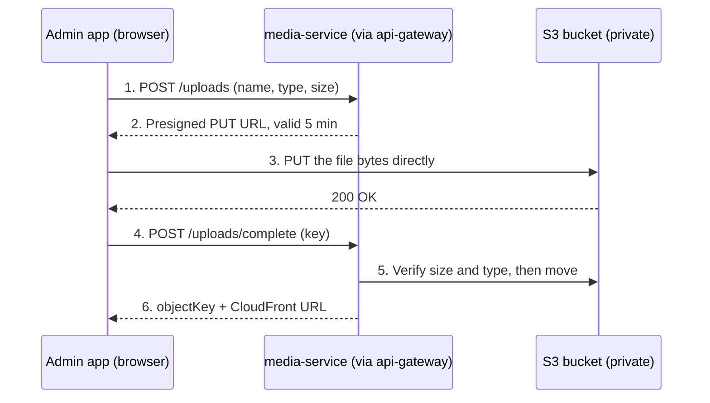

# S3 File & Image Uploads — Setup Guide for Nexora

Last checked: 2026-11-02 · Online copy: https://claude.ai/artifact/AT7syJGyUTWTRQnJEyS18b

## Overview

Use one private S3 bucket, and let the browser upload straight to S3 with short-lived presigned URLs that a new `media-service` hands out behind the api-gateway. Files never pass through Next.js or Express, so there is no body-size limit to fight and no AWS secret ever reaches the browser.

What this guide covers:

- **Images**: organization logos, product images, avatars (JPEG, PNG, WebP, AVIF, SVG with care).
- **Documents**: PDF, Word (DOCX/DOC), Excel, plain text, for onboarding documents such as tax and business registration.
- **AWS setup**: bucket, encryption, CORS, IAM, CloudFront.
- **Code setup**: env vars, AWS SDK v3, a presign endpoint, the browser upload, and saving metadata in Postgres.

It fits what Nexora already has:

| Piece in the repo | How uploads use it |
| --- | --- |
| `apps/admin` (Next.js 16.4) | Picks the file, asks for a presigned URL, `PUT`s the file to S3, then confirms |
| `services/api-gateway` (Express 5) | Authenticates and proxies `/api/v1/media/*` to the new service |
| `services/organization-service` Prisma contract | Already stores private keys: `Organization.logoObjectKey`, `OrganizationRequestDocument.objectKey`, `contentType`, `sizeBytes`, `checksumSha256` |
| `OrganizationDocumentRequirement.allowedMimeTypes` / `maxFileSizeBytes` | The per-country rules the presign endpoint checks before signing |

**Why presigned URLs, not uploading through the server:** the server only signs a 5-minute permission for one exact key, type and size. S3 does the heavy lifting, and your services stay small and stateless.

### Upload flow

File bytes go straight to S3; the service only signs and checks.



The browser talks to S3 only once, with a URL that works for one key, one type and 5 minutes; everything else goes through your own services. Logos then load from CloudFront; private documents through a fresh presigned GET.

## Step 1 — Create and configure the S3 bucket

Create one private bucket per environment (for example `nexora-media-dev`, `nexora-media-prod`) in the Region nearest your users and your services. Most of the secure settings are already AWS defaults for new buckets; you just confirm them.

### 1.1 Settings at creation time

| Setting | Choose | Why (current AWS default?) |
| --- | --- | --- |
| Bucket type | General purpose | Directory buckets (S3 Express) are for low-latency analytics, not media |
| Object Ownership | **Bucket owner enforced** (ACLs disabled) | Default for new buckets; CloudFront OAC requires it |
| Block Public Access | **All four boxes on** | Default; files are reached only via presigned URLs or CloudFront |
| Default encryption | **SSE-S3** (AES256) | Default and free since Jan 5, 2023. Use SSE-KMS only if compliance asks for your own key |
| SSE-C | Leave **disabled** | Disabled by default on new buckets since the April 2026 rollout |
| Bucket Versioning | **Enable** | Recovers overwritten or deleted onboarding documents |
| Object Lock | Off (unless legal retention is required) | Can only be turned on at creation |

CLI equivalent (replace the Region and name):

```bash
aws s3api create-bucket \
  --bucket nexora-media-dev \
  --region ap-south-1 \
  --create-bucket-configuration LocationConstraint=ap-south-1

aws s3api put-bucket-versioning \
  --bucket nexora-media-dev \
  --versioning-configuration Status=Enabled

# Confirm the defaults
aws s3api get-public-access-block --bucket nexora-media-dev
aws s3api get-bucket-ownership-controls --bucket nexora-media-dev
aws s3api get-bucket-encryption --bucket nexora-media-dev
```

### 1.2 Key layout (the "folders")

S3 has no real folders; the prefix in the key does the job and lets IAM, lifecycle rules and CloudFront target each kind of file. Never use the user's file name as the key — generate an ID and keep the original name in the database (`originalFileName`).

| Prefix | What goes there | Access |
| --- | --- | --- |
| `tmp/{userId}/{purpose}/{uuid}.{ext}` | Every fresh upload, before it is confirmed | Private; auto-deleted after 1 day |
| `public/orgs/{orgId}/logo/{uuid}.webp` | Approved organization logos | Read through CloudFront |
| `public/products/{productId}/{uuid}.webp` | Product images | Read through CloudFront |
| `private/orgs/{orgId}/documents/{documentId}.{ext}` | Tax, registration, ID documents (PDF, DOCX, images) | Presigned GET only, 5 minutes |
| `private/requests/{requestId}/{documentId}.{ext}` | Documents attached to an `OrganizationRequest` | Presigned GET only, for reviewers |

`public/` only means "may be served through CloudFront" — the bucket itself still blocks all public access.

### 1.3 CORS (required for browser uploads)

The browser `PUT`s straight to `*.s3.<region>.amazonaws.com`, a different origin from the admin app, so the bucket must allow it. S3 console → bucket → **Permissions** → **Cross-origin resource sharing (CORS)** → Edit:

```json
[
  {
    "AllowedOrigins": ["http://localhost:3001", "https://admin.nexora.example"],
    "AllowedMethods": ["PUT", "GET", "HEAD"],
    "AllowedHeaders": ["content-type", "content-length", "x-amz-*"],
    "ExposeHeaders": ["ETag", "x-amz-version-id"],
    "MaxAgeSeconds": 3000
  }
]
```

- List exact origins; never `*` on a bucket that accepts writes. Keep this list in sync with `CLIENT_ORIGINS`.
- `ETag` must be exposed if you later add multipart uploads (the browser has to read each part's ETag).
- Add `POST` only if you choose presigned POST (Step 4.4).

### 1.4 Lifecycle rules

S3 console → **Management** → **Create lifecycle rule**:

| Rule | Filter | Action |
| --- | --- | --- |
| Clean abandoned uploads | Prefix `tmp/` | Expire current versions after **1 day**; delete noncurrent versions after 1 day |
| Abort stuck multipart uploads | Whole bucket | Delete incomplete multipart uploads after **7 days** |
| Trim old versions | Prefix `private/` | Delete noncurrent versions after **90 days** (adjust to your retention policy) |
| Cheaper storage (optional) | Prefix `private/` | Transition to **S3 Intelligent-Tiering** after 30 days |

### 1.5 Bucket policy guard-rails

Add these statements on top of the CloudFront one in Step 3. They reject plain HTTP and presigned URLs whose signature is older than 10 minutes, even if someone signs a 7-day URL by mistake:

```json
{
  "Version": "2012-10-17",
  "Statement": [
    {
      "Sid": "DenyInsecureTransport",
      "Effect": "Deny",
      "Principal": "*",
      "Action": "s3:*",
      "Resource": ["arn:aws:s3:::nexora-media-dev", "arn:aws:s3:::nexora-media-dev/*"],
      "Condition": { "Bool": { "aws:SecureTransport": "false" } }
    },
    {
      "Sid": "DenyOldPresignedSignatures",
      "Effect": "Deny",
      "Principal": "*",
      "Action": "s3:*",
      "Resource": "arn:aws:s3:::nexora-media-dev/*",
      "Condition": { "NumericGreaterThan": { "s3:signatureAge": "600000" } }
    }
  ]
}
```

## Step 2 — IAM: who is allowed to sign

Only `media-service` holds AWS permissions; the browser never sees a key. A presigned URL can do only what the signer could do, so a tight policy on the signer is the real security boundary.

### 2.1 Policy `nexora-media-service-s3`

IAM console → **Policies** → **Create policy** → JSON:

```json
{
  "Version": "2012-10-17",
  "Statement": [
    {
      "Sid": "UploadToTmpOnly",
      "Effect": "Allow",
      "Action": ["s3:PutObject", "s3:AbortMultipartUpload"],
      "Resource": "arn:aws:s3:::nexora-media-dev/tmp/*"
    },
    {
      "Sid": "PromoteReadDelete",
      "Effect": "Allow",
      "Action": ["s3:GetObject", "s3:PutObject", "s3:DeleteObject", "s3:GetObjectAttributes"],
      "Resource": [
        "arn:aws:s3:::nexora-media-dev/tmp/*",
        "arn:aws:s3:::nexora-media-dev/public/*",
        "arn:aws:s3:::nexora-media-dev/private/*"
      ]
    }
  ]
}
```

- `GetObject` covers `HeadObject` (checking size and type after upload); `CopyObject` needs `GetObject` on the source plus `PutObject` on the target.
- No `s3:ListBucket`, no `s3:*`, no bucket-level actions: the service never needs them.
- Using SSE-KMS instead of SSE-S3? Also allow `kms:GenerateDataKey` and `kms:Decrypt` on that key ARN.

### 2.2 Attach it to an identity

| Environment | Identity | Credentials |
| --- | --- | --- |
| Local dev | IAM Identity Center user with a permission set that holds the policy (recommended), **or** an IAM user `nexora-media-dev` | `aws sso login --profile nexora-dev`, or an access key in `services/media-service/.env` (never committed) |
| Staging / prod on ECS | **Task role** with the policy | Picked up automatically by the SDK; no keys |
| Staging / prod on EC2 | **Instance profile** role | Automatic |
| Prod on EKS | EKS Pod Identity or IRSA role | Automatic |

Presigned URLs die when the signing credentials die. Role credentials rotate every 1–6 hours, which is fine here because the URLs live for 5 minutes. A URL signed with an IAM user key can live at most 7 days.

### 2.3 Credential hygiene

- Keep AWS keys only in git-ignored `.env` files, and rotate IAM user keys every 90 days.
- Never prefix AWS variables with `NEXT_PUBLIC_` — that ships them to the browser.
- Turn on **CloudTrail** (management events are free) to see who changed the bucket or the policy.

## Step 3 — Serving files back to users

Serve logos and product images through CloudFront, and private documents through 5-minute presigned GET URLs. The bucket stays fully private in both cases.

| File kind | How the app shows it | URL shape |
| --- | --- | --- |
| Logos, product images (`public/*`) | CloudFront with Origin Access Control (OAC), cached at the edge | `https://media.nexora.example/public/orgs/{orgId}/logo/{uuid}.webp` |
| Onboarding documents, ID proofs (`private/*`) | `media-service` checks the user may see it, then returns a presigned GET | `https://nexora-media-dev.s3.ap-south-1.amazonaws.com/private/...?X-Amz-Signature=...` |

### 3.1 CloudFront distribution (public images)

1. CloudFront console → **Create distribution** → Origin domain = the bucket's REST endpoint (`nexora-media-dev.s3.ap-south-1.amazonaws.com`), **not** the website endpoint.
2. **Origin path**: leave empty. Add a cache behavior for path pattern `public/*`, and make the **default behavior** return 403 (or point it at a dummy origin) so `private/*` can never be read through CloudFront.
3. **Origin access** → **Origin access control settings (recommended)** → Create control setting → Signing = **Sign requests (recommended)**.
4. Viewer protocol = **Redirect HTTP to HTTPS**; allowed methods = **GET, HEAD**; cache policy = **CachingOptimized**.
5. Optional: an alternate domain `media.nexora.example` with an ACM certificate issued in **us-east-1** (CloudFront only reads certificates from there).
6. After creating it, copy the bucket policy CloudFront shows you, or add this statement next to the guard-rails from Step 1.5:

```json
{
  "Sid": "AllowCloudFrontReadPublicPrefix",
  "Effect": "Allow",
  "Principal": { "Service": "cloudfront.amazonaws.com" },
  "Action": "s3:GetObject",
  "Resource": "arn:aws:s3:::nexora-media-dev/public/*",
  "Condition": {
    "StringEquals": {
      "AWS:SourceArn": "arn:aws:cloudfront::<ACCOUNT_ID>:distribution/<DISTRIBUTION_ID>"
    }
  }
}
```

The `public/*` resource is the second lock: even if a cache behavior is misconfigured, CloudFront cannot read `private/*`. Use OAC, not the legacy Origin Access Identity (OAI), which does not support SSE-KMS or newer Regions.

Because every new image gets a new UUID key, you never need to invalidate the cache — a replaced logo is simply a new URL.

### 3.2 Presigned GET (private documents)

- `media-service` signs a `GetObjectCommand` with `expiresIn: 300` only after checking the caller owns the organization or is a reviewer.
- Add `ResponseContentDisposition: 'attachment; filename="<originalFileName>"'` so a download keeps its real name, or `inline` to preview a PDF in the browser.
- Never store the presigned URL in the database; store the key and sign on each request.

### 3.3 Let the Next.js admin app load them

Two things in [next.config.ts](../../../apps/admin/next.config.ts) will block S3 and CloudFront today, so plan for both:

**Content Security Policy.** The current CSP has `img-src 'self' blob: data:` and `connect-src 'self'`, so the browser will refuse the S3 upload and the CloudFront images. Extend it:

```ts
`img-src 'self' blob: data: https://media.nexora.example https://nexora-media-dev.s3.ap-south-1.amazonaws.com`,
`connect-src 'self' https://nexora-media-dev.s3.ap-south-1.amazonaws.com`,
// Only if PDFs are previewed in an <iframe>/<object>:
`frame-src https://nexora-media-dev.s3.ap-south-1.amazonaws.com`,
```

Read the hosts from env vars rather than hard-coding them per environment.

**next/image remote patterns.** Next.js 16 rejects external images unless they match `images.remotePatterns`:

```ts
images: {
  formats: ["image/avif", "image/webp"],
  remotePatterns: [new URL("https://media.nexora.example/public/**")],
},
```

For private images behind a presigned URL, use `<Image unoptimized src={signedUrl} />` (or a plain ``): its signed query string changes on every request, which `remotePatterns` and the optimizer cache are not built for, and it expires in 5 minutes anyway. Also note that Next.js 16 only allows `quality={75}` unless you add `images.qualities`.

## Step 4 — Code setup

Add a `services/media-service` (Express 5, same layout as `organization-service`) with three endpoints, proxy it through the gateway, and upload from the admin app with `fetch`. Snippets below follow the repo's style: zod env, `verifyGateway`, no semicolons.

### 4.1 Packages

```bash
pnpm --filter @nexora/media-service add @aws-sdk/client-s3 @aws-sdk/s3-request-presigner file-type
# optional
pnpm --filter @nexora/media-service add @aws-sdk/s3-presigned-post   # strict size limits (4.4)
pnpm --filter @nexora/media-service add @aws-sdk/lib-storage         # server-side multipart
pnpm --filter @nexora/media-service add sharp                        # re-encode images to WebP
```

All `@aws-sdk/*` packages are released together (3.1161.0 as of 2026-11-02); keep them on the **same version**. Never install the old `aws-sdk` v2 package.

### 4.2 Environment variables

`services/media-service/.env`:

```bash
NODE_ENV=development
PORT=4007
CLIENT_ORIGINS=http://localhost:3001
INTERNAL_SERVICE_SECRET=<same 32+ char secret as the gateway>

AWS_REGION=ap-south-1
S3_BUCKET=nexora-media-dev
S3_PUBLIC_BASE_URL=https://media.nexora.example   # CloudFront domain
S3_UPLOAD_URL_TTL_SECONDS=300
S3_DOWNLOAD_URL_TTL_SECONDS=300

# Local dev only — pick ONE:
AWS_PROFILE=nexora-dev                 # after `aws sso login --profile nexora-dev`
# AWS_ACCESS_KEY_ID=...
# AWS_SECRET_ACCESS_KEY=...
# In ECS/EC2/EKS set none of these; the role is used automatically.
```

`services/api-gateway/.env`: add `MEDIA_SERVICE_URL=http://localhost:4007`.

`apps/admin/.env`: add `MEDIA_CDN_URL=https://media.nexora.example` and `MEDIA_UPLOAD_ORIGIN=https://nexora-media-dev.s3.ap-south-1.amazonaws.com` for the CSP and `remotePatterns` in Step 3.3. These hold no secrets.

`src/config/media-env.ts`:

```ts
import { z } from "zod"
import "dotenv/config"

const envSchema = z.object({
  NODE_ENV: z.enum(["development", "production", "test"]).default("development"),
  PORT: z.coerce.number().int().positive().default(4007),
  INTERNAL_SERVICE_SECRET: z.string().min(32),
  AWS_REGION: z.string(),
  S3_BUCKET: z.string(),
  S3_PUBLIC_BASE_URL: z.url(),
  S3_UPLOAD_URL_TTL_SECONDS: z.coerce.number().int().min(60).max(900).default(300),
  S3_DOWNLOAD_URL_TTL_SECONDS: z.coerce.number().int().min(60).max(900).default(300),
})

export const env = envSchema.parse(process.env)
```

### 4.3 The S3 client — one important setting

`src/lib/s3-client.ts`:

```ts
import { S3Client } from "@aws-sdk/client-s3"
import { env } from "../config/media-env"

// Credentials come from the default chain: AWS_PROFILE / env keys locally,
// the task or instance role in AWS. Never pass keys in code.
export const s3 = new S3Client({
  region: env.AWS_REGION,
  // Since SDK 3.729.0 the client adds a CRC32 checksum to every upload by
  // default. In a presigned PUT that checksum is computed over an empty body,
  // so the browser's real upload fails. Only add checksums when S3 requires them.
  requestChecksumCalculation: "WHEN_REQUIRED",
})
```

If you skip `requestChecksumCalculation: "WHEN_REQUIRED"`, the classic symptom is a `403 SignatureDoesNotMatch` or `400 BadDigest` on the browser `PUT`, even though the URL looks fine. The same setting can be given as env var `AWS_REQUEST_CHECKSUM_CALCULATION=WHEN_REQUIRED`.

### 4.4 Endpoint 1 — `POST /uploads` (sign an upload)

The browser sends what it wants to upload; the service checks the rules and signs one URL for one key.

```ts
import { PutObjectCommand } from "@aws-sdk/client-s3"
import { getSignedUrl } from "@aws-sdk/s3-request-presigner"
import { randomUUID } from "node:crypto"
import { z } from "zod"

export const createUploadSchema = z.object({
  purpose: z.enum(["org-logo", "product-image", "org-document"]),
  fileName: z.string().min(1).max(255),
  contentType: z.string(),
  sizeBytes: z.number().int().positive(),
})

export const createUpload = async (userId: string, input: CreateUploadInput) => {
  const rule = UPLOAD_RULES[input.purpose] // see Step 5
  if (!rule.mimeTypes.includes(input.contentType)) throw badRequest("UNSUPPORTED_TYPE")
  if (input.sizeBytes > rule.maxBytes) throw badRequest("FILE_TOO_LARGE")

  const ext = EXTENSION_BY_MIME[input.contentType]
  const key = `tmp/${userId}/${input.purpose}/${randomUUID()}.${ext}`

  const url = await getSignedUrl(
    s3,
    new PutObjectCommand({
      Bucket: env.S3_BUCKET,
      Key: key,
      ContentType: input.contentType, // the browser must send exactly this header
    }),
    { expiresIn: env.S3_UPLOAD_URL_TTL_SECONDS }
  )

  return { key, url, headers: { "Content-Type": input.contentType } }
}
```

- The key is chosen by the server, never by the client.
- Purpose and owner are baked into the key, so the confirm step can trust them without a database table.
- **Presigned PUT cannot enforce a maximum size by itself**; the confirm step re-checks it. If you need S3 to reject oversize files at upload time, use presigned POST instead:

```ts
import { createPresignedPost } from "@aws-sdk/s3-presigned-post"

const { url, fields } = await createPresignedPost(s3, {
  Bucket: env.S3_BUCKET,
  Key: key,
  Conditions: [
    ["content-length-range", 1, rule.maxBytes],
    ["eq", "$Content-Type", input.contentType],
  ],
  Fields: { "Content-Type": input.contentType },
  Expires: env.S3_UPLOAD_URL_TTL_SECONDS,
})
// Browser: FormData with every `fields` entry first, the file LAST, POST to `url`.
```

### 4.5 Endpoint 2 — `POST /uploads/complete` (verify and promote)

Called by the browser after S3 returns 200. This is where you stop trusting the client.

```ts
import { CopyObjectCommand, DeleteObjectCommand, GetObjectCommand, HeadObjectCommand } from "@aws-sdk/client-s3"
import { fileTypeFromBuffer } from "file-type"

export const completeUpload = async (userId: string, key: string) => {
  // 1. The key must belong to this user.
  if (!key.startsWith(`tmp/${userId}/`)) throw forbidden()
  const purpose = key.split("/")[2] as UploadPurpose
  const rule = UPLOAD_RULES[purpose]

  // 2. Real size, from S3.
  const head = await s3.send(new HeadObjectCommand({ Bucket: env.S3_BUCKET, Key: key }))
  if ((head.ContentLength ?? 0) > rule.maxBytes) return reject(key, "FILE_TOO_LARGE")

  // 3. Real type, from the file's first bytes (magic numbers), not its name.
  const start = await s3.send(new GetObjectCommand({ Bucket: env.S3_BUCKET, Key: key, Range: "bytes=0-4100" }))
  const sniffed = await fileTypeFromBuffer(await start.Body!.transformToByteArray())
  if (!sniffed || !rule.mimeTypes.includes(sniffed.mime)) return reject(key, "UNSUPPORTED_TYPE")

  // 4. Move it out of tmp/ to its final prefix.
  const finalKey = buildFinalKey(purpose, key) // e.g. public/orgs/{orgId}/logo/{uuid}.webp
  await s3.send(new CopyObjectCommand({
    Bucket: env.S3_BUCKET,
    CopySource: `${env.S3_BUCKET}/${key}`,
    Key: finalKey,
    MetadataDirective: "REPLACE",
    ContentType: sniffed.mime,
    CacheControl: rule.public ? "public, max-age=31536000, immutable" : "private, no-store",
  }))
  await s3.send(new DeleteObjectCommand({ Bucket: env.S3_BUCKET, Key: key }))

  return {
    objectKey: finalKey,
    contentType: sniffed.mime,
    sizeBytes: head.ContentLength,
    publicUrl: rule.public ? `${env.S3_PUBLIC_BASE_URL}/${finalKey}` : null,
  }
}
```

- `file-type` does not detect plain text (`.txt`, `.csv`) or SVG; validate those separately or skip them.
- `.docx`, `.xlsx` are ZIP files underneath; `file-type` reports them correctly as `application/vnd.openxmlformats-officedocument...`.
- For images, a stronger step 3 is re-encoding with `sharp` to WebP: it strips EXIF/GPS data and destroys anything hidden in the file.
- `CopyObject` handles files up to 5 GB, which is far above the limits in Step 5.

The caller then sends the returned `objectKey` (plus `originalFileName`, `contentType`, `sizeBytes`) to the existing onboarding/organization API, which saves it in `Organization.logoObjectKey` or a new `OrganizationRequestDocument` row. That service should re-check the key starts with the expected prefix for that organization.

### 4.6 Endpoint 3 — `GET /files/url?key=...` (private download)

```ts
const url = await getSignedUrl(
  s3,
  new GetObjectCommand({
    Bucket: env.S3_BUCKET,
    Key: key,
    ResponseContentDisposition: `attachment; filename="${safeName}"`,
  }),
  { expiresIn: env.S3_DOWNLOAD_URL_TTL_SECONDS }
)
```

Check authorization first (owner of the organization, or a reviewer), and strip quotes and line breaks from `safeName`.

### 4.7 Routes and the gateway

`services/media-service/src/modules/media-routes.ts`:

```ts
const verifyGateway = createVerifyGateway(env.INTERNAL_SERVICE_SECRET)

router.post("/api/v1/media/uploads", verifyGateway, createUploadHandler)
router.post("/api/v1/media/uploads/complete", verifyGateway, completeUploadHandler)
router.get("/api/v1/media/files/url", verifyGateway, getDownloadUrlHandler)
```

Handlers read the user from the `x-user-id` header the gateway sets. In [proxy-routes.ts](../../../services/api-gateway/src/routes/proxy-routes.ts) add the same two lines every other service has:

```ts
router.use("/api/v1/media", authenticate)
router.use(createServiceProxy("/api/v1/media", env.MEDIA_SERVICE_URL))
```

...and `MEDIA_SERVICE_URL: z.url()` in `gateway-env.ts`. The JSON bodies are tiny, so the gateway's body limits and rate limiter need no change.

### 4.8 Browser side (admin app)

A small helper in a client component, for example `apps/admin/lib/api/media/upload-file.ts`:

```ts
export async function uploadFile(file: File, purpose: UploadPurpose) {
  // 1. Ask for a presigned URL (through your existing API client, so auth cookies go along).
  const { key, url, headers } = await api.post("/api/v1/media/uploads", {
    purpose,
    fileName: file.name,
    contentType: file.type,
    sizeBytes: file.size,
  })

  // 2. Send the bytes straight to S3. No auth header, no credentials.
  const res = await fetch(url, { method: "PUT", headers, body: file })
  if (!res.ok) throw new Error(`S3 upload failed: ${res.status}`)

  // 3. Confirm, and get the final key back.
  return api.post("/api/v1/media/uploads/complete", { key })
}
```

- Check type and size in the browser too (with the same rules) so users get instant feedback — but only the server checks count.
- `fetch` has no upload-progress events. For a progress bar on large PDFs, use `XMLHttpRequest` and `xhr.upload.onprogress`.
- Show an image preview with `URL.createObjectURL(file)` before uploading; `blob:` is already allowed in the CSP.
- Files over ~100 MB: switch to multipart (`CreateMultipartUpload`, one presigned `UploadPart` URL per 5–100 MB part, then `CompleteMultipartUpload`). Not needed for logos or onboarding documents.

## Step 5 — File rules and security checklist

Keep the rules in one `UPLOAD_RULES` map shared by the browser and `media-service` (for example in `@nexora/schemas`). For onboarding documents, `OrganizationDocumentRequirement.allowedMimeTypes` and `maxFileSizeBytes` from the database override the defaults per country.

### 5.1 Suggested default rules

| Purpose | Allowed MIME types | Extensions | Max size | Served via |
| --- | --- | --- | --- | --- |
| `org-logo` | `image/png`, `image/jpeg`, `image/webp` | .png .jpg .jpeg .webp | 2 MB | CloudFront |
| `product-image` | `image/png`, `image/jpeg`, `image/webp`, `image/avif` | .png .jpg .webp .avif | 10 MB | CloudFront |
| `org-document` | `application/pdf`, `image/jpeg`, `image/png`, `application/vnd.openxmlformats-officedocument.wordprocessingml.document`, `application/msword` | .pdf .jpg .png .docx .doc | 10 MB | Presigned GET |
| `spreadsheet` (if needed) | `application/vnd.openxmlformats-officedocument.spreadsheetml.sheet`, `text/csv` | .xlsx .csv | 10 MB | Presigned GET |

**SVG logos:** SVG can carry JavaScript. Either leave it out (as above), or accept it only after sanitizing with a library such as DOMPurify and serving it from the CloudFront domain, never from the app's own origin. `.doc` (old Word) is a legacy binary format; drop it if no country requires it.

### 5.2 Security checklist

- [ ] Bucket: Block Public Access on, ACLs disabled, SSE-S3 on, versioning on
- [ ] Bucket policy denies non-HTTPS and signatures older than 10 minutes
- [ ] CORS lists exact origins only, never `*`
- [ ] IAM policy limited to `tmp/*`, `public/*`, `private/*` — no `s3:*`
- [ ] Production uses an IAM role, not access keys; no AWS variable starts with `NEXT_PUBLIC_`
- [ ] Server generates every key with a UUID; user file names only go in the database
- [ ] Upload URLs expire in 5 minutes and sign the exact `Content-Type`
- [ ] Confirm step re-checks real size (`HeadObject`) and real type (magic bytes)
- [ ] Confirm step checks the key starts with `tmp/{userId}/`
- [ ] Download URLs are signed only after an authorization check, and never stored
- [ ] Lifecycle rule deletes `tmp/` after 1 day and incomplete multipart uploads after 7 days
- [ ] Next.js CSP and `images.remotePatterns` updated for the S3 and CloudFront hosts
- [ ] Optional for ID documents: malware scanning with **Amazon GuardDuty Malware Protection for S3** on the `tmp/` prefix before promotion

## Step 6 — Test it, and fix common errors

### 6.1 Try it in order

1. Confirm credentials: `aws sts get-caller-identity --profile nexora-dev`.
2. Upload by hand: `aws s3 cp ./logo.png s3://nexora-media-dev/tmp/test/logo.png --profile nexora-dev`.
3. Start `media-service`, call `POST /api/v1/media/uploads` through the gateway, then upload with curl using the returned URL:

   ```bash
   curl -X PUT -H "Content-Type: image/png" --upload-file ./logo.png "<presigned-url>"
   ```

4. Call `/uploads/complete` and check the object moved from `tmp/` to `public/` in the S3 console.
5. Open the CloudFront URL; then try the raw S3 URL of the same object — it must return **403**.
6. Repeat from the admin app in the browser, with DevTools → Network open.

### 6.2 Troubleshooting

| Symptom | Likely cause | Fix |
| --- | --- | --- |
| Browser: "blocked by CORS policy" on the `PUT` | Missing or wrong bucket CORS, or origin not listed | Step 1.3; origin must match exactly, including port |
| Browser: "Refused to connect … Content Security Policy" | `connect-src 'self'` in `next.config.ts` | Step 3.3 |
| `403 SignatureDoesNotMatch` | Browser sent a different `Content-Type` than was signed, or extra headers | Send exactly the `headers` the server returned |
| `400`/`403` on PUT with `x-amz-checksum-crc32` / `x-amz-sdk-checksum-algorithm` in the URL | SDK default checksums (3.729.0+) | `requestChecksumCalculation: "WHEN_REQUIRED"` (Step 4.3) |
| `403 AccessDenied` on PUT | IAM policy doesn't cover the key prefix, or signature older than 10 minutes | Check the policy resource; sign right before upload |
| `ExpiredToken` / URL dies early | Signed with role or SSO credentials that expired | Re-sign; refresh `aws sso login` locally |
| `403` from CloudFront | OAC missing, wrong distribution ARN in the bucket policy, or a key outside `public/*` | Step 3.1 |
| `400` from `/_next/image` | Host not in `images.remotePatterns`, or a `quality` not in `images.qualities` | Step 3.3 |
| `AccessControlListNotSupported` | Code sends an `ACL` parameter | Remove it; ACLs are disabled on purpose |

## Sources

Checked against the current AWS and Next.js docs on 2 Nov 2026:

- [Presigned URLs — expiry, who can sign, `s3:signatureAge`](https://docs.aws.amazon.com/AmazonS3/latest/userguide/using-presigned-url.html)
- [Default bucket encryption (SSE-S3 since Jan 2023)](https://docs.aws.amazon.com/AmazonS3/latest/userguide/default-bucket-encryption.html)
- [Default SSE-C setting for new buckets (April 2026)](https://docs.aws.amazon.com/AmazonS3/latest/userguide/default-s3-c-encryption-setting-faq.html)
- [Object Ownership and disabling ACLs](https://docs.aws.amazon.com/AmazonS3/latest/userguide/about-object-ownership.html)
- [CORS on S3](https://docs.aws.amazon.com/AmazonS3/latest/userguide/cors.html)
- [CloudFront Origin Access Control for S3](https://docs.aws.amazon.com/AmazonCloudFront/latest/DeveloperGuide/private-content-restricting-access-to-s3.html)
- [SDK for JavaScript v3 — S3 checksums (3.729.0 change)](https://docs.aws.amazon.com/sdk-for-javascript/v3/developer-guide/s3-checksums.html)
- [AWS SDKs — data integrity settings](https://docs.aws.amazon.com/sdkref/latest/guide/feature-dataintegrity.html)
- Next.js 16.4 `next/image` `remotePatterns` and the v16 upgrade guide: `node_modules/next/dist/docs/01-app/03-api-reference/02-components/image.md` and `01-app/02-guides/upgrading/version-16.md`
