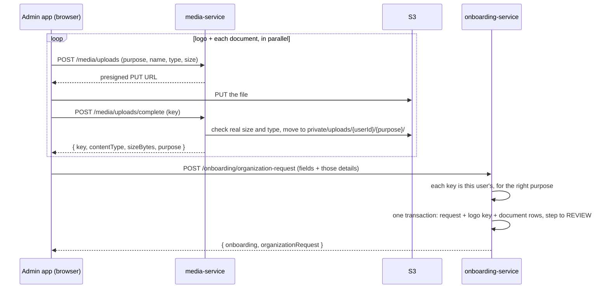

# Submitting a create-organization request, with its logo and documents

Step 3 of the `CREATE_ORGANIZATION` onboarding path: the user fills in the
organization details, picks a logo and verification documents, and submits.

The flow is deliberately simple. The browser uploads each file through
media-service, gets the file's details back, and sends those details with
the form. onboarding-service checks they belong to the user and saves them.
No service calls another, and there are no events.

Storage, signing and the AWS setup are in
[../aws/S3/media-service.md](../aws/S3/media-service.md).

## Flow



## Why onboarding-service can trust the keys without asking media-service

media-service picks every key, and only after the file passed its size and
type checks:

```
private/uploads/{userId}/{purpose}/{uuid}.{ext}
```

So the key itself says who uploaded the file and what for.
`parseUploadKey` in `@nexora/schemas/media/upload` reads it, and
onboarding-service rejects:

- a key with another user's ID (someone else's file);
- a key for another purpose (a document sent as the logo);
- anything that isn't a checked upload (e.g. a `tmp/` key);
- the same key in two slots.

The UUID can't be guessed, so a user can't point at a file they don't know.
`contentType` and `sizeBytes` come from `complete` through the browser; they're
stored for display only. A signed URL always serves what's really in S3.

## Request body

`createCreateOrganizationRequestSchema` in
[create-organization.ts](../../packages/schemas/src/onboarding/create-organization.ts):

```json
{
  "type": "CREATE",
  "proposedName": "Acme Retail",
  "proposedSlug": "acme-retail",
  "proposedDescription": "Retail chain selling household goods across India.",
  "proposedCountryCode": "IN",
  "proposedIndustry": "RETAIL",
  "proposedSize": "11-50",
  "proposedWebsite": "",
  "proposedTaxDetails": { "taxId": "27AAPFU0939F1ZV" },
  "proposedAddress": {
    "addressLine1": "12 MG Road",
    "city": "Pune",
    "state": "Maharashtra",
    "postalCode": "411001"
  },
  "proposedLogoKey": "private/uploads/usr_1/org-logo/3f1c....png",
  "proposedDocuments": {
    "businessRegistration": {
      "key": "private/uploads/usr_1/org-document/a1....pdf",
      "originalFileName": "Certificate of incorporation.pdf",
      "contentType": "application/pdf",
      "sizeBytes": 182044
    },
    "taxRegistrationCertificate": { "key": "...", "originalFileName": "GST certificate.pdf", "contentType": "application/pdf", "sizeBytes": 95120 },
    "addressProof": { "key": "...", "originalFileName": "Electricity bill.jpg", "contentType": "image/jpeg", "sizeBytes": 240311 }
  }
}
```

`additionalDocument` is optional. Each slot is saved as an
`OrganizationRequestDocument` with the type from `ORGANIZATION_DOCUMENT_SLOTS`:

| Slot | `documentType` |
| --- | --- |
| `businessRegistration` | `BUSINESS_REGISTRATION` |
| `taxRegistrationCertificate` | `TAX_DOCUMENT` |
| `addressProof` | `PROOF_OF_ADDRESS` |
| `additionalDocument` | `OTHER` |

The logo is stored on `OrganizationRequest.proposedLogoObjectKey`.

## Where the code is

| Piece | File |
| --- | --- |
| Key check (`parseUploadKey`) | [packages/schemas/src/media/upload.ts](../../packages/schemas/src/media/upload.ts) |
| Request schema, slots | [packages/schemas/src/onboarding/create-organization.ts](../../packages/schemas/src/onboarding/create-organization.ts) |
| Key checks, document rows (`toOrganizationDocumentRows`) | [services/onboarding-service/src/modules/onboarding-service.ts](../../services/onboarding-service/src/modules/onboarding-service.ts) |
| Save request + documents in one transaction | [services/onboarding-service/src/modules/onboarding-repository.ts](../../services/onboarding-service/src/modules/onboarding-repository.ts) |
| Upload server actions | [apps/admin/lib/api/media/](../../apps/admin/lib/api/media/) |
| Browser upload helper (`uploadFile`) | [apps/admin/lib/media/upload-file.ts](../../apps/admin/lib/media/upload-file.ts) |
| Submit server action | [apps/admin/lib/api/onboarding/submit-create-organization-request.ts](../../apps/admin/lib/api/onboarding/submit-create-organization-request.ts) |
| Form submit | [apps/admin/features/onboarding/create-organization/create-organization-form.tsx](../../apps/admin/features/onboarding/create-organization/create-organization-form.tsx) |

## Resubmitting

Going back to step 3 and submitting again replaces the request's permissions
and documents in the same transaction. A file the user keeps is sent again
with the same details; a replaced file loses its row. Switching to JOIN on the
same revision removes the documents and the logo key.

The S3 objects of replaced files stay in the bucket (see "Not handled yet").

## Error codes

Translated in all 16 locales (`apps/admin/locales/*/codes.json`):

| Code | Status | When |
| --- | --- | --- |
| `ONBOARDING.CREATE_ORGANIZATION_REQUEST.SUCCESS` | 200 | Saved; onboarding moved to REVIEW |
| `ONBOARDING.ORGANIZATION_FILE_INVALID` | 400 | A key isn't this user's upload, is for another purpose, or isn't a checked upload |
| `ONBOARDING.ORGANIZATION_FILE_DUPLICATE` | 400 | The same key in two slots |
| `VALIDATION_ERROR` | 400 | A field or file detail is missing or malformed |
| `MEDIA.UNSUPPORTED_TYPE`, `MEDIA.FILE_TOO_LARGE` | 400 | From `complete`, before the submit |
| `MEDIA.UPLOAD_FAILED` | (browser) | The `PUT` to S3 failed |

## Tested

Against the real bucket, with the onboarding of a user on step
`ROLE_REQUIREMENTS` of `CREATE_ORGANIZATION`:

| Case | Result |
| --- | --- |
| Upload PUT with a different `Content-Type` than signed | S3 `SignatureDoesNotMatch` |
| Upload logo (PNG) and documents (PDF), `complete` | Keys under `private/uploads/{userId}/...` with the sniffed type and size |
| Another user's logo key | `ONBOARDING.ORGANIZATION_FILE_INVALID` |
| Another user's document key | `ONBOARDING.ORGANIZATION_FILE_INVALID` |
| A document key as the logo | `ONBOARDING.ORGANIZATION_FILE_INVALID` |
| A `tmp/` key | `ONBOARDING.ORGANIZATION_FILE_INVALID` |
| The same file in two slots | `ONBOARDING.ORGANIZATION_FILE_DUPLICATE` |
| Missing logo key / missing `addressProof` | `VALIDATION_ERROR` on that field |
| After all of the above | Onboarding still on `ROLE_REQUIREMENTS`: nothing was saved |

The successful submit wasn't run against that onboarding, because it moves
it to REVIEW.

## Not handled yet

- **Unused files stay in S3.** Files uploaded but never submitted, and files
  replaced on resubmit, aren't deleted. Don't add a lifecycle rule that
  expires `private/uploads/`: submitted files live there too, and it would
  delete them. Clean up later with a job that deletes keys no record points
  to, if storage ever matters.
- **Viewing the files.** The requester can preview their own files with
  `GET /api/v1/media/uploads/url?key=...` (media-service checks the key has
  their user ID). A reviewer can't yet: when the review screen is built,
  decide where the "is this user the assigned reviewer?" check lives.
- **On approval**, organization-service should copy `proposedLogoObjectKey`
  into `Organization.logoObjectKey`. The documents stay with the request.
